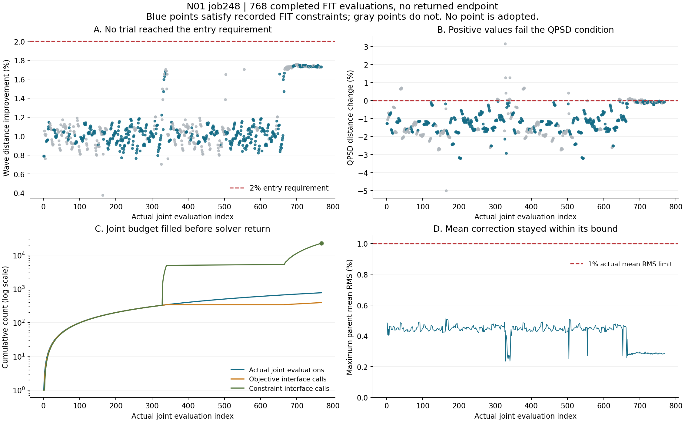

# N01 248：有限硬目标拟合核收

2026-10-24，Asia/Singapore。**受限平均响应目标尚未完成。248 已在登记的 768 个实际评价点处触发预算保护，原生退出 1；求解器未返回端点，P2/P3 未进入，没有采用模型。** 本次按“实现未完整结束”关闭，保留全部计算成本，不把它写成目标在数学上不可行。

## 768 个实际评价点给出的结果

改善定义为 `100 × (1 − trial wave / M0 wave)`；QPSD 变化定义为 `100 × (trial QPSD / M0 QPSD − 1)`。M0 wave 为 `0.15009812561260472`，M0 QPSD 为 `0.050408367003778376`，均来自已核对哈希的原生参考结果。人口仍为 6465 个 SOURCE FIT 父事件、两库各 8 draw，以及 18948 条 REAL FIT。

| 项目 | 核收结果 |
|---|---:|
| 完整实际评价点 | 768 |
| 满足保存的 FIT 约束标量、QPSD 和 RMS 条件 | 483 / 768 |
| 完整 wave 达到 2% 改善 | 0 / 768 |
| 所有试探点最大 wave 改善 | 1.757072713% |
| 满足记录约束的点中最大 wave 改善 | 1.748274575% |
| 距离 2% 的剩余差值 | 0.251725425 个百分点 |
| 最后一条试探记录的 wave 改善 | 1.728727991% |
| 全部试探点的最大实际均值 RMS | 0.512684980%，限值 1% |

这些极值用于完整描述搜索结果，没有从中选取端点。“满足记录约束”基于已保存的最大约束值以及 wave/QPSD/RMS 标量；本次核收没有重新生成各点的 18 项风险、14 项异常或全部 CDF 列。036 正容差的最终独立原生验收属于未进入的 P2，不能据 FIT 记录宣称通过。

## 中断原因及实际成本

原脚本在共享评价函数中按映射后系数的精确字节缓存。实际 SciPy 1.16.3 的 `NonlinearConstraints.violation` 没有使用传入的已算约束值，而是调用 `PreparedConstraint.violation(x)` 再次评价。回溯发生在 `set_best_index → merit → violation → constraint → evaluate`，最终到达冻结脚本第 67 行的不同点预算断言。

全部系数仅作小数 14 位的事后诊断分组，可归为 392 组；其中 376 条与既有条目的最大系数差不超过 `5.551115123125783e-17`，wave 和 QPSD 差均为 0。该分组没有用于缓存修改、成本扣减或端点选择。它与实际回溯共同说明：接口重复评价消耗了共同预算；不能把实际完成的 768 点等同于求解器完成了 768 次目标调用。

| 成本或状态 | 实际记录 |
|---|---:|
| 参数拟合 / 端点选择 | 1 / 0 |
| 求解器调用 | 1 |
| 目标接口调用 / 约束接口调用 | 392 / 22673 |
| 缓存命中 | 22296 |
| 完整有限点评价 | 768 |
| 缓存硬观察行 | 79441920 |
| 均值头父事件求值行 | 4965120 |
| 新随机 draw / 原骨干调用 / 梯度更新 | 0 / 0 / 0 |
| 运行耗时 | 10568.524 秒，约 2 小时 56 分 |
| 峰值 RSS | 4004659200 字节 |
| 原生退出码 | 1 |

`392 + 22673 = 22296 + 768 + 1`：最后的 1 次请求在开始新有限点之前被预算保护拒绝。已完成点没有在途未计成本。此次中断未触及四小时墙钟期限；进程已退出，现场没有 N01 科学进程，GPU 使用约 187 MiB、利用率 0%。

## 已完成的最小工程修正核验

保存了一个两行补丁：在已有 `cub_val/ceq_val` 时直接用这些已算约束值计算违约度，避免重新调用约束。补丁**未安装**，原运行源码和共享环境保持原文件；本次没有重启 N01 拟合。

在同一个隔离 SciPy 1.16.3 运行时做了两个纯合成对照：

| 合成用例 | 原实现：目标 / 约束 / 实际联合评价 | 补丁：目标 / 约束 / 实际联合评价 |
|---|---:|---:|
| 信赖半径终止 | 37 / 513 / 38 | 37 / 37 / 37 |
| 24 次目标预算终止 | 24 / 223 / 25 | 24 / 24 / 24 |

两种实现的最终目标及最大违约值分别一致；预算用例正常返回状态 5，返回点没有新增联合评价。另有五个混合上下界／等式约束的范数和最大违约度一致性检查通过。四次合成求解器调用未读取 N01 数据、未执行模型、未新增科学拟合或候选。这是接口修正的合成验证，尚未验证修正后的真实 N01 拟合。

## 关闭与交付

关闭状态为 `CLOSED_INCOMPLETE_DISTINCT_POINT_BUDGET_BEFORE_SOLVER_RETURN`。`restricted_average_response_acceptance=false`，`scientific_acceptance=false`，科学状态仍为 `response_match_not_established`。全部 768 个已观察点未达到原 2% 入口；目标是否能由修正后的有界方法达到，仍未由本次运行确定。

没有可合法送入 P2 的求解器返回端点，P2/P3 均未执行。当前没有长等待，已删除本聊天 `n01` 定时；不在已耗尽的单次拟合预算上自动重跑。后续如登记新的拟合，须使用独立修正版本、保留本次失败及成本，并先验证真实接口的预算终止语义，不能回写 248。

交付：[全部试探指标 CSV](ALL_768_TRIAL_METRICS.csv)、[轨迹审计 JSON](TRACE_AUDIT.json)、[可编辑图 SVG](FIT_TRACE.svg)、[终端与源码核对](../../receipts/finite_native_goal01_20261024/P1/wake_20261024_0712_01/REMOTE_HASH_AND_SOURCE_AUDIT.json)、[合成修正核验](../../receipts/finite_native_goal01_20261024/P1/wake_20261024_0712_01/SYNTHETIC_FIX_VERIFICATION.json)。必要配置、冻结脚本、原始逐点日志、退出回执和拟议补丁一同纳入小型审计包；没有生成或交付响应模型。NAS 访问及哈希为 0。
