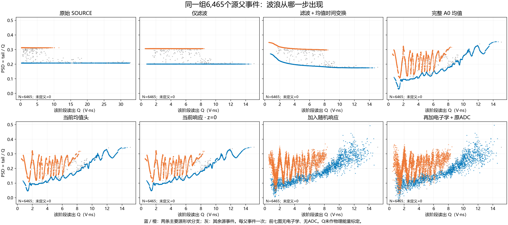
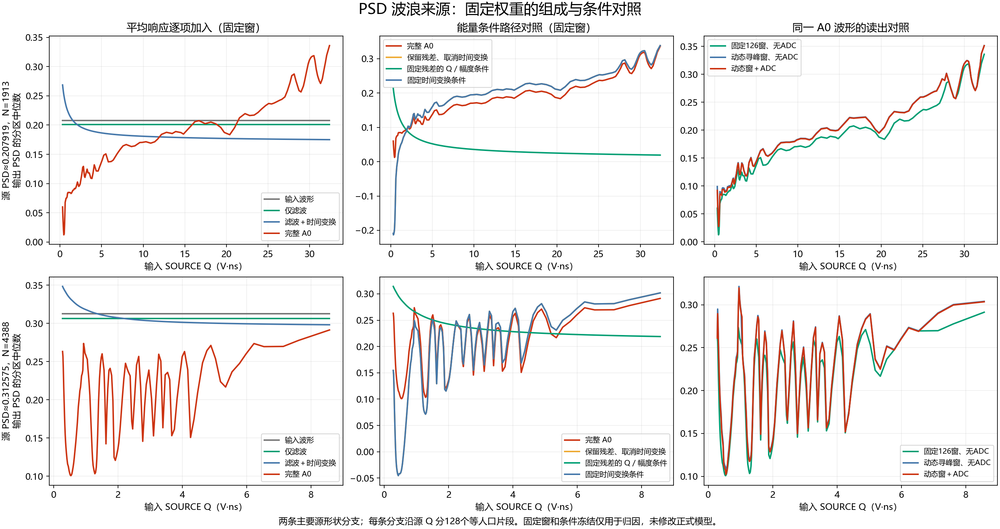

# N01 全 Q PSD 波浪来源调查

主要来源已经定位到旧平均响应 A0 中由 Q／幅度条件驱动的神经残差。它把几乎不随 Q 改变的源波形形状映射成上下摆动的尾电荷比例；后续随机响应把这条摆动曲线展宽为条带。当前 B 继承了这一结构。

本次 job163 固定所有权重，对同一批 6465 个 FIT 源父逐步拆分响应。原生 exit=0，计算 17.059 秒，优化更新 0。完整 A0 重建的最大波形误差为 1.11e-16 V；固定窗口的解析 PSD 分解误差为 1.11e-16。因果对照采用同一输入形状、原有 qbar 和 detector condition，只移除指定分支或固定该分支的两个标量条件。

| 对照 | 结果 |
|---|---|
| 原始 SOURCE、仅滤波 | 两条主要形状分支近似水平，没有原图的波浪 |
| 滤波＋学习到的均值时间变换，移除残差 | 两条分支平滑、单调 |
| 加回完整神经残差，即 A0 | 出现明显波浪 |
| 只固定残差网络的 log(Q/q_ref) 与 log(amplitude/a_ref) 为 0 | 保留真实输入形状与原时间变换，波浪消失于预定的 128 段中位数尺度 |
| 只固定时间条件，或取消时间变换 | 波浪仍存在 |
| 固定积分窗口，或取消 ADC | 波浪仍存在 |
| 当前均值头、零潜变量响应 | 继承 A0 的波浪 |
| 加入随机响应与电子学 | 在已有波浪周围展宽 |

两条主要源形状分支分别含 1913、4388 行，共 6301/6465=97.46%；颜色代表源形状分支，不代表经鉴别的中子／伽马标签。两组归一化源波形的 RMS 离散中位数分别为 6.55e-9、6.70e-9，说明组内形状几乎相同。其他 164 行保留在全人口图中。

为把整体单调趋势与反复上下摆动分开，沿输入 SOURCE Q 将每组划为预登记的 128 个等人口片段，取 PSD 中位数 p_i，计算 E=sum|p_(i+1)-p_i|-|p_last-p_first|。E 是累计反向变化量，不是误差百分比、峰峰值或统计显著性。

| 固定窗口、无 ADC 的阶段 | 分支 1 的 E | 分支 2 的 E |
|---|---:|---:|
| 原始 SOURCE | 9.67e-8 | 3.66e-8 |
| 滤波＋时间变换 | 0 | 0 |
| 完整 A0 | 0.47648 | 2.40679 |
| 固定残差的 Q／幅度条件 | 0 | 0 |
| 固定时间变换条件 | 0.32155 | 2.42858 |
| 当前均值头 | 0.47620 | 2.40513 |

同一 A0 上，ADC 引起的逐事件 PSD RMS 改变量分别为 0.00179、0.00262；动态寻峰窗口相对固定窗口的改变量为 0.01569、0.01983。读出会修改幅度，但波浪在无 ADC、固定窗口下已经存在。所有拆分的原始总电荷均为正，最小值至少 15.47；不是总电荷接近零导致的除法发散。

代码中的实际链条是：归一化源形状和 logQ／log幅度进入带 FiLM 条件的 U-Net，形成 R=0.20*tanh(mean_head(decoded))*gate；均值为 qbar*(W+R)/Q(W+R)，W 为滤波和时间变换后的形状。在固定窗口中，PSD=(T_W+T_R)/(Q_W+Q_R)，标量 qbar 会抵消。残差随 Q 改变尾部与全波形积分的相对比例，因而能直接生成 PSD 的反复起伏。当前实验同时冻结 logQ 和 log幅度；两者在这些近固定模板中高度耦合，尚不能单独归因到其中某一个标量或某一个 FiLM 层。

训练实现提供了一个明确的约束缺口：model008.py 的 regular 惩罚残差幅度和时间采样方向的差分；trend 返回 qbar.sum()*0。response008.py 虽给 trend 权重 0.1，实际贡献仍为零。losses008_v2.py 的 QPSD 约束有全局项和 8 个 Q 区间的条件统计，未提供相邻 Q 下残差形状变化的直接平滑约束。因此，单条波形在时间轴上平滑，不保证一族波形随 Q 平滑。这些代码事实解释了为何该解未被直接排除；“优化器利用起伏近似宽分布”仍是训练机制假说，本实验没有回放旧训练轨迹来证明它。

最小后续方向应针对均值残差的条件映射：用现有 FIT 波形记忆给出随 Q 变化的形状目标，并约束邻近 Q 的残差变化与曲率；同时保留真实趋势以及原有波形、PSD、ADC 门槛。不能直接交付冻结条件的对照模型，因为它也改变了真实的平均响应。先验证均值趋势是否改善，再判断随机响应的条件宽度；当前 247 参数 B 小修正没有消除继承的波浪。

本轮完成的是来源定位，没有训练新模型、没有修复成功结论。固定窗、删除分支和固定条件均仅用于诊断。统计与归因使用 FIT 源父；REAL FIT 18948 行只作已绑定参考。初始化仍按现有代码构造 6593 行冻结源缓存，其中包括 128 行 REPORT，计入 old_A_rows；REPORT 未进入本次组分实验、记忆、优化或结论选择。横轴 Q 为电荷（V·ns），尚未标定成物理能量。一次固定随机抽样只用于展示展宽，不作随机不确定性估计。

原生证据：configs/comb_components_20261021.json；receipts/global_memory_repair_20261021/comb_components_01/{BINDINGS,RESULT,exit_receipt,CLOSURE_RECEIPT}.json。详细统计见本目录 COMPONENT_ANALYSIS.json 与 CONDITIONAL_TREND_CURVES.json。源实现见 src/n01/{model008,model,response008,losses008_v2}.py。本次没有 NAS 文件检查、枚举、尺寸探测或哈希核验。
