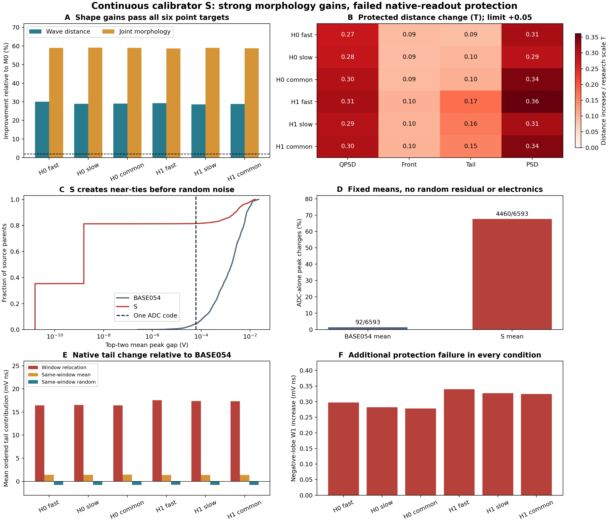

# S 全人口 FIT：形态收益成立，原生读出保护失败

2026-10-19。S 已完成两个原头、全部 6593 SOURCE 父事件、21047 TRAIN REAL 和三种噪声假设的评价。全部 13186 个均值 QP 求解成功；确定性峰、外支撑、非正均值支撑和参考前/tail 积分约束成立。原 039 的完整接受合同未通过，S 不进入确认，也不视为已匹配的随机响应。

|条件|波形距离改善|联合形态距离改善|平均形态改善|保护合同|
|---|---:|---:|---:|---|
|H0 fast|30.011%|58.988%|3.672T|未通过|
|H0 slow|28.888%|59.123%|3.667T|未通过|
|H0 common|29.061%|58.961%|3.660T|未通过|
|H1 fast|29.287%|58.606%|3.679T|未通过|
|H1 slow|28.580%|58.925%|3.668T|未通过|
|H1 common|28.820%|58.750%|3.665T|未通过|

两个头、三 H 均失败于 QPSD、front、tail、guarded PSD 和负波瓣面积距离。其余保护、原异常计数与条件覆盖检查保留原结果。负波瓣距离增量为 0.278–0.340 mV ns，明显大于数值守恒残差。完整原始距离见 [METRICS.csv](METRICS.csv)，不能用波形改善抵消这些失败。

## 关键证据：保持浮点峰索引没有保住 ADC 后的峰稳定性

S 将 5374/6593（81.51%）个父事件的前两峰间隔压到一个 ADC code 以内；BASE054 为 294/6593。S 的 3923 行达到预设近并列阈值，约束对均值峰索引的严格检查仍全部成立。

一次事前限定为四个固定均值读出的补充诊断，关闭原随机残差和电子学，只施加原 ADC/减基线/选峰。BASE054 有 92/6593 行重新选峰，S 有 4460/6593（67.65%）。这说明读出敏感性在确定性均值中已经存在。该诊断没有新随机库、参数、QP、checkpoint 或原数据解码，也没有改写主候选得分。

真实 FIT 路径中，BASE054→S 终态选峰改变 3421–3455 行；先加均值修正改变 signal 峰 3501/3548 行，再加随机修正另改变 398/391 行。终态峰不同组的均值修正峰优势平均为 +13.40 至 +13.86 mV，随机修正为 −0.23 至 −0.28 mV。窗口移动是 tail 平均增量的主要正项。各阶段计数有重叠；这些是固定路径的代数分解，不能解释成唯一物理因果百分比。

## 决策

S 的数值实现和用途点收益通过，但其均值近并列峰与 ADC 选择冲突，且原生保护失败。当前证据没有把剩余问题分离成适合仅调三项随机协方差幅度的失配，因此本次不触发 S+R；也不开未用确认库。该结论针对本次冻结的 S 配置，不证明所有样条或随机模型均不可行。

保留 070 和 S 的负结果，以 BASE054 作为有限收益参照。下一步只独立重算已保存科学输出并完成失败方法交付；不根据本次 REAL 得分回头扫 λ、增加峰间隔、基函数或随机幅度候选。后续方法更改须作为新的研究设计明确登记。

## 可复核范围与执行成本

24 份完整原生文件包含 158232 行，ADC 和 waveform 的原始字节 SHA 已核对；各行峰、读出特征及 flags 均复核。跨 CPU 解码的最大差为 1.08e-19 V，独立特征复算差为零，参考积分残差最大 6.83e-16 V ns。三参照×两头×三 H 的 18 份完整指标 JSON 精确复演；541 部署源文件未改。

本次成功执行约 104.05 秒，峰值 RSS 2.95 GB；此前一次工程失败仅完成首头 M0，因 NumPy 字典直接比较 JSON 而退出，S 求解和评分均为零。修复仅改为比较已落盘 JSON。两次累计原生墙钟约 131.07 秒，run 输出 210766260 字节；失败费用和文件均保留，累计墙钟/文件帽未增加。累计 12 次 checkpoint，TRAIN、PCA 各 2 次解码，AD/神经更新/DEV/确认均为零。

完整主指标独立重算现已通过：新进程只读取已保存 ADC/XOR/基线及原 REAL TRAIN，24 份完整指标 JSON 与原报告逐项精确一致，覆盖 158232 行；波形和 ADC 原始字节及峰索引全部精确。复用原冻结指标定义及投影种子，不重新生成响应。preADC flags 沿用原保存值，不从 ADC 推断。该验证原生墙钟 77.04 秒、峰值 RSS 2.08 GB、输出 1893488 字节；checkpoint、响应 forward、响应随机抽样、AD、QP、PCA、SOURCE 与 DEV 解码均为零，REAL TRAIN 三成员解码一次。重算成功保留 S 的科学负结果。[完整重算验收](../../receipts/finalization_saved_replay_20261019/terminal_01/TERMINAL_REVIEW.json)。

证据：[数组验收](../../receipts/finalization_S_20261019/terminal_01/ARTIFACT_VERIFICATION.json)、[全量分解](../../receipts/finalization_S_20261019/terminal_01/ANALYSIS.json)、[固定均值诊断](../../receipts/finalization_S_20261019/terminal_01/MEAN_MARGIN_DIAGNOSTIC.json)、[工程失败](../../receipts/finalization_S_20261019/engineering_failure_01/TERMINAL_REVIEW.json)、[唯一修复](../../receipts/finalization_S_20261019/engineering_recovery_01/REPAIR_REVIEW.json)、[实际配置](../../configs/finalization_S_20261019_fix01.json)。
