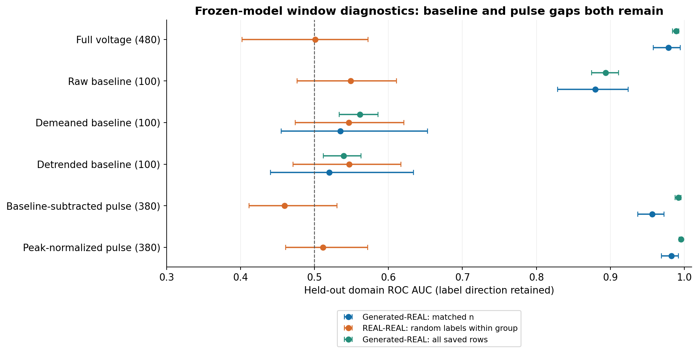
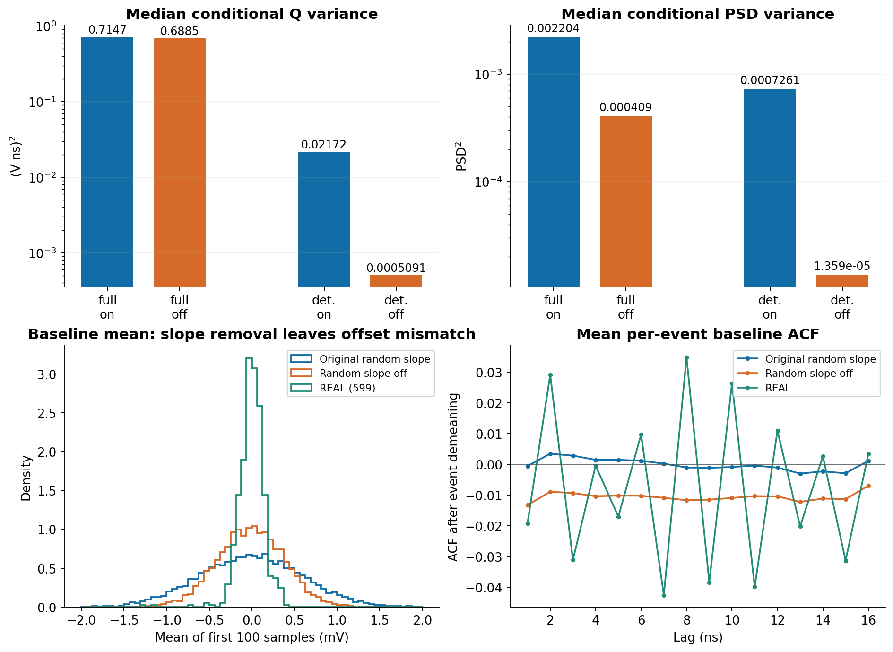
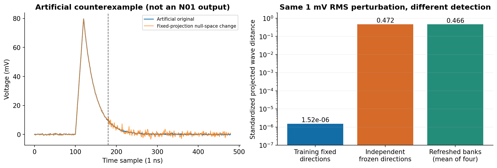

# N01 冻结模型机制复核

[完整中文报告](N01_NOISE_MECHANISM_REVIEW.html) · [机器可读汇总](REVIEW_SUMMARY.json)

本轮冻结公开基准 `2c501e9`，完成24个诊断分类器、full/deterministic各128父事件×64次同随机数斜率开关，以及96条人工波形的固定投影盲区检查。响应模型训练更新为0，诊断分类器更新4800；没有训练新的噪声候选。

- 确定性模型条件Q方差中位数：0.021724 → 0.00050908（ddof=1，下降97.7%）。full条件PSD方差：0.0022044 → 0.00040904。
- 原始基线AUC 0.879；去均值后0.535；归一化脉冲仍0.982。匹配样本量、组内随机标签REAL–REAL阴性对照均未显著偏离0.5；测试仅5个REAL原组，不证明等价。
- 原全组分域的反向AUC对照完整保留为组移位压力对照，补充控制属于透明的观察后分析。
- 1mV人工扰动使旧wave距离仅约1.52e-6，而独立方向检出约0.472；不含ADC、对抗或正则项，不证明旧模型利用了盲区。
- 关闭随机斜率后基线均值散布仍约实测2.5倍。干预输出不是已校准的修复模型。

执行协议见 [NOISE_AUDIT_PROTOCOL](../../docs/NOISE_AUDIT_PROTOCOL.md) 与 [阴性对照补充](../../docs/NOISE_AUDIT_CONTROL_AMENDMENT.md)。脚本位于 `scripts/diagnose_n01_windows.py`、`scripts/diagnose_n01_slope.py`、`scripts/audit_projection_blindspot.py`、`scripts/analyze_slope_psd_bins.py`，报告可由 `scripts/build_noise_audit_report.py` 重建。每个脚本均固定记录随机流和输入；模型科学修复边界见 [NOISE_REPAIR_SCOPE](../../docs/NOISE_REPAIR_SCOPE.md)。原基准数据角色未改，验证集已用于诊断，不能重新称为未查看的独立终验。
