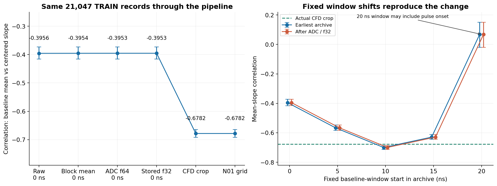
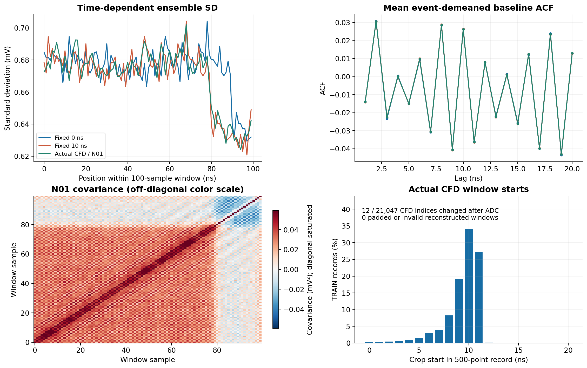
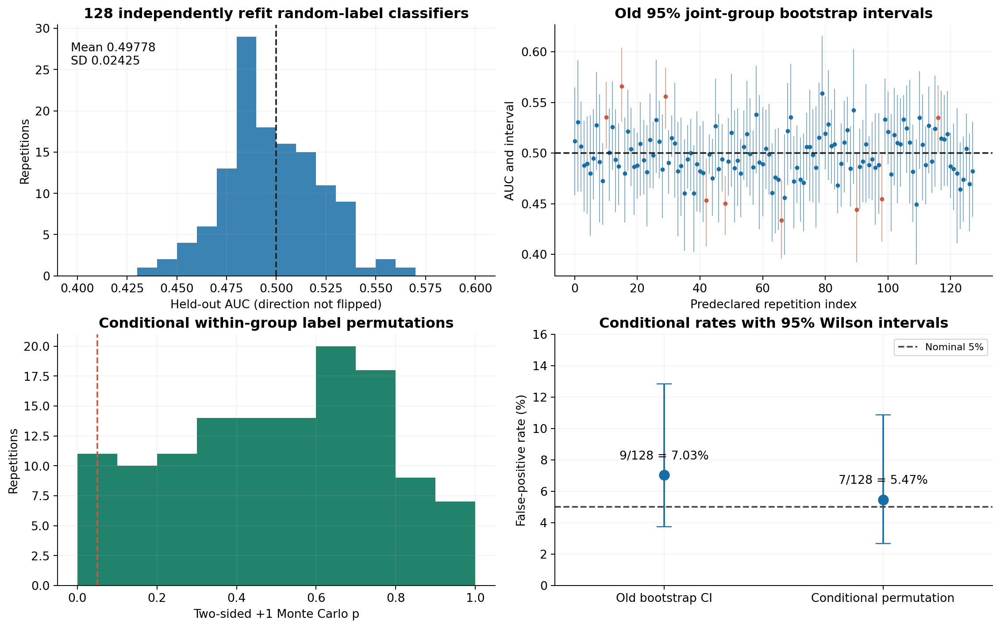

# N01 噪声来源与 REAL–REAL 对照校准

本轮诊断已完成。21,047 条合法 TRAIN 的 480 点目标全部逐位重建；128 次 REAL–REAL 全重新拟合完成，全部 65,536 个保存分数 GPU 重放逐位一致。新增噪声模型训练 **0**，脉冲响应训练 **0**；评价分类器共 25,600 更新。上一轮噪声门仍未通过，完整响应匹配尚未成立。

## 负相关早于已知处理链，固定取窗平移可复现其增强

同一批记录从最早可读 NPZ 的前 100 ns 到实际 CFD 基线，均值—中心化 OLS 斜率相关由 −0.3956 变为 −0.6782。固定位置的降采样、ADC 与 float32 转换对该相关系数只产生很小变化。起点固定移到 10 ns 时，原始容器内的相关已为 −0.6997，比实际 CFD 基线还强。因此，已知链中主要变化与取窗位置有关；不能把它归结为 CFD 算法创造了原本不存在的结构。

| 同事件阶段 | 相关系数 | 422 个人工组 bootstrap 95% 区间 |
| --- | ---: | --- |
| 最早容器，固定起点 0 ns | -0.395587 | [-0.415989, -0.372936] |
| 20 点均值降采样，固定 0 ns | -0.395426 | [-0.415842, -0.372861] |
| 14-bit ADC，固定 0 ns | -0.395313 | [-0.415561, -0.372791] |
| float32 存储，固定 0 ns | -0.395313 | [-0.415561, -0.372791] |
| 实际 CFD 裁窗 | -0.678247 | [-0.691496, -0.664186] |
| N01 再量化 | -0.678247 | [-0.691496, -0.664186] |

固定原始窗起点 0/5/10/15/20 ns 的相关依次为 −0.3956 / −0.5666 / −0.6997 / −0.6295 / +0.0683。20 ns 窗可能接近脉冲前沿，其均值/斜率与 CFD 位置的关联更明显，不能当成独立、纯净的电子学对照。所有这些窗都来自同一已选 TRAIN 人口，仍带有历史触发与 QC 条件。

在相同实际取窗位置，量化前后相关从 −0.678471 变为 −0.678247。使用量化前/后 CFD 位置截取同一降采样记录，仅 12/21,047 条的整数位置改变，相关从 −0.678452 变为 −0.678471。两条分支均无越界、填充或删行。float32 与 N01 再量化的差异属于微小数值舍入。

这里的“小变化”仅指上述均值—斜率相关。降采样会明显改变其他噪声统计：固定 0 ns 窗的 1 ns 延迟 ACF 从原始 −0.129768 变为降采样后 −0.013888。因此，后续噪声评价仍必须保留完整观察链。

原始固定 0 ns 和最终基线的负交叉协方差中，组内贡献分别为 98.21% 与 98.05%。因此，50 条人工分组之间的整体偏移不能解释主要结构；这些组也不等于独立采集。基线随窗内位置变化的标准差、完整协方差及短延迟 ACF 已保留。

## 阴性对照可以偶发误报，不能凭一次区间排除 0.5 认定实现故障

全部 128 次按预登记 seed 重抽随机域标签、重新初始化并拟合。每域拟合 2048、测试 256；分类器拟合与测试按原组隔离，标准化仅拟合样本参与。12 个伪测试组在数据解码前按 ID/数量确定，原 VAL 波形本轮未解码。

| 判据 | 随机标签下的误报 | 条件误报率 | Wilson 95% 区间 |
| --- | ---: | ---: | ---: |
| 旧 joint-group bootstrap 95% 区间不含 0.5 | 9 / 128 | 7.03% | 3.74%–12.82% |
| 固定分数、组内等配额置换，双侧 p ≤ 0.05 | 7 / 128 | 5.47% | 2.67%–10.86% |

AUC 均值 0.49778，标准差 0.02425。两组误报率区间均包含名义 5%；相差两次不支持“新规则显著更优”。这里的重复是同一历史采集和固定 12 组条件下的随机化，不是 128 次独立采集。旧 VAL 的一次异常可能是随机波动，也可能反映未识别问题；本轮不能为其定性，更不能追认旧噪声门。ACF 与均值—斜率联合统计的旧失败证据仍独立存在。

## 下一步模型依据与停止边界

下一候选应先单独重做噪声模块：允许时间位置相关的结构，用正半定参数化联合表达慢分量的均值/趋势相关，并与短程相关噪声一起重新估计；不能冻结原 FIR 后再强加一个不可行的负协方差补偿。经已绑定的降采样、ADC 和取窗接口评价，逐项检查联合协方差、时间标准差、ACF、谱与分布判别。

基线证据只覆盖约 100 ns 的观测窗，不能直接认定慢分量在整段 480 ns 持续。整段外推及硬件解释需要额外安静长窗或独立采集证据。未来候选开始前，应先登记有限预算和评价规则，并把 REAL–REAL 对照作为校准证据；分类器未拒绝差异不等于分布相等。此次没有实现或拟合该新候选，脉冲响应训练保持停止。

## 执行与复核回执

- 原始来源完整 SHA256、ZIP CRC/EOF、时间网格、角色与身份绑定均已核验；只将 21,047 条 TRAIN 原始行解释为浮点数组，没有保存 10,000 点原始长波形副本。原始重建耗时 49.04 秒。
- 首次 RR 在 CUDA 显存 guard 的设备编号接口处退出 1，当时 target 尚未解码、分类器更新为 0。原失败回执保留。显式同一逻辑 GPU `cuda:0` 修复后，在独立 continuation 从 0 执行原定 128 次；原始重建未重算，科学种子、规则与预算未变。
- continuation 与 RR 原生退出均为 0；RR 科学执行 40.79 秒。独立重放原生退出 0，128 个模型、65,536 个分数全部逐位一致，最大绝对差 0，未新增拟合或重新抽 bootstrap/置换。
- 新增语义测试 16 项通过。旧模型、旧损失实现与 repair_002 失败门保留；执行源码与结果 SHA256 见回执。

最早 NPZ 的创建过程、触发前处理和原始仪器流程尚未得到验证；“已存在于最早归档”不能改写成“已证明硬件漂移”。422 个组为连续记录人工分块。此轮没有新的 VAL 检验或独立采集验证。

方法背景：[Classifier Two-Sample Tests](https://arxiv.org/abs/1610.06545)，[Multi-level block permutation](https://pubmed.ncbi.nlm.nih.gov/26074200/)。本项目的具体统计量、随机流和口径以预登记协议及代码为准。

本地完整数据与回执：`runs/noise_origin_audit_003_20261012/`。公开发布包排除实测原始与降采样波形，仅含派生统计、分类器、日志和复核材料。预登记方法文档保留其执行前写作时点，完成状态以本报告及 FINAL_RECEIPT 为准。
