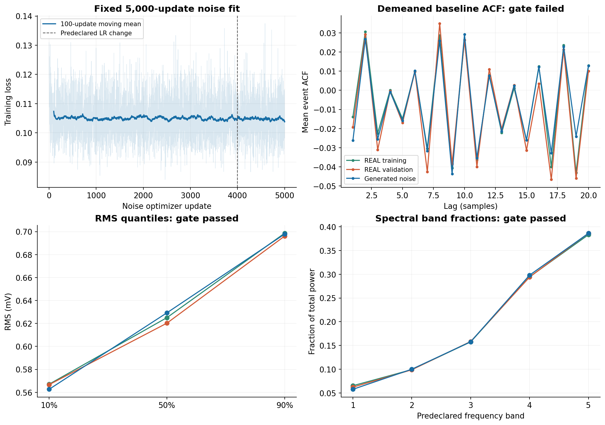
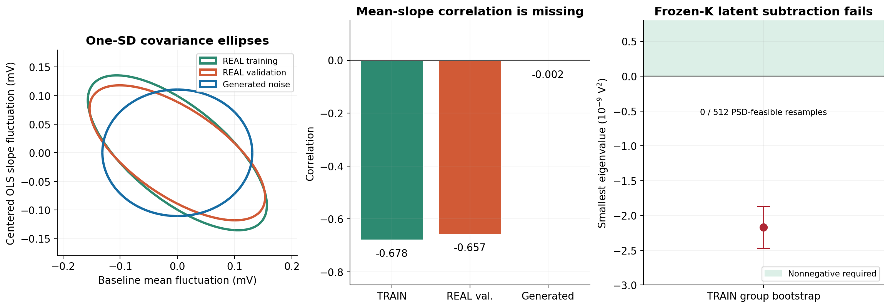
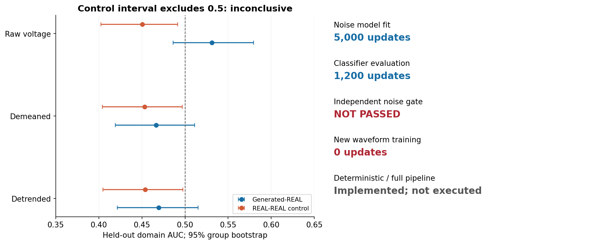

# N01 repair_002：噪声独立验证未通过

电子学训练 **5000 次**，评价分类器 **1200 次**，新脉冲训练 **0 次**。保留 U-Net，电子学 V2、投影刷新、逐坐标/短延迟损失及条件两臂训练/独立评价代码已实现；噪声门未通过，本轮两臂比较未执行。

| 检查 | 实际值 | 运行前规则 | 结果 |
|---|---:|---:|---|
| 基线均值标准差比 | 0.85383 | 0.85–1.15 | 通过 |
| 最大 ACF 差 | 0.021871 | ≤0.015 | 未通过 |
| OLS 联合协方差误差 | 0.57436 | ≤0.20 | 未通过 |
| 完整100点独立 SWD 比 | 0.98959 | ≤2.0 | 通过 |
| 生成–REAL AUC | 0.53114 [0.48612,0.57958] | 预注册点值/区间范围 | 通过 |
| REAL–REAL AUC | 0.45052 [0.40264,0.49146] | 95%区间包含0.5 | 未通过 |

平稳标量噪声加独立偏置的中心化均值—斜率协方差为零；生成相关系数 −0.00223，TRAIN −0.67825，REAL −0.65679。固定当前 K 后，OLS 协方差相减的潜在协方差非半正定，最小特征值 −2.1693e−9 V²。422 个 TRAIN 组的 512 次重采样均未通过半正定条件。这是固定 K、同次采集及 pre/post-ADC 近似下的诊断，不证明真实硬件漂移，也不能识别480点外推。

34 项工程测试通过；6 个分类器权重/得分重开核对；同设备重放10,240条噪声样本逐位一致。验证集已在此前诊断中查看，仅一份采集的12个验证组；没有独立采集或硬件校准结论。

[完整 HTML 报告](N01_NOISE_REPAIR_REPORT.html) · [噪声门全部结果](NOISE_GATE.json) · [协方差诊断](IDENTIFIABILITY_REPORT.json) · [重开核对](REOPEN_VERIFICATION.json) · [同设备重放](REPLAY_VERIFICATION.json) · [预注册](PREREGISTRATION.json)

报告、PNG/PDF 图和 JSON 证据由 `scripts/build_noise_repair_report.py` 从冻结终点生成，不增加训练更新。权重、完整日志和源码在 [repair_002 Release](https://github.com/Aggressivecyber/ej276d-n01/releases/tag/n01-repair-002-20261012)。
