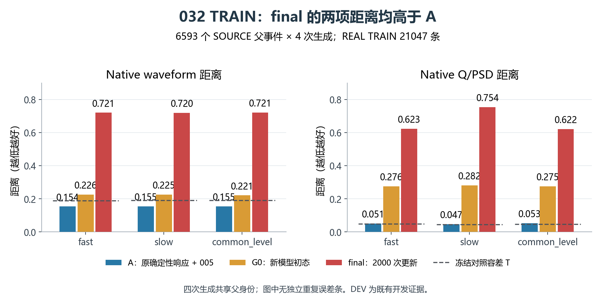
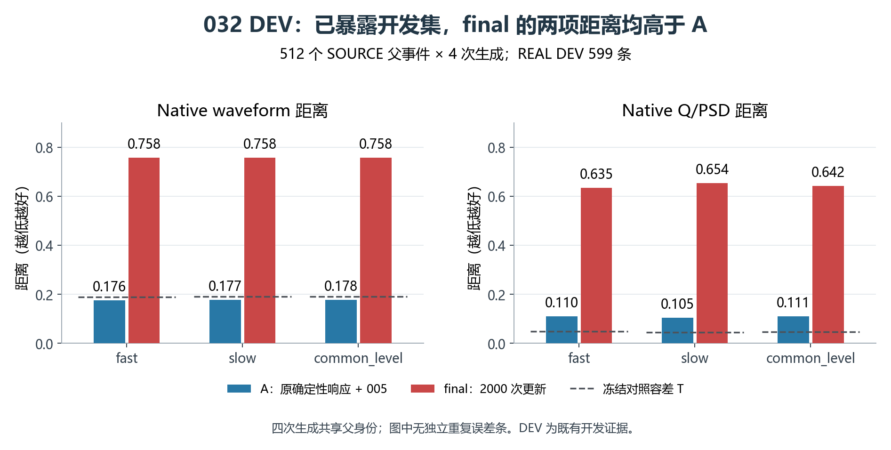
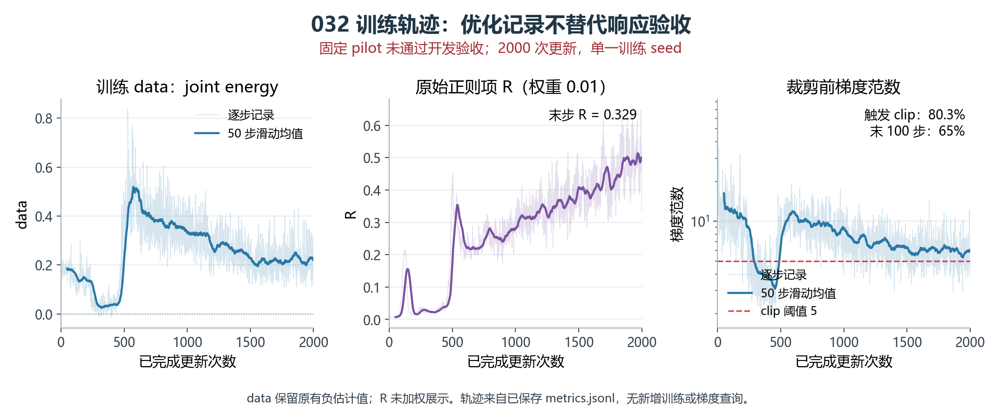

# REAL032：实测响应试跑未通过

2,000 次更新正常结束，但既定进展门未通过。3 个 TRAIN 波形改善门全部失败，TRAIN/DEV 的 6 个非劣比较全部失败；54/90 个有正容差的分量比较失败。032 权重保留为负结果，不晋升为响应模型。

| 数据 / 噪声假设 | A 波形距离 | G0 波形距离 | final 波形距离 | final/A | A Q/PSD | final Q/PSD |
|---|---:|---:|---:|---:|---:|---:|
| TRAIN / fast | 0.153839 | 0.225999 | 0.720824 | 4.686 | 0.051433 | 0.623302 |
| TRAIN / slow | 0.154915 | 0.225441 | 0.720418 | 4.650 | 0.047189 | 0.753974 |
| TRAIN / common_level | 0.154866 | 0.221066 | 0.721251 | 4.657 | 0.053235 | 0.621986 |
| DEV / fast | 0.175766 | — | 0.758166 | 4.313 | 0.109800 | 0.634539 |
| DEV / slow | 0.177039 | — | 0.757847 | 4.281 | 0.104718 | 0.654304 |
| DEV / common_level | 0.177632 | — | 0.758100 | 4.268 | 0.111270 | 0.642392 |

距离越低越好。A 为原确定性响应加固定 005 噪声；G0 为新随机模型初始状态。每个 SOURCE 父事件生成 4 次，共享父身份，不能当作 4 个独立父事件。DEV 是已暴露的同次采集开发数据，未用于这轮训练或设置选择。

现有输出支持两条具体线索：随机头初始化已造成明显扰动；约第 460–500 步，优化目标与随机头正则同步升高。首步 shape 梯度范数 20.946，mean 为 3.044；80.3% 的更新触发全局裁剪。总正则的增长超过原 mean 正则的理论上界，因而不能仅用 mean 残差饱和解释。

TRAIN fast 的上升沿未定义比例为 3361/26372（12.75%），A 为 262/26372（0.99%），REAL 为 94/21047（0.447%）。最终生成波形出现双极振荡和电荷偏移；定义成功子集上的 rise 距离改善不能抵消新增截断。搜索边界与全局窗外峰比例较低，不足以单独解释这些退化。

实际覆盖全部 6,593 个 SOURCE 和 21,047 个 REAL TRAIN 父记录，分别累计采样 256,000 与 512,000 行；TRAIN/DEV 父身份及 REAL 组无交集。005 与原 A 参考状态未变。CPU 原始 REAL 观察重放与准备数据逐位一致，未二次 ADC。

下一步固定为 033 首步审计：复现首个训练银行、原梯度和一次 Adam 更新，比较同一参数增量的整步、1/4、1/16 及四个参数组，并在 8 个独立 TRAIN 银行上计算配对风险差。mean 参数组同时影响共享特征和随机输出，不能解释成纯平均波形干预。该诊断尚未执行；单步改善也不等于后续训练稳定。

执行回执：原生退出码 0，耗时 205.14 秒，峰值 RSS 3.023 GiB；2000 G / 2000 AD、4446 NN 调用、312840 NN 行。独立审核复算 432 项数值，最大误差 0。后处理未增加 NN、AD、检查点反序列化或观察调用。项目累计完成更新 195667。

[最终回执](../../receipts/response032_20261017/FINAL_RESULT_RECEIPT.json) · [独立复算](../../receipts/response032_20261017/independent_result_01/RESULT_REVIEW.json) · [机制诊断](../../receipts/response032_20261017/model_diagnosis_01/DIAGNOSIS.json)
