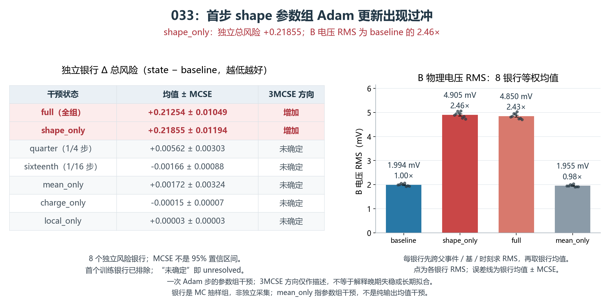

# 033：首步形状更新造成风险上升

033 严格复现了 032 的首步：9 项损失、正则与梯度记录逐值相等。随后只执行 1 次 Adam 更新，固定比较整步、两个缩步及四个参数组；没有继续训练。独立复算的 161 项均值/MCSE 与 1288 个配对差误差均为 0。

| 参数干预 | 首训练银行总损失变化 | 8 个独立 TRAIN 银行变化：均值 ± MCSE | 3 MCSE 描述方向 |
|---|---:|---:|---|
| 整步 | +0.122162 | +0.212543 ± 0.010495 | 上升 |
| 全组 1/4 步 | -0.025649 | +0.005619 ± 0.003032 | 未分辨 |
| 全组 1/16 步 | -0.009925 | -0.001662 ± 0.000879 | 未分辨 |
| 仅 mean 参数 | -0.010700 | +0.001722 ± 0.003244 | 未分辨 |
| 仅 shape 参数 | +0.124110 | +0.218551 ± 0.011941 | 上升 |
| 仅 charge 参数 | +0.000023 | -0.000149 ± 0.000070 | 未分辨 |
| 仅 local 参数 | -0.000005 | +0.000032 ± 0.000030 | 未分辨 |

配对差以同一银行初态为基准；正值代表恶化。MCSE 不是 95% 置信区间，3 MCSE 是描述性判据。8 个风险银行来自现有 TRAIN 经验总体，首训练银行单列；DEV 未参与。

仅 shape 参数更新就足以复现整步的大幅恶化，8/8 个独立银行的总损失均增加。首训练银行中，B 的物理 RMS 从 0.002081 V 增至 0.005102 V（2.45 倍），而 A 峰、qbar、charge_v、alpha 和局部噪声摘要保持不变。风险增加主要来自波形与有符号积分项，正则项贡献很小。

1/4 与 1/16 全组缩步均改善了首训练银行损失，但独立银行的风险下降尚未分辨。mean-only 也会改变共享特征与随机输出，不能解释成只改变确定性波形。033 定位的是这一初态的一次更新，不能直接解释 032 后期全部失稳。

下一项唯一有限修复为 034：shape 学习率由 3e-4 降至 1.875e-5；mean 保持 1e-4，charge/local 保持 3e-4。保留 032 初始化、随机种子、数据、损失、2,000 步和验收门。此组合尚未在 033 中单独测量；选择它是为了针对已明确致害的 shape 更新，同时保留均值学习速度。独立 reviewer 更倾向全组缩步，因其直接接受过首步比较；这一取舍已记录，未写成一致意见。

034 必须仍满足全部 TRAIN 波形相对 A 改善至少 2%，且 TRAIN/DEV 所有有定义正容差分量均非劣。2% 仅为试跑进展；物理条件响应、低计数外推和独立采集验收仍未建立。若失败，保存负结果，不自动切换另一学习率组合。

原生执行耗时 6.004 秒，峰值 RSS 2.652 GiB；144 次 NN 调用、9216 行，1 AD、1 次诊断更新，2 次 CP 加载。项目累计更新 195668。后处理没有新 NN、AD、CP 或观察调用。

[最终回执](../../receipts/response033_20261017/FINAL_RESULT_RECEIPT.json) · [独立复算](../../receipts/response033_20261017/independent_result_01/RESULT_REVIEW.json)
