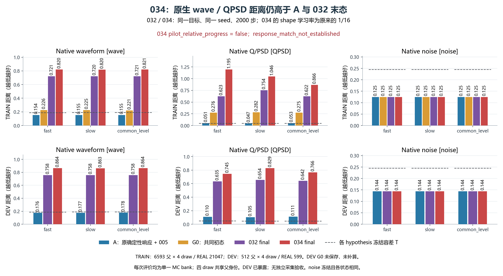
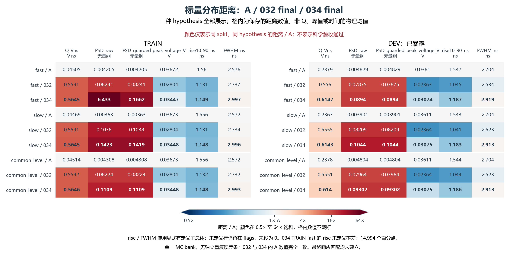
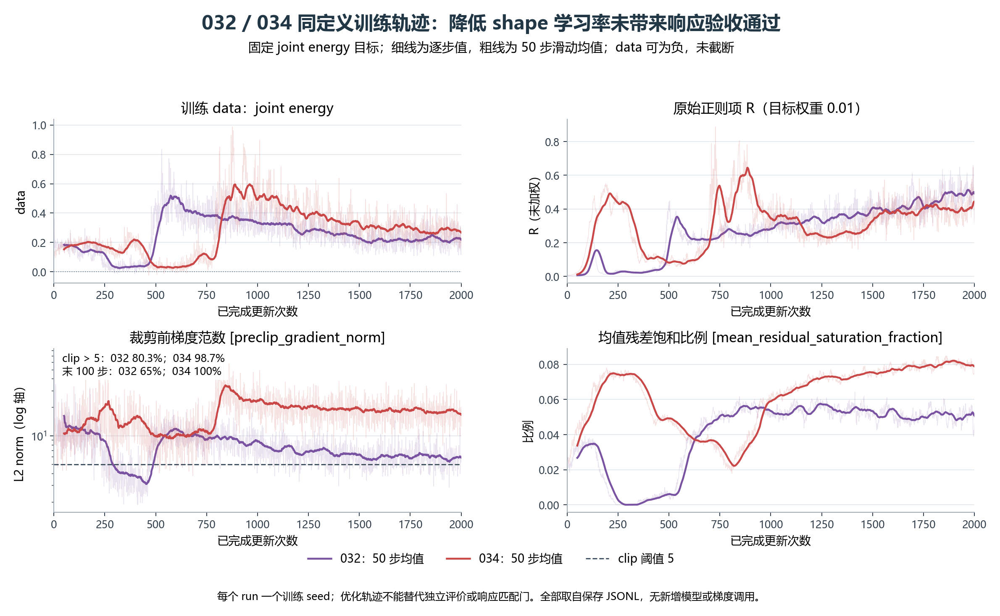

# RESPONSE034：shape 学习率缩小后的固定试跑负结果

REAL034 完成预登记的 2000 步，但未通过原定进展门。shape 学习率从 3e-4 降至 1.875e-5 减轻了最初更新的冲击，未解决长期失稳。三种假设的 TRAIN 波形距离均高于原 A 和失败的 032 final；DEV 也同向恶化。权重不提升为可用响应模型。

相对于 032，唯一科学设置变化为 shape LR/16；mean LR=1e-4、charge/local LR=3e-4、原初始化、seed=2026101732、训练样本、联合能量目标、硬 ADC/动态首 argmax 裁窗、2000 步预算及评价门均相同。A/G0 的 9 份参考结果和有限示例、父身份与覆盖数组、第一步损失和四组梯度记录均与 032 精确一致。

下表是保存的原生完整波形距离，越小越好。034/A 倍数由同一行计算。单个训练种子及单个评价 MC bank 不提供独立重复实验的误差估计。DEV G0 未计算/保存，表中保留为空。

| 数据/假设 | A | G0 | 032 final | 034 final | 034/A |
|---|---:|---:|---:|---:|---:|
| TRAIN_fast | 0.153839 | 0.225999 | 0.720824 | 0.819873 | 5.329 |
| TRAIN_slow | 0.154915 | 0.225441 | 0.720418 | 0.819769 | 5.292 |
| TRAIN_common_level | 0.154866 | 0.221066 | 0.721251 | 0.820810 | 5.300 |
| DEV_fast | 0.175766 | — | 0.758166 | 0.864334 | 4.918 |
| DEV_slow | 0.177039 | — | 0.757847 | 0.863270 | 4.876 |
| DEV_common_level | 0.177632 | — | 0.758100 | 0.864483 | 4.867 |

正式进展门保持原样：全部 3 个 TRAIN 波形距离相对 A 至少改善 2%，并且 TRAIN/DEV 每个有定义正 T 分量的 final-minus-A 不超过原 T。结果为 0/3 波形门通过、0/6 非劣单元通过，90 项正 T 分量检查中 54 项失败。每个单元失败项均为 wave、QPSD、Q、front、tail、raw/guarded PSD、rise 未定义率和 rise 前沿截断率。未校准的 7 类 flags 不被当成通过项；RR 比值只作描述。2% 是试跑进展要求，不能代替响应拟合与物理验收。

相同口径的轨迹显示，034 的第 501–600 步平均目标约 0.0317，随后在约第 800 步明显反转。末 100 步平均目标为 0.279755，高于 032 的 0.219571；梯度裁剪触发 1974/2000 次，末 100 步全部触发。中间低损失段没有完整硬观测端点评价，不能据此选择或追认中间模型。

TRAIN fast 的 26372 条生成观测中，全局峰落在搜索区外为 2404 条（9.116%），032 为 73 条；搜索边界峰为 3283/26372（032：190），ADC 触轨为 1197/26372（032：738）。rise 未定义/前沿截断为 4072/26372（032：3361），FWHM 未定义为 940/26372（032：181）。这些分母覆盖全部观测，没有删掉失败行。rise/FWHM 距离本身只在各自有定义子总体上计算，其减少不能抵消未定义率增加。

TRAIN fast 的 raw PSD W1=6.432669，guarded PSD W1=0.166163；仅 2 条 Q 进入保护阈值，Q 非正为 8 条、PSD 精确未定义为 0 条。极端 raw PSD 距离受近零 Q 影响，但 guarded PSD 仍高于 032 的 0.082405，波形、电荷和时间形态也失败，因此不能把总体失败归为少数 PSD 比值异常。完整精度、final/T、RR 比值、flags 和分母见独立复算回执。

训练覆盖全部 6593 个 SOURCE 父事件与 21047 条 REAL TRAIN 记录，访问数分别为 256000 和 512000；各父身份至少访问 19 次/7 次。采用均匀计数权重，标定物理权重为 unknown。DEV 是此前已暴露的内部开发样本（512 个 SOURCE 父事件×4 抽样，对 599 条 REAL），本轮未用于训练或选择。固定 005 的噪声距离保持不变；真实条件协方差、低计数外推及独立采集仍未验收。

原生执行用时 203.123 秒，exit=0，峰值 RSS=3.004 GiB。实际 2000 G/2000 AD、4446 次 NN 调用/312840 行，与登记预算完全一致。52 个选择性收集文件校验通过；独立审核从保存结果重算 432 项标量，最大误差为 0。三幅图已实际打开检查。复算和绘图未新增 NN、AD、优化更新或 checkpoint 反序列化。034 前累计 195668，本轮 2000 步结算后为 197668；启动时记入的 301 步不重复累计。

下一步是 RESPONSE035 零更新参数交换诊断。把 034 初态/终态的整个 mean_model 与 shape/charge/local 参数块组成四个固定角点，在 033 已考察过的 8 个 TRAIN 风险 bank 上比较；另从相同 forward 缓存 A0/Af，仅改变进入同一电子学观测的确定性信号。登记预算为 64 次 NN/4096 行、0 AD/0 优化更新、0 DEV、0 完整原生 W1 评价。四角点不是候选模型，既有 TRAIN bank 也不是新留出集；以成对差值、交互项和直接输出几何为下一次最小修复提供依据。执行须先冻结来源、配置及独立审核；不自动切换全组学习率方案、扫参或追加训练步数。

[完整独立复算](../../receipts/response034_20261017/independent_result_01/RESULT_REVIEW.json) · [模型诊断](../../receipts/response034_20261017/model_diagnosis_01/DIAGNOSIS.json) · [绘图与 QA 回执](PLOT_RECEIPT.json) · [ROOT 最终回执](../../receipts/response034_20261017/FINAL_RESULT_RECEIPT.json)
