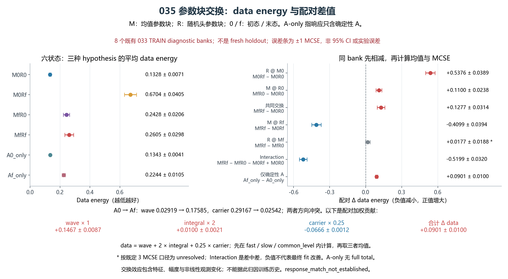
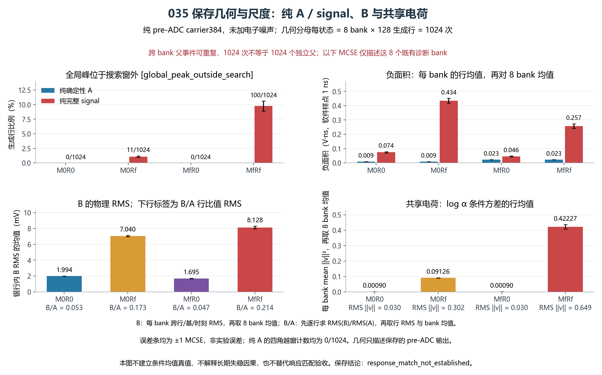

# RESPONSE035：平均响应与随机分支的零更新参数交换

035 完成预登记的零更新诊断。034 失败包含两个层面：平均响应单独经过同一电子学和硬观测后，波形能量距离已明显恶化；末态随机分支又引入较大的电荷/局部涨落和错峰。四个端点组合的相互作用很强，不能把故障归为某个孤立随机头，也不支持“共享特征整体爆炸”。当前仍未建立响应匹配。

M 表示完整 mean_model 参数块，R 表示 shape/charge/local 参数块，0/f 表示 034 初态/终态。四角点分别直接从原始 checkpoint 字典组合；A0_only/Af_only 使用同一 forward 返回的确定性 A，加上相同的固定 005/延拓噪声后再做硬 ADC 和动态裁窗，没有额外模型调用。A-only 未继承随机分支正则或完整目标值。

数据来自 033 已考察过的 8 个 TRAIN 风险批组，不是新的留出确认。每个状态共 1024 次有放回生成抽样，不等于 1024 个独立父事件。差值先在同一批组内求得，再计算均值与 MCSE；以下 ± 为一个 MCSE。energy 与 034 的原生 W1 波形距离是不同指标，不能直接互换数值。

| 参数组合 | data energy | wave energy | carrier energy |
|---|---:|---:|---:|
| M0R0 | 0.132808 ± 0.007078 | 0.032003 | 0.257117 |
| M0Rf | 0.670392 ± 0.040519 | 0.416897 | 0.488432 |
| MfR0 | 0.242819 ± 0.020607 | 0.206080 | 0.022302 |
| MfRf | 0.260488 ± 0.029781 | 0.215040 | 0.019735 |
| A0_only | 0.134300 ± 0.004116 | 0.029188 | 0.291674 |
| Af_only | 0.224386 ± 0.010483 | 0.175851 | 0.025422 |

原 data = wave + 2×integral + 0.25×carrier，分别计算三种延拓假设后求平均。Af_only−A0_only 的配对贡献为 wave +0.146663、2×integral +0.009986、0.25×carrier −0.066563，总 data +0.090086±0.009966。完整终态 MfRf−M0R0 的 data 也增加 +0.127680±0.031358。因此 carrier 改善与主要波形项的退化方向冲突，但原完整目标本身也变差，现有结果尚不能把 carrier 系数确认为唯一失效原因。

R 在 M0 下的效应为 +0.537583±0.038893，在 Mf 下为 +0.017669±0.018757，后者按既定描述性 3 MCSE 口径仍未分辨。交互项 MfRf−MfR0−M0Rf+M0R0 = −0.519914±0.031956。它说明两个末态参数块存在功能补偿；负交互不等于最终模型拟合变好，也不能重建训练过程的因果关系。

在本轮 1024 次抽样中，纯 A0、Af 的全局峰越搜索区计数均为 0，Af_only 与 MfR0 的三种硬观测也均无边界峰、全局越区或 ADC 触轨。平均响应的波形能量退化无法完全用这些裁窗标记解释。末态完整随机信号 MfRf 则有 100/1024 纯信号全局峰越区、135/1024 边界峰；加入 fast 电子学并硬观测后为 92/1024 越区、138/1024 边界和 47/1024 触轨。

Af 的平均 canonical Q 从 4.575868 降至 4.077485 V·ns，平均正/绝对峰从 0.178332 降至 0.125764 V。全局 decoded/pooled RMS 仅从约 1.06860/0.86863 变为 1.15877/1.00371；R0 在 Mf 下的 B 物理 RMS 和 B/A 反而降低。学习后的 Rf 与 Mf 结合时，log α 条件方差的行均值为 0.422271，高于它在 M0 下的 0.091264。图中明确区分行均值、每批 RMS 的均值及 B/A 行比值 RMS，避免混用不同聚合量。

作为下一轮设计准备，仅从保存标量重算去掉 carrier 后的 wave+2×integral：Af−A0 仍为 +0.156649±0.010016，MfRf−M0R0 仍为 +0.187025±0.029088，8 个批组全部为正。重评分没有把 034 变成成功结果。A-only 的边际匹配也不提供逐父事件的真实条件均值；非线性 ADC/裁窗后的条件平均不等于 A-only 观测。

ROOT 选择唯一后续 RESPONSE036：从原 A+005、seed=2026101732 重建同一 G0，只把训练 carrier 权重 0.25 改为 0；wave+2×integral、全部均值/随机参数可训练、034 三组学习率、原数据与采样、2000 步、正则、硬观测、固定末态 DEV 评价及原全部进展门保持不变。carrier 与原含 carrier 数据项继续记录，仅退出反向传播目标。代价是失去原始 384 点坐标及裁窗外尾部的直接训练约束；原错峰、边界、触轨和尾部指标完整保留。固定终点失败即关闭该候选，不自动转学习率方案、冻结均值、扫参或延长训练。当前阶段为 036 代码准备，执行前另行冻结配置并独立审核。

035 原生用时 5.003684 秒，exit=0，峰值 RSS=2.381760 GiB。实际 64 NN 调用/4096 行、005 1024 行、三假设延拓 3072 行、生成 ADC 18432 行、checkpoint 读取 3 次；AD、训练更新、DEV 读取、统计重拟合和权重写入均为 0。18 个收集文件的 SHA/大小全部匹配；独立复算 300 个均值/MCSE 和 1632 个逐批差值，误差均为 0。初态与 033 相同批组的 184 个风险值最大差 2.78e-17，192 个硬观测摘要及 flags 精确重放；A 跨 R 的差为 0。两幅图已实际打开并检查。累计训练更新保持 197668。

[独立复算回执](../../receipts/response035_20261017/independent_result_01/RESULT_REVIEW.json) · [模型诊断](../../receipts/response035_20261017/model_diagnosis_01/DIAGNOSIS.json) · [绘图与 QA](PLOT_RECEIPT.json) · [ROOT 回执](../../receipts/response035_20261017/FINAL_RESULT_RECEIPT.json)
