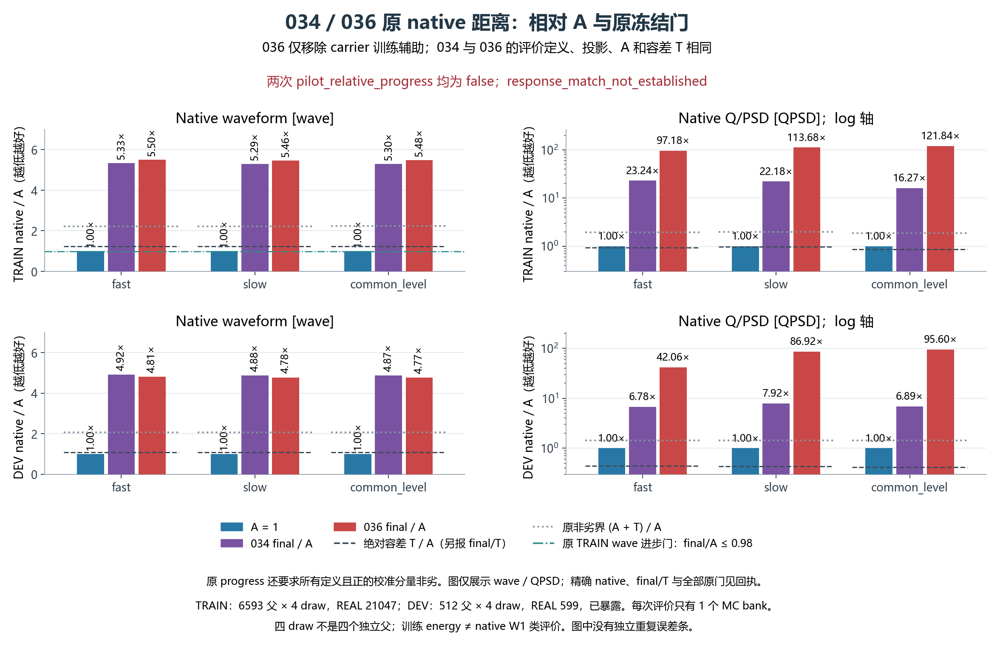
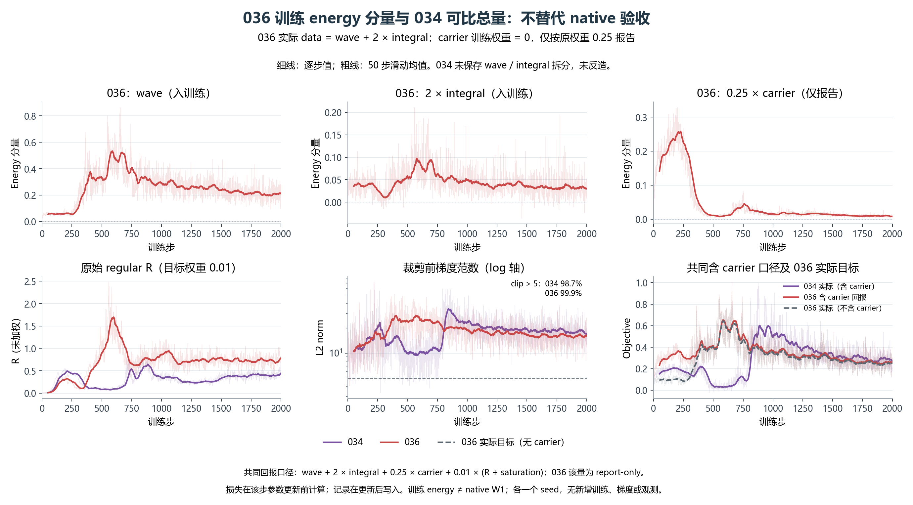
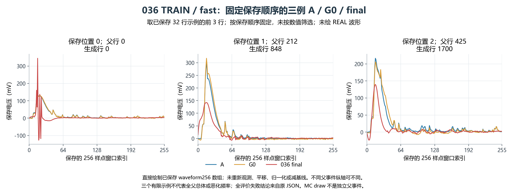

# RESPONSE036：移除 carrier 训练项后的固定 2000 步试跑

036 完成预登记的 2000 步，原生 exit=0，独立结果审核通过，但原科学进展门全部失败。TRAIN 三种电子学延拓假设的最终波形距离为初始 A 的 5.46–5.50 倍；DEV 为 4.77–4.81 倍。移除 carrier 的训练梯度没有恢复波形拟合，当前仍未建立响应匹配，末态权重不提升为可用响应模型。

本轮从原 A+005 重建与 034 相同的 G0，仅将目标中的 carrier 系数从 0.25 改为 0。目标为三假设平均的 wave energy + 2×joint signed-integral energy，加 0.01×(model regular+saturation)。carrier 和旧完整目标仍由同一观测计算并记录；其数值不参与 backward。全部均值与随机参数可训练，mean/shape/charge-local 学习率分别为 1e-4、1.875e-5、3e-4，AdamW、全局梯度裁剪 5、采样、种子、2000 步及原硬 ADC/动态首 argmax 裁窗保持固定。

每步两个 SOURCE64、两个 REAL128 均为独立、有放回、计数均匀抽样。全部 6593 SOURCE 和 21047 REAL TRAIN 父记录均得到访问，分别累计 256000/512000 次抽样；父身份及组划分与 DEV 不交叉，ID 不作为神经输入，物理混合权重仍为 unknown。全 TRAIN 评价为每父 4 次生成，共 26372 行，对照 REAL21047。末态先冻结，随后仅评价一次此前已暴露的 DEV512×4 对 REAL599；没有据 DEV 选择参数。三种假设和四次抽样不是独立采集重复。

下表为原生评价距离，越小越好。wave 是固定加权 W1 组合，与训练的 energy 距离不同；QPSD 是原生联合量。T 为已冻结的分量容差。相对进展要求三种 TRAIN wave 均较 A 至少改善 2%，并要求 TRAIN/DEV 每个有定义正 T 分量满足 final−A≤T；后者不等于 final≤T。

| 数据/假设 | wave A | wave G0 | wave final | final/A | wave final/T | QPSD final | QPSD final/T |
|---|---:|---:|---:|---:|---:|---:|---:|
| TRAIN/fast | 0.153839 | 0.225999 | 0.846729 | 5.504 | 4.495 | 4.998464 | 103.55 |
| TRAIN/slow | 0.154915 | 0.225441 | 0.846517 | 5.464 | 4.452 | 5.364538 | 117.62 |
| TRAIN/common_level | 0.154866 | 0.221066 | 0.848074 | 5.476 | 4.451 | 6.486250 | 140.35 |
| DEV/fast | 0.175766 | 未评价 | 0.844623 | 4.805 | 4.484 | 4.618328 | 95.67 |
| DEV/slow | 0.177039 | 未评价 | 0.845692 | 4.777 | 4.447 | 9.102148 | 199.57 |
| DEV/common_level | 0.177632 | 未评价 | 0.846641 | 4.766 | 4.443 | 10.637656 | 230.18 |

六个单元各有相同的 9 项非劣性失败：wave、QPSD、Q、front、tail、PSD_raw、PSD_guarded、rise 未定义率与 rise 前沿截断率。90 项有定义正 T 检查中 54 项失败；只有 12 项满足绝对 final≤T，另有 42 项未校准，不能算作通过。TRAIN 三种 wave 相比 034 还恶化约 3.3%；DEV 略有改善也未通过原门。TRAIN/fast 的峰高距离从 0.036718 降至 0.032224 V，仅代表这一分量的改善。

训练首步更新前 data=0.025904961225047825、objective=0.02596907309128277，与预登记重评分之差约 6.94e-18。四参数组的梯度有限且非零，shape 占组梯度平方和的 98.77%；2000 步中 1998 步触发裁剪。独立复算 24000 项损失与报告恒等式，最大误差 2.22e-16，确认 carrier 确实退出训练目标。

波形 energy 首步为 0.023662，第 2000 步为 0.277514；data 上升至 0.285668、objective 至 0.293335。carrier 虽仅作报告，仍从首步 0.279218 降至末步 0.033716。损失取自每步不同的随机批组，不能当作同一固定风险曲线；首步是全部记录的最小值也不证明每一步单调恶化。记录在更新后写入，但对应损失在该步更新前计算。以上证据说明本次失败同时出现于主要训练表征和原生波形评价，不能仅用两种评价指标不一致解释。

TRAIN/fast 最终全局峰越搜索区 1814/26372、边界峰 2388/26372，均少于 034 的 2404/3283，波形距离却更差。最终非正 Q 为 83/26372，PSD guarded 为 1/26372、undefined 为 0/26372；PSD_raw/guarded 距离分别为 0.748817/0.746007，说明异常不限于一个接近零分母的比值。rise 未定义 3954/26372，对照 REAL 为 94/21047，报告的 0.145466 是两者发生率之差的绝对值，不能误作生成未定义比例。rise/FWHM 距离分别为 1.619084/3.038962 ns；这里 ns 仅依据软件采样坐标，硬件时间标定仍未获得。

有限保存示例显示末态出现更强负瓣和宽低幅结构。下图固定使用既有保存位置 0/1/2，仅展示 A、G0、final 的原始保存裁窗，没有重新观测、归一化或平移；这些例子不代表总体发生率。训练/验证初始参考、统计、lineage/coverage 与 034 精确重放。未知的 REAL pre-ADC 状态继续记作 unknown。

静态实现与保存记录尚未发现可确认的符号、detach、自项或 zero_grad 错误。正确的四批组 energy 前向估计也不能保证 STE 是硬 ADC/argmax 风险的无偏导数；梯度裁剪不限制 Adam 的有效参数位移或输出波形位移。因此 ROOT 选择唯一后续 037 首步方向诊断：精确重放 036 第一批及其实际 Adam 更新，沿参数位移的 0、±1/64、±1/16、1 六个固定坐标，比较原硬观测 H、锚定初始 ADC 的连续代理 S、以及进一步固定初始裁窗的 F。S/F 在零点须与 H 逐元素一致，代理值只用于数学诊断。

037 将复用 033 已考察的 8 个 TRAIN 风险批组，并单列首批结果；这些不是新留出数据。仅一次原 H/STE 反向传播和一次诊断更新，108 NN 调用/6912 行，DEV 读取、checkpoint 写入及原生 W1 评价均为 0。两种小尺度用于检查有限差分稳定性，不选择最佳尺度或学习率。F 仍含 amax、abs、guard、clamp 等非光滑环节，差分不稳定不能直接判为自动微分错误。结果混合或不明确即按既定预算结束。当前仅批准代码准备，正式执行须另行冻结与审核。

036 原生用时 198.123977 秒，峰值 RSS=3.004284 GiB；实际 2000 G/AD、4446 NN 调用/312840 行、005 310792 行、延拓 932376 行、生成 ADC 1017636 行，CP 读取 2 次，TRAIN archive 1 次，DEV numeric/metadata 各 1 次，均与冻结预算一致。50 个选择性收集文件共 29676366 字节，SHA/大小全部核对；独立审核重算 282 项比较数值及 300 项聚合关系，误差为 0。审核及绘图没有新增 NN、AD、CP 反序列化或观测。三幅图已实际打开检查，轨迹横轴/图注修订后也重新检查。

累计更新为 197668+2000=199668。启动曾计入 578 步，本次终态仅增记 1422 步；历史工程更新另列，没有再次加入启动计数。源码、汇总、图表和回执按既有授权同步；私有原波形、身份数组和权重仅留在本地/原执行端。

[独立复算回执](../../receipts/response036_20261017/independent_result_01/RESULT_REVIEW.json) · [模型诊断](../../receipts/response036_20261017/model_diagnosis_01/DIAGNOSIS.json) · [绘图与 QA](PLOT_RECEIPT.json) · [ROOT 回执](../../receipts/response036_20261017/FINAL_RESULT_RECEIPT.json)
