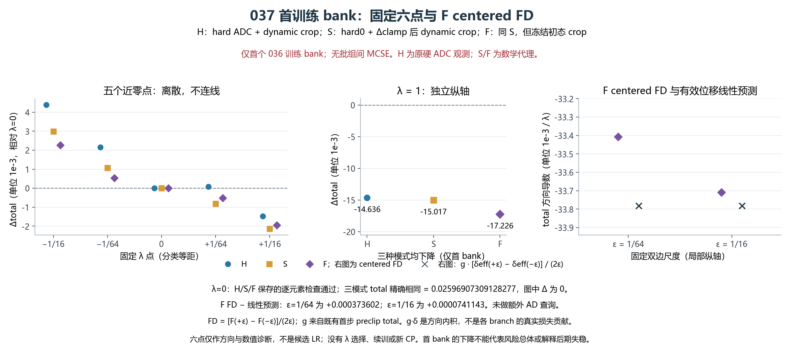
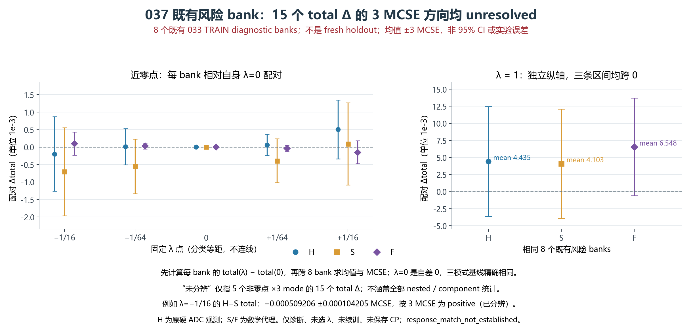

# RESPONSE037：实际首步 Adam 方向与 ADC/裁窗诊断

037 完成唯一预登记诊断，原生 exit=0，预算精确。036 的实际首步在求梯度的同一批数据上确实下降，没有出现同批过冲；固定初始裁窗的代理 F 与自动微分在两个有限差分尺度上方向、量级接近。另一方面，8 个既有 TRAIN 风险批组仍未分辨总目标的改善或损害，无法据此确认跨批收益、决定学习率或宣布响应修复。036 的最终拟合失败结论保持不变。

本轮精确读取 036 初始 checkpoint 和原 005，恢复统计量、模型、空 Adam 状态、4 个 NumPy/6 个 CPU Torch 随机流；重放第一批与一次实际 AdamW 更新。五个标量及 mean/shape/charge/local 四组梯度范数均与 036 保存值逐位相同。只有这一次 H/STE 反向传播，梯度在裁剪前保存。参数在 float32 下按 θ0+λ(θ1−θ0) 独立构造，λ=1 直接复制实际更新后的 θ1；计量时先把两套坐标转成 float64 再相减，避免额外舍入混入有效位移。

六个固定 λ 为 0、±1/64、±1/16、1，用于方向和有限步长诊断，不是可选择的学习率候选。H 使用原硬 ADC 和动态首 argmax 裁窗；S 使用 hard0+[clamp(preλ)−clamp(pre0)] 再动态裁窗；F 使用同一 S 值，但冻结各批组/电子学假设的初始硬裁窗。每批零点的 carrier、基线、裁窗及峰索引均逐元素一致。S/F 是数学代理，不能作为新的物理观测或增广数据。

首训练批组的零点 total=0.02596907309128277。下表是相对零点的 total 变化，负值表示下降。g·Δθ 只使用该首批的更新前总梯度，是一阶预测；不能把它当成其他风险批组的梯度。

| λ | H 变化 | S 变化 | F 变化 | g·有效 Δθ |
|---:|---:|---:|---:|---:|
| -0.015625 | +0.002155378 | +0.001068331 | +0.000529041 | +0.000527824 |
| 0.015625 | +0.000087110 | -0.000820658 | -0.000514932 | -0.000527824 |
| -0.0625 | +0.004384034 | +0.002993256 | +0.002267149 | +0.002111373 |
| 0.0625 | -0.001475410 | -0.002135268 | -0.001946333 | -0.002111373 |
| 1 | -0.014636471 | -0.015017077 | -0.017225823 | -0.033781327 |

实际完整首步的 H/S/F total 分别为 0.011332602048、0.010951996332、0.008743250275，都低于零点。因此不能把 033 原学习率与旧目标下的过冲结论套用到本轮 036 首步，本次未据此选择更小步长。小正向 +1/64 的 H 反而略升，而 S/F 下降，说明观察方式可改变局部有限步长的结果；这不等于量化是 036 终态失败的唯一原因。

首批总目标的主要改善来自有限样本的积分 energy：H 的 wave 仅从 0.023661778 降至 0.023167659，而 integral 从 0.001121592 变为 −0.005949594，并以系数 2 进入目标。四批组 energy 估计在有限样本下可以为负，不能将负值本身认作符号错误或分布已拟合。本轮没有重做原生 W1 评价，也没有重新判定 036 的 2% 进展门。

对称差分为 [L(+ε)−L(−ε)]/(2ε)，对应的一阶预测由两个实际有效参数位移的 g·Δθ 之差计算。F 比较如下：

| ε | F total 中心差分 | 有效参数一阶预测 | 相对绝对差 |
|---|---:|---:|---:|
| 1/64 | -0.033407107 | -0.033780708 | 1.1060% |
| 1/16 | -0.033707859 | -0.033781973 | 0.2194% |

两个 F 差分相差约 0.000300752。H/S 的中心差分对尺度更敏感；F 仍含 amax、abs、guard、clamp、模型幅度和插值等非光滑环节。这里的局部一致性不证明所有梯度正确或 STE 对硬风险无偏，也不是后期训练故障定位。完整步 g·Δθ 中 mean/shape/charge/local 的线性预测贡献分别约 72.561%/25.860%/1.556%/0.023%；这与 shape 占初始组梯度平方和 98.77% 是不同量，不能当作实际损失的因果分解。

另 8 个批组复用 033 已考察的 TRAIN 随机流，首次梯度批组不纳入均值。各模式和参数点共享输入、潜变量、005/延拓噪声和 REAL 目标。差值先在批组内求得，再计算 8 批均值和 MCSE；下表 ± 为一个 MCSE。预登记描述口径用均值±3 MCSE 是否跨零判断方向。MCSE 描述这些批组的蒙特卡洛抽样波动，不代表真实物理总体或独立采集的不确定度。

| λ | H total 配对变化 | S total 配对变化 | F total 配对变化 |
|---|---:|---:|---:|
| +1/64 | +0.0000618 ± 0.0001017 | -0.0003913 ± 0.0002096 | -0.0000373 ± 0.0000287 |
| +1/16 | +0.0005053 ± 0.0002811 | +0.0000921 ± 0.0003913 | -0.0001493 ± 0.0001097 |
| 1 | +0.0044348 ± 0.0026805 | +0.0041029 ± 0.0026664 | +0.0065484 ± 0.0023840 |

全部 15 个非零点×模式的风险 total 配对变化均在该口径下未分辨。完整步 H/S 有 5/8 批变差，F 有 7/8 批变差；这些计数和正均值不能替代预登记的方向判断。小步 F 的平均方向略降同样未分辨。因此本轮没有证明跨批下降，也没有把跨批上升确定为故障原因。

并非所有比较都未分辨：负向 −1/16 的 H−S total 为 +0.000509206±0.000104205 MCSE，8/8 批均为正，按描述性 3 MCSE 有分辨。它只说明这个负向有限点的观测方式存在差异。H−S 与 S−F 是嵌套功能比较，允许交互，不能拼成 036 全训练过程的唯一因果分解。

分量也可能出现有分辨而总量仍未分辨的竞争：完整步 F 的 wave 风险变化为 +0.007443378±0.001273606 MCSE；同点 S−F 的 wave 为 −0.005071471±0.000825059，而 integral 为 +0.001312992±0.000335488。它们是预登记的描述性分量比较，不能推翻总目标的不确定结论，也不构成选择观测代理的依据。

观察改变具有可见规模。首批 fast 在 +1/64 已有 16852/49152 个 ADC 单元变码，H 与 S 均有 3/128 个选峰改变；完整步 H 变码 34377/49152、选峰改变 32/128。首批纯信号位移 RMS 为 +1/64 时 1.959 ADC LSB、完整步 72.652 LSB，最大位移分别为 82.092/1521.545 LSB；这不是所有采样点同幅变化。8 个风险批组的完整步 fast H 选峰改变 240/1024，F 因定义固定为 0。零点首批 fast 有 3/128 个窗口峰并列；记录的窗口/搜索峰并列并不穷尽模型内的非光滑位置。

在 +1/64，只有 1 个原本非零的 mean 参数位移被 float32 舍入为零，shape/charge/local 为 0；完整步按保存的实际更新精确复制，没有该项舍入误差。这不能保证所有输出差异的来源，但不支持把本轮现象笼统归为参数位移全部被舍掉。

ROOT 按既定预算关闭 037，不增加尺度、批组、AD 查询或优化更新，不选 λ、修改学习率、冻结 mean、改观测或立即启动另一个训练候选。已经确认的局部方向结果予以保留；跨批风险与后期退化仍是待解决问题，任何后续科学动作需要围绕它们单独提出并事前登记。本轮未找到可交付的修复模型，未验证条件物理响应、数据增广有效性或低计数外推。

原生用时 7.004064 秒，峰值 RSS=2.653637 GiB。实际 108 NN 调用/6912 行、005 1152 行、延拓 3456 行、硬 ADC 20736 行、S/F 裁窗 41472 行、原有 REAL CPU 观测 21047 行、2 次 CP 读取、1 次 TRAIN archive 解码、1 AD/1 诊断更新；DEV 读取、统计重拟合、CP 写入及原生 W1 运行均为 0。13 个选择性收集文件共 1353494 字节，全 SHA/大小匹配；原始数据和权重未下载。54 条保存记录覆盖 9 批×6 点，三模式共用相同 NN 输出。一次启动快照已确认结束、项目锁释放、无本项目剩余进程。

本轮增记且仅增记 1 次诊断更新，累计 199668+1=199669；这不是新的候选训练次数。036 及更早计数保持不变。

[独立结果复算](../../receipts/response037_20261017/independent_result_01/RESULT_REVIEW.json) · [模型诊断](../../receipts/response037_20261017/model_diagnosis_01/DIAGNOSIS.json) · [图表与 QA](PLOT_RECEIPT.json) · [ROOT 回执](../../receipts/response037_20261017/FINAL_RESULT_RECEIPT.json)
