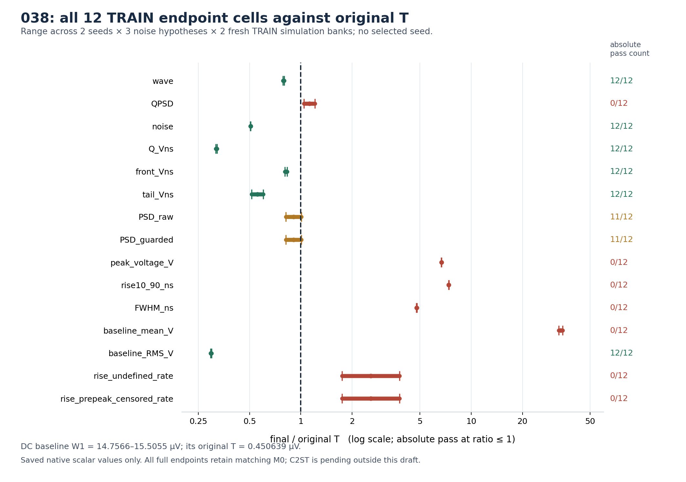
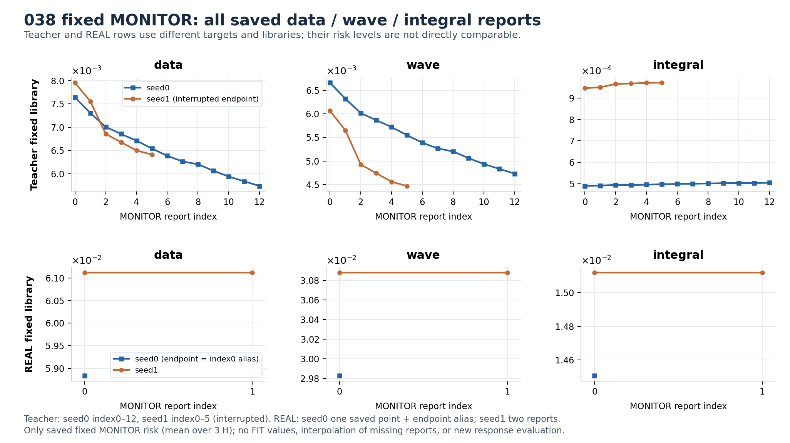
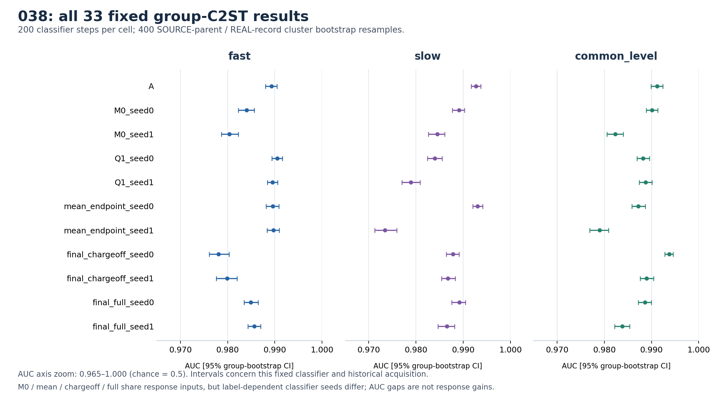

# 038 统一最终报告：主评价与 C2ST 补齐

编制：2026-10-18，依据原 resume02 主评价与已完成的 C2ST 补齐 JSON 回执统一汇总。原运行 exit 1 与补齐运行 exit 0 分别保留；本报告施工新增 SSH、CP 反序列化、NPZ 解码、NN、AD、优化更新、距离重算均为 **0**。原主评价草稿与公共摘要保留为不可变历史快照。

**038 在两个 REAL seed 上均未取得新增校准收益。** 两条 REAL 轨迹分别连续五个均值方向未接纳，接纳更新均为 0，随机阶段与电荷激活均未开启。两套 fresh TRAIN 库、两个 seed、三个噪声假设的全部 12 个终点单元，相对 matching M0 的 wave 改善为 **0%**；相对 A 的 **2.2197%–3.7369%** 改善全部随既有 M0 保留。科学状态为 `response_match_not_established`，统一科学接受为 false。

C2ST 补齐已保存全部 **33/33** 单元，native 状态为 `C2ST_SUPPLEMENT_COMPLETE`。原始及计数加权 AUC 均为 **0.97342–0.99377**，所有 95% 组 bootstrap 区间下界均高于 0.971；在当前固定分类器及同一历史采集的分组下，生成输出与 REAL 仍可被明显区分。该工程完成状态与响应模型的科学接受分别判断。

保存的所有 18 个 bank/seed/H 单元中，matching M0、mean_endpoint、final_chargeoff 与 final_full 的指标、异常分母、条件覆盖及组成敏感性汇总完全相同。这里的 **mean_endpoint 仍含冻结的非零 M0 随机形状头**，名称表示均值阶段终点，并非 deterministic mean-only 消融。因此本次证据支持“新增均值适配未被接纳、随机校准尚未执行”；随机模型的一般价值仍需其实际训练与消融证据。

## 保存完成度与证据口径

| 项目 | 已保存证据与实际状态 |
|---|---|
| 原 native | exit 1；`RESULT.native_status=INCOMPLETE_AFTER_PRIMARY_FINAL` |
| 主评价 | `PRIMARY_FINAL.json`、全部 99 份 FINAL 原生指标 JSON、fresh16 风险、教师恢复、013 SOURCE 干预、026 固定参数重权、REAL–REAL 均已保存 |
| 退出原因 | `038 stored ADC reconstruction changed classifier float32 inputs`，发生在 C2ST 入口存储重建一致性检查 |
| 原 C2ST | 原 PRIMARY_FINAL 的 classifier 计数仍为 0，原失败文件不改 |
| 补齐 C2ST | exit 0，`C2ST_SUPPLEMENT_COMPLETE`，33/33 分类器；仅从保存输出完成独立评价 |
| 末尾 A0/005 guard | 源码把最终 `state_digest` 检查放在 C2ST 后；原 native 未执行到此处，不能称原 native 全链完成 |
| 端点与轨迹 | 四端点已冻结；teacher1 始终保留服务器中断状态；四条轨迹完整训练=false |
| 收回完整性 | 原主评价 405 文件、666,597,010 字节；C2ST 补齐另 119 文件、10,231,706 字节，逐文件 SHA256 全通过 |
| 原成本 | 保存计数的下界：53 次 Adam 构造、912 个 FIT AD、17 个保留更新全部来自教师；REAL 保留更新 0。未知重启尾部工作不补记为完成 |

完整 `metrics.jsonl` 方向记录为 **52 条**：teacher0=29、teacher1=13、REAL0=5、REAL1=5。teacher0 的终点字段 `last_direction=30`，第 30 方向在 900 秒停止前已产生构造成本，却没有完整方向记录。53 次 Adam 构造与 52 条完整记录分别保留；不推测该部分方向最终试探或接纳。

原起点检查在 6,593 个 SOURCE 父事件、两 seed 和三 H 上记录 G0 与原 014/M0 的 pure/hard bitwise 一致，最大差均为 0；它说明包装起点保住原函数。此数值恒等回执与科学响应验收分别解释。

| 评价库 | SOURCE 父事件 × 每父抽样 | fake / REAL 行分母 | H / 比较状态 | 评价性质 |
|---|---:|---:|---|---|
| FINAL_TRAIN_0 | 6,593 × 4 | 26,372 / 21,047 | 3 H × 11 状态 | 冻结端点后的新随机库；原计数人口 |
| FINAL_TRAIN_1 | 6,593 × 4 | 26,372 / 21,047 | 3 H × 11 状态 | 第二套新随机库；相同历史采集人口 |
| FINAL_DEV | 512 × 4 | 2,048 / 599 | 3 H × 11 状态 | 已曝光 DEV；本次无调参，不构成新采集 |
| FINAL_RISK | 16 个 count-IID TRAIN 微库 | 按原 TRAIN_CHECK 构造 | 两 seed，三 H | fresh16 是有限模拟误差确认，非 16 套 DEV |

所有 FINAL 行保留。四次抽样来自同一个父事件时，不作为四个独立父事件。三个 H 分别为 fast、slow、common_level；本稿给出其完整范围，不挑 seed、噪声假设或 TRAIN 库。

## 同库 wave / QPSD / noise

A 是原 008 冻结的确定性纯信号 A0；M0 是 A0 加原 015 的非零、零 canonical-Q 随机形状头（保留原 014/010 组装）；Q1 是 matching M0 加原 016 终点的两参数正值、均值修正电荷涨落律，本轮仅作为既有冻结对照，未训练为 038 新候选；三者共用冻结 005 与同一硬观察链。

下表的 A、M0、Q1 均使用当前统一观察口径。`M0/mean/off/full` 按相同 seed 合并显示；其四个标签在 99 记录的完整汇总文件中分别保留。wave、QPSD、noise 为原冻结标准化下的不同原生距离，不相互代替。

| bank | H | 状态 | wave | QPSD | noise |
|---|---|---|---:|---:|---:|
| TRAIN_0 | fast | A | 0.15384655 | 0.05191761 | 0.12404548 |
| TRAIN_0 | fast | seed0 M0/mean/off/full | 0.15043165 | 0.05167016 | 0.12404548 |
| TRAIN_0 | fast | seed0 Q1 | 0.15044939 | 0.05217236 | 0.12404548 |
| TRAIN_0 | fast | seed1 M0/mean/off/full | 0.15020743 | 0.05326260 | 0.12404548 |
| TRAIN_0 | fast | seed1 Q1 | 0.15014038 | 0.05357017 | 0.12404548 |
| TRAIN_0 | slow | A | 0.15476877 | 0.04532119 | 0.12404548 |
| TRAIN_0 | slow | seed0 M0/mean/off/full | 0.15104903 | 0.05418937 | 0.12404548 |
| TRAIN_0 | slow | seed0 Q1 | 0.15103250 | 0.05415817 | 0.12404548 |
| TRAIN_0 | slow | seed1 M0/mean/off/full | 0.15086934 | 0.05512370 | 0.12404548 |
| TRAIN_0 | slow | seed1 Q1 | 0.15091455 | 0.05517107 | 0.12404548 |
| TRAIN_0 | common_level | A | 0.15455289 | 0.05317562 | 0.12404548 |
| TRAIN_0 | common_level | seed0 M0/mean/off/full | 0.14944218 | 0.05207223 | 0.12404548 |
| TRAIN_0 | common_level | seed0 Q1 | 0.14943634 | 0.05188191 | 0.12404548 |
| TRAIN_0 | common_level | seed1 M0/mean/off/full | 0.14937098 | 0.05311406 | 0.12404548 |
| TRAIN_0 | common_level | seed1 Q1 | 0.14933728 | 0.05318660 | 0.12404548 |
| TRAIN_1 | fast | A | 0.15442694 | 0.05142629 | 0.12432587 |
| TRAIN_1 | fast | seed0 M0/mean/off/full | 0.15054977 | 0.05022715 | 0.12432587 |
| TRAIN_1 | fast | seed0 Q1 | 0.15065729 | 0.04998973 | 0.12432587 |
| TRAIN_1 | fast | seed1 M0/mean/off/full | 0.15046206 | 0.05065573 | 0.12432587 |
| TRAIN_1 | fast | seed1 Q1 | 0.15048003 | 0.05070349 | 0.12432587 |
| TRAIN_1 | slow | A | 0.15548968 | 0.04560221 | 0.12432587 |
| TRAIN_1 | slow | seed0 M0/mean/off/full | 0.15121129 | 0.05385290 | 0.12432587 |
| TRAIN_1 | slow | seed0 Q1 | 0.15117158 | 0.05385512 | 0.12432587 |
| TRAIN_1 | slow | seed1 M0/mean/off/full | 0.15094488 | 0.05450697 | 0.12432587 |
| TRAIN_1 | slow | seed1 Q1 | 0.15090540 | 0.05451413 | 0.12432587 |
| TRAIN_1 | common_level | A | 0.15520053 | 0.05297246 | 0.12432587 |
| TRAIN_1 | common_level | seed0 M0/mean/off/full | 0.14981486 | 0.05133275 | 0.12432587 |
| TRAIN_1 | common_level | seed0 Q1 | 0.14978762 | 0.05129731 | 0.12432587 |
| TRAIN_1 | common_level | seed1 M0/mean/off/full | 0.14940090 | 0.05193800 | 0.12432587 |
| TRAIN_1 | common_level | seed1 Q1 | 0.14936476 | 0.05182656 | 0.12432587 |
| DEV | fast | A | 0.17478644 | 0.11061943 | 0.14105744 |
| DEV | fast | seed0 M0/mean/off/full | 0.17196500 | 0.10477093 | 0.14105744 |
| DEV | fast | seed0 Q1 | 0.17222405 | 0.10507316 | 0.14105744 |
| DEV | fast | seed1 M0/mean/off/full | 0.17198175 | 0.10720538 | 0.14105744 |
| DEV | fast | seed1 Q1 | 0.17209688 | 0.10781928 | 0.14105744 |
| DEV | slow | A | 0.17582149 | 0.10606235 | 0.14105744 |
| DEV | slow | seed0 M0/mean/off/full | 0.17238155 | 0.10377102 | 0.14105744 |
| DEV | slow | seed0 Q1 | 0.17236679 | 0.10092551 | 0.14105744 |
| DEV | slow | seed1 M0/mean/off/full | 0.17233634 | 0.10833910 | 0.14105744 |
| DEV | slow | seed1 Q1 | 0.17283317 | 0.10667128 | 0.14105744 |
| DEV | common_level | A | 0.17644499 | 0.11199382 | 0.14105744 |
| DEV | common_level | seed0 M0/mean/off/full | 0.17178226 | 0.10416057 | 0.14105744 |
| DEV | common_level | seed0 Q1 | 0.17190059 | 0.10422757 | 0.14105744 |
| DEV | common_level | seed1 M0/mean/off/full | 0.17191712 | 0.10820321 | 0.14105744 |
| DEV | common_level | seed1 Q1 | 0.17195608 | 0.10763791 | 0.14105744 |

## 积分、PSD、形态与负瓣距离

下表每个范围覆盖该 bank 的全部三 H；状态合并规则同上。物理标量列是 **W1 距离**，仅表示分布差异大小。峰高、上升时间或 FWHM 的 W1 值没有正负方向。

| bank | 状态 | Q W1 (V·ns) | front W1 (V·ns) | tail W1 (V·ns) | PSD W1 | peak W1 (V) | rise W1 (ns) | FWHM W1 (ns) | 负瓣面积 W1 (V·ns) |
|---|---|---:|---:|---:|---:|---:|---:|---:|---:|
| TRAIN_0 | A | 0.0447899–0.0451113 | 0.104842–0.105189 | 0.0217194–0.0239675 | 0.00354237–0.00418948 | 0.0367206–0.0367289 | 1.55512–1.55762 | 2.57569–2.57985 | 0.00166001–0.00317519 |
| TRAIN_0 | seed0 M0/mean/off/full | 0.0448655–0.0451889 | 0.0878882–0.0880651 | 0.0171443–0.0187147 | 0.00353583–0.00416941 | 0.0367641–0.0367728 | 1.56097–1.56401 | 2.455–2.45922 | 0.00376263–0.00600214 |
| TRAIN_0 | seed0 Q1 | 0.0448721–0.0452264 | 0.0876118–0.087758 | 0.0170962–0.018688 | 0.00354158–0.00417598 | 0.0367625–0.0367711 | 1.56132–1.56398 | 2.4553–2.45905 | 0.00376201–0.00600304 |
| TRAIN_0 | seed1 M0/mean/off/full | 0.0448316–0.0451641 | 0.0903726–0.0906164 | 0.0159565–0.0173248 | 0.00356917–0.0042453 | 0.0367329–0.036741 | 1.56116–1.56492 | 2.45901–2.46323 | 0.0039381–0.0061831 |
| TRAIN_0 | seed1 Q1 | 0.0448451–0.0451982 | 0.0902679–0.0904892 | 0.015927–0.0173134 | 0.00356727–0.00424669 | 0.0367313–0.0367392 | 1.56128–1.56495 | 2.45901–2.46298 | 0.00393842–0.00618334 |
| TRAIN_1 | A | 0.0443652–0.04492 | 0.104569–0.104974 | 0.0219318–0.0242467 | 0.00361709–0.00431877 | 0.036734–0.0367422 | 1.55539–1.55868 | 2.57083–2.57527 | 0.00155572–0.0030315 |
| TRAIN_1 | seed0 M0/mean/off/full | 0.0444072–0.0449634 | 0.0883459–0.0885479 | 0.0162456–0.0176209 | 0.00349366–0.00422719 | 0.0367947–0.0368023 | 1.56052–1.5631 | 2.46098–2.465 | 0.00366194–0.00594325 |
| TRAIN_1 | seed0 Q1 | 0.0444535–0.0450024 | 0.0883599–0.0885767 | 0.0162407–0.0175837 | 0.00349347–0.00423711 | 0.0367927–0.0368002 | 1.56037–1.563 | 2.46083–2.46475 | 0.00366319–0.00594392 |
| TRAIN_1 | seed1 M0/mean/off/full | 0.0444302–0.0449801 | 0.0888361–0.0890841 | 0.0167864–0.0184143 | 0.00358881–0.00430045 | 0.0368248–0.0368321 | 1.5621–1.56567 | 2.4554–2.45852 | 0.00393283–0.00621977 |
| TRAIN_1 | seed1 Q1 | 0.0444532–0.0450178 | 0.0889537–0.0891945 | 0.016791–0.0184435 | 0.00358733–0.00430159 | 0.0368227–0.0368302 | 1.56253–1.56596 | 2.45544–2.45855 | 0.00393443–0.00621973 |
| DEV | A | 0.236971–0.238406 | 0.190791–0.191068 | 0.0562841–0.0581036 | 0.00405529–0.00501487 | 0.0360615–0.0360755 | 1.54254–1.54419 | 2.71392–2.71665 | 0.00181897–0.00344347 |
| DEV | seed0 M0/mean/off/full | 0.237007–0.238406 | 0.177609–0.177888 | 0.0540762–0.0554016 | 0.0039279–0.00410506 | 0.0360507–0.036063 | 1.54958–1.55333 | 2.61303–2.61674 | 0.00419465–0.00629067 |
| DEV | seed0 Q1 | 0.236801–0.238098 | 0.17735–0.177566 | 0.053979–0.0553454 | 0.00391544–0.00412256 | 0.0360626–0.0360758 | 1.54957–1.55343 | 2.61271–2.61661 | 0.00419539–0.00628977 |
| DEV | seed1 M0/mean/off/full | 0.237008–0.238463 | 0.178842–0.179153 | 0.0513268–0.0524178 | 0.00377745–0.00397485 | 0.0361085–0.0361211 | 1.54761–1.54927 | 2.60981–2.61353 | 0.00445808–0.00658179 |
| DEV | seed1 Q1 | 0.23692–0.238316 | 0.178714–0.178986 | 0.0512188–0.0523443 | 0.00376912–0.0039628 | 0.0361159–0.0361298 | 1.54752–1.54961 | 2.6098–2.61373 | 0.00445701–0.0065786 |

负瓣按同处理 REAL 的面积分布距离单列，波形未因负电压被截零。覆盖全部三 H、两 TRAIN 及 DEV，A 的负瓣距离为 0.00155572–0.00344347 V·ns，M0/final 为 0.00366194–0.00658179 V·ns；各对应单元相对 A 均变大。因此相对 A 的 wave 局部收益并未同时带来负瓣距离改善。

有符号形态残差另用已保存的 output-Q 分箱行数和均值汇总：`fake 定义人口均值 − REAL 定义人口均值`。这不是重算 W1，也不是配对逐事件误差。

| 观测量 | full，2 TRAIN × 2 seed × 3 H（12 单元） | full，DEV × 2 seed × 3 H（6 单元） |
|---|---:|---:|
| Q_Vns | -0.03063546 … -0.0295697 | -0.02205909 … -0.0211816 |
| front_Vns | -0.02842659 … -0.02663384 | +0.004117229 … +0.005736727 |
| tail_Vns | -0.003329632 … -0.001948224 | -0.02747092 … -0.02552006 |
| PSD_raw | +0.002638756 … +0.003367898 | -0.0004290007 … +0.0005840357 |
| peak_voltage_V | +0.0205883 … +0.02067495 | +0.02237354 … +0.02258735 |
| rise10_90_ns | +1.450712 … +1.456059 | +1.423338 … +1.428361 |
| FWHM_ns | -0.5366972 … -0.5182136 | -0.520676 … -0.5057856 |

保存均值表明：TRAIN 的 full 峰高均值偏高约 20.59–20.67 mV、rise 均值偏长约 1.451–1.456 ns，FWHM 均值偏短约 0.518–0.537 ns。FWHM W1 同时约 2.46 ns，二者分别描述整体分布差异与均值方向，不能写成“W1 显示 FWHM 偏长”。这些残差仍与 matching M0 相同，现有结果不足以把它们归因到某一个 STE 环节或证明整个时间变形族不可表达。

条件分箱全部为输出观测 Q 分箱，TRAIN/DEV 每状态均 8/8 支持、最低支持要求为每域 16 行；它不把 SOURCE 的 Q/h 或形状分层当作 REAL 事件真值。条件宽度仅作保存标量的描述：

| 量 | TRAIN：fake/REAL 条件 std 范围；支持单元 | DEV：fake/REAL 条件 std 范围；支持单元 |
|---|---|---|
| PSD_raw | 0.87407–1.1474；96/96 | 0.91225–1.1769；48/48 |
| rise10_90_ns | 0.16106–2.643；96/96 | 0.15224–2.4166；48/48 |
| FWHM_ns | 0.44215–2.4776；96/96 | 0.44093–2.0142；48/48 |

## 原 15 个正 T：相对非劣与绝对验收分别报告

正 T 直接取原 `PRIMARY_FINAL` 内嵌的执行时标定值，输入 pin 为 `f33217e07b1872dfd51f56e86ed30cda665a705568f2f9ada937865d8a33607b`；没有替换成同名本地文件。原终点的相对非劣口径是 `final − reference ≤ T`，绝对口径是 `final ≤ T`。训练提案使用更紧的增量门，二者分开。

| 正 T 指标 | TRAIN final/T（12 单元） | TRAIN 绝对通过 | TRAIN 非劣 A / M0 | DEV final/T（6 单元） | DEV 绝对通过 |
|---|---:|---:|---:|---:|---:|
| wave | 0.78395–0.79928 | 12/12 | 12/12 / 12/12 | 0.90157–0.91306 | 6/6 |
| QPSD | 1.0405–1.2086 | 0/12 | 12/12 / 12/12 | 2.1705–2.3754 | 0/6 |
| noise | 0.50603–0.50717 | 12/12 | 12/12 / 12/12 | 0.57543–0.57543 | 6/6 |
| Q_Vns | 0.31704–0.32262 | 12/12 | 12/12 / 12/12 | 1.6921–1.7025 | 0/6 |
| front_Vns | 0.8063–0.83123 | 12/12 | 12/12 / 12/12 | 1.6294–1.6429 | 0/6 |
| tail_Vns | 0.5129–0.6026 | 12/12 | 12/12 / 12/12 | 1.6498–1.7822 | 0/6 |
| PSD_raw | 0.81558–1.0047 | 11/12 | 12/12 / 12/12 | 0.88183–0.96262 | 6/6 |
| PSD_guarded | 0.81558–1.0047 | 11/12 | 12/12 / 12/12 | 0.88183–0.96262 | 6/6 |
| peak_voltage_V | 6.6789–6.6969 | 0/12 | 12/12 / 12/12 | 6.5548–6.5675 | 0/6 |
| rise10_90_ns | 7.369–7.4028 | 0/12 | 12/12 / 12/12 | 7.3086–7.3434 | 0/6 |
| FWHM_ns | 4.7685–4.8056 | 0/12 | 12/12 / 12/12 | 5.0682–5.1015 | 0/6 |
| baseline_mean_V | 32.746–34.408 | 0/12 | 12/12 / 12/12 | 41.803–41.803 | 0/6 |
| baseline_RMS_V | 0.29499–0.29901 | 12/12 | 12/12 / 12/12 | 0.2541–0.2541 | 6/6 |
| rise_undefined_rate | 1.7469–3.7901 | 0/12 | 11/12 / 12/12 | 2.1143–4.9357 | 0/6 |
| rise_prepeak_censored_rate | 1.7469–3.7901 | 0/12 | 11/12 / 12/12 | 2.1143–4.9357 | 0/6 |

每个 bank 含 2 seed × 3 H × 15=90 项正 T 判断：TRAIN_0 绝对失败 **42/90**，TRAIN_1 **44/90**，DEV **60/90**。TRAIN 的波形绝对门通过 12/12，QPSD 绝对门通过 0/12；峰高、rise、FWHM、baseline_mean、rise 未定义率与前峰截尾率均通过 0/12。2% 同时优于 A 与 matching M0 为 0/12。

相对 A 还有明确的异常率代价：TRAIN_1 的 seed0/common_level 中，rise 未定义率和 rise 前峰截尾率各未过一项相对非劣门；DEV 的 seed1 三 H 中，这两项各有三项失败。相对 matching M0 全部 180/180 个 TRAIN 正 T 非劣判断通过，原因是终点保留原 M0。

baseline_mean 的绝对 W1 距离为 **14.7566–15.5055 µV**，而 T 为 **0.450639 µV**，故出现 32.746–34.408 倍；DEV 为 18.8382 µV、41.803 倍。较大倍数与较小绝对电压同时给出。当前信号 prefix100 固定为零、005 冻结、所有状态共享 prefix，均值 timewarp 不能改变该项。它按原工单单列为噪声/DC 边界，本次补齐不重启 005、不放宽 T。

此图与下方固定 MONITOR 图复用原主评价快照。图内 “C2ST is pending outside this draft” 为原运行的历史注记；本次补齐的完成状态、计数和结果见后文 C2ST 专节。

七个 null T 域原样保留为未标定：`Q_nonpositive_rate`、`PSD_undefined_rate`、`PSD_guarded_rate`、`FWHM_undefined_rate`、`temporal_nonpositive_peak_rate`、`FWHM_prepeak_censored_rate`、`FWHM_postpeak_censored_rate`。零计数也不把这些域改写为通过物理容差。负瓣面积另有增量检查，不计入原七个 null T。

## 异常、裁窗、截尾和定义人口

下表为 full 的全部 seed/H 范围；每次均保留原总人口分母。matching M0、mean、chargeoff 的分母与 full 一致；A 和 Q1 的各状态完整计数也保留在 readback 的 99 个记录中。

| bank | rise 未定义 / 前峰截尾：fake | REAL | rise 定义行：fake / REAL | FWHM 定义行：fake / REAL |
|---|---|---|---|---|
| TRAIN_0 | 296–316/26372 | 94/21047 | 26056–26076/26372；20953/21047 | 26372/26372；21042/21047 |
| TRAIN_1 | 264–315/26372 | 94/21047 | 26057–26108/26372；20953/21047 | 26372/26372；21042/21047 |
| DEV | 24–30/2048 | 3/599 | 2018–2024/2048；596/599 | 2048/2048；599/599 |

所有 FINAL 状态中，Q、front、tail、PSD、peak、baseline mean/RMS 的定义人数均等于总人数；rise 使用上表保留的定义人口。TRAIN 的 REAL FWHM 未定义/前峰截尾为 5/21,047，fake 为 0/26,372；DEV 为 fake 0/2,048、REAL 0/599。rise 的未定义记录全部由前峰截尾计入；`rise_other_undefined`、FWHM postpeak/other 未定义均为 0/原分母。

已保存的全部 fake 状态中，`peak_at_search_boundary`、`global_peak_outside_search`、`selected_peak_below_global_crop_max`、Q 非正、PSD undefined/guarded、temporal nonpositive peak 均为 0/各自原总行数。ADC rail 与 preADC out-of-range 存在稀有非零记录，二者在每个对应单元的计数相同：

| bank | A：rail / out-of-range | seed0 M0/Q1/mean/off/full | seed1 M0/Q1/mean/off/full |
|---|---|---|---|
| TRAIN_0，全部三 H | 各 0/26,372 | 各 0/26,372 | 各 **1/26,372** |
| TRAIN_1，全部三 H | 各 0/26,372 | 各 **1/26,372** | 各 **1/26,372** |
| DEV，全部三 H | 各 0/2,048 | 各 0/2,048 | 各 0/2,048 |

这些是各状态/假设的重复计数，不能把它们相加称为新增独立事件数。REAL 的可观测 crop/时间标记按原 JSON 保留；REAL 的 `pre_ADC_out_of_range`、`ADC_halfgrid_tied`、`ADC_rail_hit`、`ADC_halfgrid_min_distance`、`ADC_halfgrid_tie_cells` 保持 **unknown**，不能由 fake 计数推成实测零碰轨。

## 固定 MONITOR、拒绝轨迹与 fresh16

| REAL 轨迹 | 完整方向 | 幅度试探 | 初始信赖域通过且进入硬评价 | native 检查全过 | 逐 H energy 合取通过 | 至少一个 energy lower3MCSE > 0 |
|---|---:|---:|---:|---:|---:|---:|
| REAL_seed0 | 5 | 20 | 15 | 9/15 | 0/15 | 4/15 |
| REAL_seed1 | 5 | 20 | 15 | 11/15 | 0/15 | 11/15 |

两 REAL 共 30 个合法幅度候选完成硬评价，其中 20 个 native 全过，但逐 H energy 合取通过均为 0。15 个候选至少有一个按原内部规则可分辨的不利 energy 单元，余下未得到联合下降支持。候选共享父事件与检查库，以上是保存记录的描述统计，不作为 30 次独立检验。该结果也不能证明不存在其他可行下降方向。

REAL0 的固定 MONITOR 只有原始 index0，终点显式别名复用同一未更新模型；REAL1 的 initial/end 两条 MONITOR 风险完全一致。把不同方向刷新的 FIT loss 连成收敛曲线会混入批变化。

图保留 teacher0 的全部 13 条、teacher1 的全部 6 条、REAL0 的 1 条原始记录及其 index0 终点别名、REAL1 的 2 条记录。教师和 REAL 使用不同目标分布与固定库，图中两行的绝对风险不可横比；不同 seed 的固定库也不作为排名依据。仅连接各自已有的 MONITOR 记录，没有混入 FIT 或为中断后补点。

fresh16 的两 seed、三 H、`full−M0` 与 `full−mean_endpoint`，data、wave 及 integral 的配对差均为 0、MCSE 均为 0；原严格改善门未通过。其含义是冻结端点与参照相同；有限模拟 MCSE 不是实验不确定度，也未产生新增独立采集证据。

## 已知教师：边缘进展与条件恢复分别判断

| 教师学习器 | 保存均值接纳 / 完整方向 | 停止状态 | 固定 MONITOR data 起点 → 终点 | 固定 MONITOR wave 起点 → 终点 | 固定 MONITOR integral 起点 → 终点 | exact all64 mean NRMSE | exact Q 方差相对 RMS | exact 协方差相对 Frobenius |
|---|---|---|---:|---:|---:|---:|---:|---:|
| seed0 | 12 / 29 | 900s 预算停止；方向30无完整记录 | 0.00763986 → 0.00573903 | 0.00666162 → 0.00473047 | 0.00048912 → 0.00050428 | 0.02503245 | 1 | 0.30962544 |
| seed1 | 5 / 13 | 服务器中断；端点保留 | 0.00795450 → 0.00641198 | 0.00606277 → 0.00446865 | 0.00094586 → 0.00097166 | 0.02555558 | 1 | 0.87567238 |

固定 MONITOR 的教师边缘 data/wave risk 下降，同时两 seed 的 integral 分量首末均上升（data=wave+2×integral）；这呈现该固定库内的分量取舍，绝对风险仍按教师内部 TRAIN 报告库解释。exact preADC 的 all64 与六个 template×Q 层均保留：每个层父事件数依次为 13、11、8、13、11、8。两 seed 的 mean NRMSE 各层都不超过 0.03；Q 方差相对 RMS 全为 1.0（门为 ≤0.15），协方差相对 Frobenius 全超过 0.20。因此七个层各自的联合恢复通过均为 0/7。电荷均处于关闭状态，条件电荷方差未恢复；teacher1 的完整资格还受中断状态限制。

固定 MC 为 16 个 heldout 父事件 × 每父 256 次＝4,096 行/seed/state，用于核对每个模型自身的解析矩。learner 的 `MC.Q_variance_relative_RMS` 约 10⁻²⁶ 是对自身近零条件方差的数值一致性，不能替代对教师条件方差的恢复。`hard_without005_Q_std≈1.947` 是混合多个父事件后的总体 Q 标准差，包含父事件间 Q 差；不能当逐父条件方差。MC 不作为条件 gate，exact moments 才用于上述恢复判断。

## 013 内容干预、026 人口敏感性与 REAL–REAL

013 按原序使用全部 121 对 TRAIN 同 Q 异形 SOURCE，无新 PCA、无输出挑选、ID 仅检索。prepared384 对比和固定 PC1 对比均为 121/121 非零。matching M0 与各对应终点的均值差、协方差差及同 latent 输出差汇总相同：

| 状态 | 均值差 RMS (V)：min / median / max | 协方差差 Frobenius (V²)：min / median / max | CRN 输出差 RMS (V)：min / median / max |
|---|---:|---:|---:|
| M0_seed0 | 0.00138992 / 0.00612502 / 0.0157375 | 2.90146e-05 / 0.000315409 / 0.00265837 | 0.00126781 / 0.00634191 / 0.0155394 |
| M0_seed1 | 0.00138992 / 0.00612502 / 0.0157375 | 3.19811e-05 / 0.00030863 / 0.00265618 | 0.00129936 / 0.00619529 / 0.0171582 |
| Q1_seed0 | 0.00138992 / 0.00612502 / 0.0157375 | 2.92194e-05 / 0.000315298 / 0.0026578 | 0.00126096 / 0.00637423 / 0.0154805 |
| Q1_seed1 | 0.00138992 / 0.00612502 / 0.0157375 | 3.20486e-05 / 0.000308763 / 0.00265605 | 0.00129076 / 0.00620792 / 0.0171658 |

以上内容依赖证据支持模型使用了 SOURCE 内容差异。每对只用一组共同 latent；它不提供 REAL 逐事件配对、粒子真值或唯一硬件响应。

026 使用固定参数输出及原始 SOURCE 父权重 `1±0.2(2h−1)`，归一后单列 nominal/low_h/high_h 的标量、异常率、定义权重质量与父事件 ESS。下表的均值 Q 变化覆盖全部 H；参数没有随人口假设重训。

| 评价库 / 状态 | low_h 相对 nominal 的均值 Q 变化 | high_h 相对 nominal 的均值 Q 变化 | 父事件 ESS：nominal / low_h / high_h |
|---|---:|---:|---|
| TRAIN_0 / A | +7.48118% … +7.48236% | -6.41275% … -6.41173% | 6593.000 / 6342.971 / 6407.478 |
| TRAIN_0 / M0_seed0 | +7.48121% … +7.48237% | -6.41275% … -6.41176% | 6593.000 / 6342.971 / 6407.478 |
| TRAIN_0 / M0_seed1 | +7.48120% … +7.48242% | -6.41279% … -6.41175% | 6593.000 / 6342.971 / 6407.478 |
| TRAIN_0 / Q1_seed0 | +7.48059% … +7.48175% | -6.41222% … -6.41122% | 6593.000 / 6342.971 / 6407.478 |
| TRAIN_0 / Q1_seed1 | +7.48078% … +7.48200% | -6.41244% … -6.41139% | 6593.000 / 6342.971 / 6407.478 |
| TRAIN_1 / A | +7.47967% … +7.48057% | -6.41121% … -6.41044% | 6593.000 / 6342.971 / 6407.478 |
| TRAIN_1 / M0_seed0 | +7.47969% … +7.48063% | -6.41126% … -6.41046% | 6593.000 / 6342.971 / 6407.478 |
| TRAIN_1 / M0_seed1 | +7.47952% … +7.48046% | -6.41111% … -6.41031% | 6593.000 / 6342.971 / 6407.478 |
| TRAIN_1 / Q1_seed0 | +7.47939% … +7.48031% | -6.41099% … -6.41020% | 6593.000 / 6342.971 / 6407.478 |
| TRAIN_1 / Q1_seed1 | +7.47928% … +7.48022% | -6.41091% … -6.41010% | 6593.000 / 6342.971 / 6407.478 |
| DEV / A | +7.19631% … +7.20291% | -6.15918% … -6.15354% | 512.000 / 492.693 / 497.739 |
| DEV / M0_seed0 | +7.19675% … +7.20329% | -6.15951% … -6.15392% | 512.000 / 492.693 / 497.739 |
| DEV / M0_seed1 | +7.19645% … +7.20311% | -6.15935% … -6.15366% | 512.000 / 492.693 / 497.739 |
| DEV / Q1_seed0 | +7.20033% … +7.20690% | -6.16260% … -6.15698% | 512.000 / 492.693 / 497.739 |
| DEV / Q1_seed1 | +7.19875% … +7.20537% | -6.16129% … -6.15563% | 512.000 / 492.693 / 497.739 |

该结果量化固定模型输出对人口组成的敏感性；不同人口下重新拟合后的参数稳定性仍为未建立。h 不作为 REAL 标签。未定义标量按各自定义人口与权重质量保留，没有补零或变更计数人口。

新 REAL–REAL 比较使用同一历史采集的 211/211 个原记录组、组交集 0；两侧为 10,520/10,527 行。其 wave / QPSD / noise 为 **0.024381568 / 0.026326579 / 0.021846773**；既有参考为 **0.029421917 / 0.024070024 / 0.024362510**（原参考每侧 10,475 行、210 组）。它是记录组分离的内部诊断，没有重标定物理 T，也不构成跨采集硬件复用验证。

## C2ST 补齐：工程证明范围与独立计数

原 ADC 存储重建检查在 99/99 份 FINAL JSON 中都保存 `bitwise=false`、`classifier_float32_bitwise=false`，最大电压差均为 `1.1102230246251565e−16 V`。这些原标记完整保留，不能因为补齐成功改写成原运行重建通过。

另存工程探针核实：完整 16,384 点 ADC 码网格中，CPU 与原设备的 float64 算法有 1,280 点舍入差异；补齐用原设备的 eager `code/16383`、再单独 `−0.5` 建 LUT，随后减去原保存的 baseline mean。全部 26,372 行 prefix 均值按原 128 行分块（尾块 4 行）逐位一致，全部 33×32＝1,056 条已存示例的 float64 波形、float32 分类器输入及 baseline100 检查通过。原完整人口的波形字节并未全部保存，工程回执明确不宣称直接穷尽原波形重放。探针本身 CP/NN/AD/optimizer 均为 0；未重训响应、未重算 FINAL。

原 A0/005 末尾 `state_digest` guard 位于原 C2ST 后，原运行没有执行到；补齐没有重载响应 CP 去模拟该检查，其状态仍为 **未到达、未重跑、未宣称通过**。teacher1 的 `SERVER_INTERRUPTED` 及 `all_four_tracks_complete=false`、`full_teacher_qualification_established=false`、`unified_scientific_acceptance_established=false` 是本轮历史结果，随补齐原样保留。

| 计数范围 | Adam / AD | 前向 / 抽样等 | 保留或累计口径 |
|---|---:|---|---|
| 原响应训练 | 53 次方向 Adam 构造 / 912 FIT AD | 拒绝方向仍计成本 | 教师保留 17，REAL 保留 0；legacy 累计 199,722 不变 |
| 原 PRIMARY_FINAL 中 classifier 字段 | 0 / 0 | 分类器前向、bootstrap、完成数均 0 | 历史 `execution_counts` 原样保留 |
| C2ST 补齐独立 `classifier_execution_counts` | **6,600 / 6,600** | **11,517** 次前向、**1,471,173** 行、**13,200** 次 bootstrap | 33 个分类器，每个固定 200 步；不加到 response 或 legacy |
| 相对先前 200 步启动快照的增量 | **6,400 / 6,400** | 11,168 次前向、1,426,592 行、12,800 次 bootstrap | 新完成 32 单元；仅补 classifier 计数 |
| 既有人工工程自检 | 4 次 Adam / 7 AD | 人工代数和控制器自检 | 与科学训练和 classifier 分开 |
| 本次统一报告施工 | 0 / 0 | 无模型或数据重放 | 仅保存 JSON 的静态汇总 |

补齐实际读取 33 份已保存 ADC NPZ、1 份公共 prefix NPZ 和 1 份 TRAIN 数据 NPZ；这是补齐运行的既有成本。本次报告没有再次解码这些文件。补齐 RESULT 同时保留原 `execution_counts` 和新的 `classifier_execution_counts`，没有将两者混成响应训练更新。

## 全部 33 个 group C2ST 单元

固定 `classifier256` 使用 256 点输入、原 TRAIN 标准化、Conv1d8/16+MLP32；每单元 Adam 200 步、LR=0.001、batch=128，不择优分类器或调整响应。SOURCE 按原父事件、REAL 按原记录组约 60/40 拆分：SOURCE train/test 为 15,820/10,552 行，REAL 为 12,618/8,429 行；测试集含 2,638 个 SOURCE 父组及 169 个 REAL 原记录组。每单元做 400 次分开重采 SOURCE 父组和 REAL 原记录组的 cluster bootstrap。

下表给出保存的 AUC [95% percentile CI]；原始与计数加权结果及区间在全部 33 单元中相同。区间是在既定分类器、当前分组和同一历史采集下的抽样范围，不覆盖初始化变化、独立采集或硬件因果不确定性。

| 响应标签 | fast | slow | common_level |
|---|---:|---:|---:|
| A | 0.989272 [0.988031, 0.990413] | 0.992729 [0.991678, 0.993753] | 0.991207 [0.989902, 0.992391] |
| M0_seed0 | 0.984005 [0.982260, 0.985651] | 0.989105 [0.987694, 0.990271] | 0.990099 [0.988910, 0.991294] |
| M0_seed1 | 0.980337 [0.978650, 0.982221] | 0.984550 [0.982645, 0.986067] | 0.982289 [0.980532, 0.984013] |
| Q1_seed0 | 0.990528 [0.989384, 0.991616] | 0.984005 [0.982388, 0.985503] | 0.988207 [0.986925, 0.989570] |
| Q1_seed1 | 0.989511 [0.988381, 0.990599] | 0.978866 [0.977027, 0.980835] | 0.988744 [0.987421, 0.990069] |
| mean_endpoint_seed0 | 0.989536 [0.988158, 0.990839] | 0.993019 [0.992012, 0.994118] | 0.987204 [0.985802, 0.988676] |
| mean_endpoint_seed1 | 0.989690 [0.988377, 0.990941] | 0.973417 [0.971248, 0.975950] | 0.978994 [0.976904, 0.980908] |
| final_chargeoff_seed0 | 0.978073 [0.976074, 0.980299] | 0.987829 [0.986404, 0.989119] | 0.993769 [0.992813, 0.994591] |
| final_chargeoff_seed1 | 0.979865 [0.977590, 0.982017] | 0.986747 [0.985376, 0.988285] | 0.988961 [0.987601, 0.990409] |
| final_full_seed0 | 0.984867 [0.983462, 0.986457] | 0.989155 [0.987567, 0.990498] | 0.988610 [0.987217, 0.989950] |
| final_full_seed1 | 0.985637 [0.984281, 0.986997] | 0.986568 [0.984662, 0.988143] | 0.983798 [0.982205, 0.985371] |

matching M0、mean_endpoint、final_chargeoff 与 final_full 的同 seed 响应输入相同，但原分类器种子为 `stream_seed(seed0, 'C2ST', label, H)`，含响应标签。上述相同输入因此会产生不同分类器初始化、小批流和 bootstrap 流；它们的 AUC 差异不能归为响应改进，也不据此选择一个最低 AUC 标签。图表保留原标签顺序和全部单元。

C2ST 与 REAL–REAL 都属于同一历史采集内部的分组证据。C2ST 显示当前观察域仍存在可辨差异；RR 则量化原记录组之间的内部差异。二者不重标定物理 T，不提供 REAL 逐事件条件真值，也不升级为跨采集硬件响应验证。

## 原工单问题的当前答案

| 问题 | 由本次保存证据支持的答案 |
|---|---|
| 新起点是否保住原解 | 是；G0 原函数恒等回执通过，最终 REAL 零接纳保留 matching M0 |
| 平均形态是否实际改善 | 相对 matching M0 改善 0%；保存的系统形态残差仍在 |
| 随机分支是否带来新增收益 | 本次未开启随机阶段；现有 mean/full/off 均含相同 M0 随机头，新增校准收益未建立 |
| 独立 TRAIN 检查库是否支持下降 | REAL 两 seed 均无接纳；fresh16 差为 0，严格下降未建立 |
| 输入内容依赖是否成立 | 013 的 121 对 SOURCE CRN 对比成立；范围为 SOURCE 内容使用 |
| 哪些假设影响解释 | 三 H 均报告；026 固定输出人口敏感性保留；005/DC 边界、七 null T、无 REAL 条件真值及同采集范围分别明记 |
| C2ST 是否补齐 | 33/33、exit 0；AUC 0.97342–0.99377，当前生成/REAL 仍可辨；相同输入的标签差异不归为响应收益 |
| 科学接受 | false；完整 response match 未建立，教师条件恢复与绝对形态/QPSD/DC 等门仍未通过 |

原主评价与 C2ST 补齐证据现已汇合。原工单 4.2 的[有限 REAL TRAIN 观测域波形族设计](../../docs/RESPONSE038_TRAIN_FAMILY_DESIGN_20261018.md)已具体化，目前只完成设计准备，未实现、未登记、未执行。现有零接纳和一致残差支持先检查所定义波形族的描述能力与求解方向；它们尚未辨别 STE 根因，也未证明完整非线性族不可表达。

## 可追溯文件

- [最终 C2ST 安全摘要](FINAL_C2ST_PUBLIC_SUMMARY.json)：33 个 AUC/组区间与安全计数、工程证明范围、旧 false 标记、原 response 与新 classifier 分账、逐结果 SHA；不含权重、预测、事件身份或私有数组。
- [C2ST 收回验证](../../receipts/response038_20261017/resume_20261018_01/wake_20261018_0245_01/COLLECTION_VERIFICATION.json)、[C2ST 补齐 COMPLETE](../../receipts/response038_20261017/resume_20261018_01/wake_20261018_0245_01/collected_c2st/c2st_storage_repair01/classifiers_01/COMPLETE.json)。
- [原主评价公共紧凑摘要](PRIMARY_PUBLIC_SUMMARY.json)（原 C2ST 为 0 的不可变快照）：保留 99 坐标的原生标量、全部异常和定义人口分母、unknown、15 正 T/7 null T、门统计、教师/轨迹/固定 MONITOR、013 聚合、026 全三 H 的 ESS/均值变化聚合及 REAL–REAL；省略逐状态的大块重复 Q 分箱和组成明细。
- 完整 `PRIMARY_SCIENTIFIC_READBACK.json` 原件（11,204,245 字节）仅在 E 盘本地可用，未纳入公共发布包；其 SHA256 为 `8b504c656102212692a9c066a8b7645f14eae8af48cfd217c2f8f1cb125545b4`。完整条件分箱、组成明细和逐输入 JSON/JSONL SHA 保留于该原件，未删改。
- [原主评价](../../receipts/response038_20261017/resume_20261018_01/wake_20261018_0200_01/collected_resume02/run_01/PRIMARY_FINAL.json)、[原失败回执](../../receipts/response038_20261017/resume_20261018_01/wake_20261018_0200_01/collected_resume02/run_01/FAILED.json)、[原端点冻结](../../receipts/response038_20261017/resume_20261018_01/wake_20261018_0200_01/collected_resume02/run_01/ENDPOINTS_FROZEN.json)。
- [原整体修复工单](../../receipts/response038_20261017/user_materials_01/IMPLEMENTATION_PLAN.md)、[038 调研与后续规划](../../docs/RESPONSE038_RESEARCH_PLAN_20261018.md)。

统一报告静态交付检查：33/33 单元 RESULT 与 aggregate、supplement 完全一致；原草稿、公共摘要与完整 READBACK 的 SHA 未变；99/99 FINAL 指标坐标齐全；全部两 seed×三 H×两 TRAIN 库已覆盖；18/18 matching 端点汇总等价；15 正 T/7 null T 与所有原生异常和定义人口分母已保留。报告不导出 SOURCE ID 列表、逐事件观测或私有波形。
