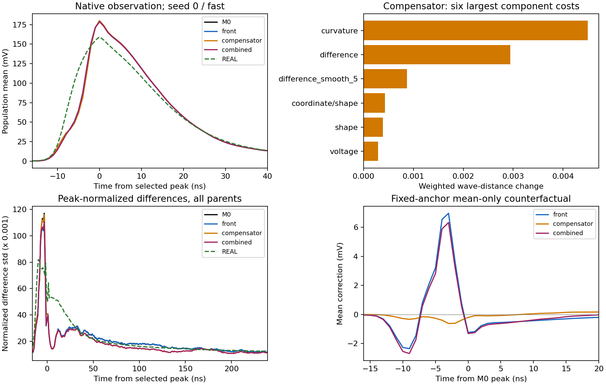

# 041 前沿与补偿机制诊断

诊断已完成并核验；未选择模型，平均响应和完整随机响应尚未验收。原生用时 139.49 秒，退出码 0。86 个产物的字节数和 SHA256 全部一致，6 组旧设置逐指标零差重放，24 组完整人口读出与分解闭合。

补偿器单独造成的 wave 增量中，一阶差分与曲率占 70.48%–76.35%；两种子、三个 H 均如此。该补偿器主要改变尾部负面积，而 front 的新增负面积主要落在裁窗的峰前 [0,16)。这支持更局部的修正试验，尚不能把差分代价唯一归因为某个物理噪声机制。

|种子|H|front wave 收益|组合 wave 收益|补偿器差分/曲率占比|
|---|---|---:|---:|---:|
|0|fast|2.831%|-5.311%|76.35%|
|0|slow|2.656%|-6.476%|75.37%|
|0|common_level|2.716%|-7.493%|70.48%|
|1|fast|2.989%|-4.783%|76.35%|
|1|slow|2.908%|-6.053%|75.39%|
|1|common_level|2.839%|-6.728%|71.74%|

front 的均值阶段负面积总量略减，加入原 M0 随机项及电子噪声后转为增加；ADC 和重选峰对该 W1 增量的贡献较小。这里是固定顺序的反事实差分，REAL 的 ADC 前真值未知，不能把相应 W1 改变量称为独立因果效应。

front 新增缺失前沿为每格 3–8/6593 个，同时恢复 23–41 个；所有事件及未定义掩码保留。负面积增加分散于人口，最大约1%行只占正增量的14%–16%，不能归咎于几个离群点。

下一项最小试验：保留原前沿时间修正，以每个输入事件在载体 [100,112) 的均值面积损失确定平滑峰前补回量，在 [126,158) 平滑扣回其 canonical-Q 份额；附加修正仅作用于 [100,158]，不重采样尾部。冻结少量补回比例和两种前沿幅度，以原合同和新随机库评价。该补回是待验证的有效响应参数化，不预先视为真实电路机制。

原 A0/M0/005、全部6593 SOURCE与21047 REAL、身份、权重、读出、阈值保留。零 AD/优化更新，未打开 DEV。图中 fast/seed0 仅作展示，结论使用全部六格。

