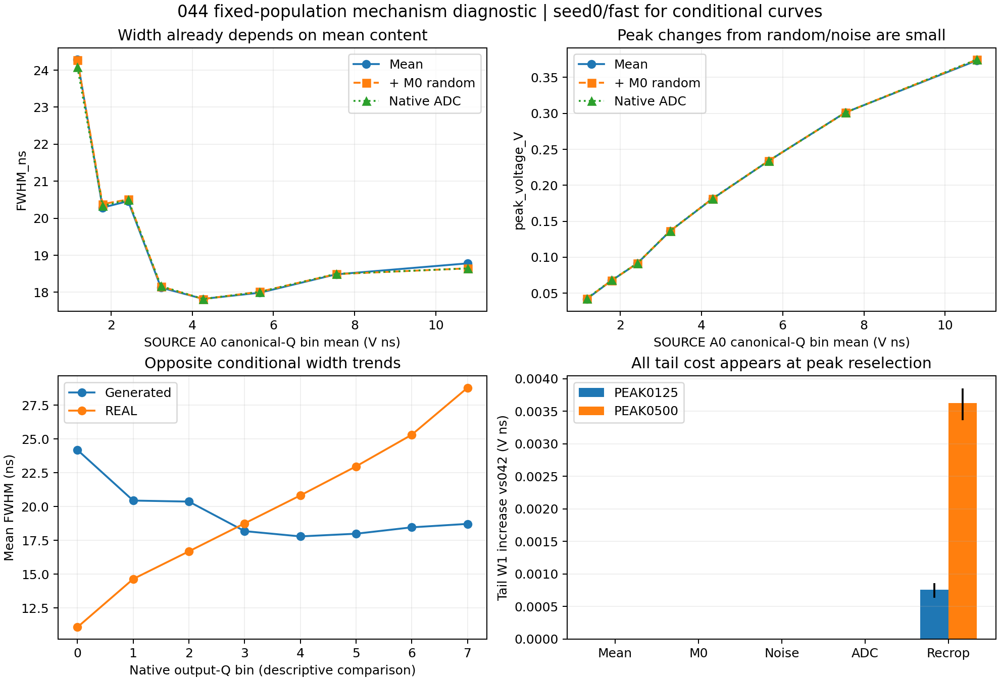

# 044：尾部代价来自重选峰，条件宽度失配已存在于均值

24个完整原生报告精确重放，18组行级数组与90个阶段摘要复算通过。所有6593 SOURCE与21047 REAL及未定义指标保留；6CP、1TRAIN、1PCA，0DEV/AD/优化更新。

在全部12个非零扩散诊断格中，固定042锚点时，均值、M0随机项、电子噪声及ADC四阶段的逐事件尾积分变化均严格为零。原生重新选峰后产生全部尾部W1增量。

|扩散强度|发生峰位置变化的事件数/6593（跨种子、H）|tail W1增量/V ns|新增FWHM未定义|
|---:|---:|---:|---|
|0.125|496–566|0.000639–0.000862|0|
|0.5|2819–2887|0.003359–0.003851|seed1 fast 2，slow/common各1；seed0为0|

SOURCE按冻结A0 canonical-Q八分位分组，seed0/fast的042均值宽度由最低箱24.284ns降至最高箱18.781ns；原生读出对应24.083ns和18.645ns。随机与电子噪声改变的尺度远小于条件趋势。生成峰高在这两箱由约0.042V升至0.375V。原生输出Q条件的REAL宽度趋势相反，最低/最高箱约11.083/28.779ns；这支持检验低输入Q收窄、高输入Q展宽的均值修正。

下一步采用一个输入Q调制系数的局部守恒宽度输运：在042均值上收缩或展开峰周波形，固定局部端点并保存canonical-Q，保持原M0随机项、005噪声及原生选峰。方向由本轮条件残差支持；幅度在预登记的小集合内评价，原039可行性和新随机库确认标准继续适用。尾部能因裁窗而变化，仍由原保护指标判定。

输入Q分组只描述SOURCE内容；输出Q分组用于未配对的描述性比较。REAL ADC前波形未知。顺序分解给出本次干预在各读出步骤的贡献，不能推广为唯一因果分解。

原生计算78.254秒，监督墙时80.038秒，峰值RSS2.661GiB。93文件、43,551,137字节逐项长度与SHA256核验通过；完整随机响应目标继续开放。

