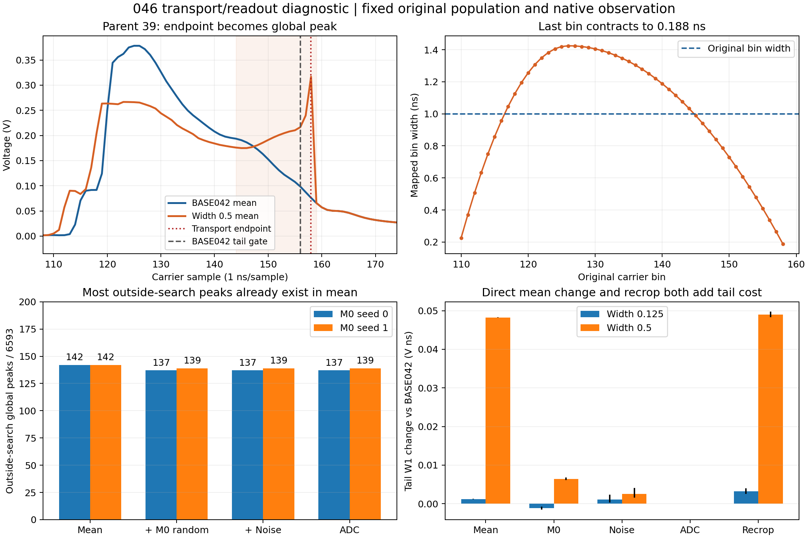

# 046：输运端点压缩在均值中生成窗外峰

24个完整原生报告与045精确一致；18组全人口行级数组、90个特征阶段摘要和72个载体阶段摘要复算通过。全部6593 SOURCE、21047 REAL及宽度未定义行保留，三段面积、tail/Q/W1分解闭合误差≤1e-12。ADC全局峰、搜索区峰和窗外标记逐行核对通过。

强度0.5时，均值中已有142/6593个事件在158号样点取全局峰，全部属于最高SOURCE输入Q八分位。加入原M0随机项后，seed0数量为137、seed1为139；电子噪声和ADC没有改变这两个数量，三个H结论相同。BASE042和强度0.125在这四个阶段均无窗外全局峰。

逐事件身份跟踪显示，随机阶段两个种子各新增8个窗外峰，同时分别消除13和11个；seed1电子噪声阶段再发生1入1出的互换，ADC没有改变成员。因此均值端点压缩是主要来源，但不能把全部ADC异常事件直接等同于均值阶段的142个。seed1父行2683的FWHM只在最后原生重选峰阶段成为未定义，固定锚点的前四阶段均定义。

这些事件的输入Q为11.335–15.120V ns，调制系数s为0.4046–0.4441，最短映射间隔仅0.1525–0.2277ns。原映射T=x+s·r·(1−u²)，端点导数为1−2s：固定边界同时将末端若干原始箱压入更窄区间，累计积分重采样提高该处电压。

固定规则选出的父行39说明这一变化：158号样点从0.076081V升至0.316733V；全局峰由125移动到158，而末箱映射宽度仅0.188416ns。该峰出现于均值输运后，早于随机项、电子噪声和ADC。

|强度|均值直接增加的平均尾积分/V ns|原生重选峰增加的平均尾积分/V ns|原生tail W1增量（相对042）/V ns|
|---:|---:|---:|---:|
|0.125|0.011105–0.011122|-0.000305–-0.000016|0.003518–0.005783|
|0.5|0.067587–0.067687|0.040436–0.042231|0.105225–0.108193|

当前输运支持110..158与6580–6590个事件的042尾窗相交。强度0.5的tail W1增量中，均值步骤为0.048204–0.048301V ns，重选峰步骤为0.048299–0.049743V ns；随机/噪声/ADC步骤构成其余顺序贡献。相同随机项对不同均值分布的W1作用可以不同，不能据此声称随机模型发生了改变。

强度0.125的均值FWHM W1已增加0.4147–0.4186ns，重选峰再增加0.0647–0.0688ns。强度0.5在均值阶段改善0.7283–0.7779ns，重选峰抵消其中0.4450–0.4658ns。小强度的整体宽度退化因此并非仅由窗外峰造成。

下一步仅将局部位移的端点过渡改为(1−u²)²：T=x+s·r·(1−u²)²。支持、中心、输入Q调制、强度集合、M0随机项、005噪声、原生选峰和原验收阈值保持既定设置。新映射端点导数为1；在|s|<0.5时，导数至少0.5，避免原端点的强压缩。该修改检验已定位的机制，是否同时改善完整波形、宽度和QPSD仍由全部人口及新随机库确认判定。

SOURCE输入Q不是能量真值，输出Q条件比较没有逐事件配对；REAL的ADC前状态未知。顺序分解仅描述本次干预的读出路径。诊断完成不作为平均响应或完整随机响应通过。

原生计算115.460秒，监督墙时118.111秒，峰值RSS2.691GiB；93个文件、53,303,717字节逐项长度与SHA256通过。实际6CP/1TRAIN/1PCA、2库、8均值52744行、24H158232观察行、90特征阶段593370行、72载体阶段474696行；0DEV/AD/Adam。

