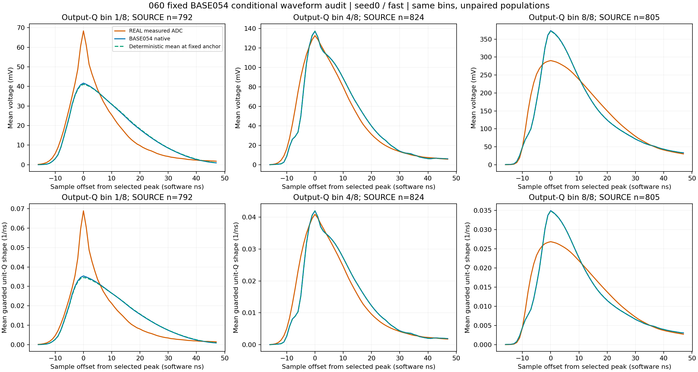

# 060 完整条件波形统计核验

状态：CLOSED_CONDITIONAL_WAVE_PROFILES_VERIFIED。均值阶段和完整随机响应目标仍开放。

完整波形支持一个新的幅度重分配方向：低 Q 提升峰附近、减少下降侧面积；高 Q 减少峰附近面积、补充峰前和较晚下降侧。这个方向来自按 Q 的完整形状，而非再次放大半高交点位移。原噪声和读出保持不变。

seed0/fast 最低输出 Q 箱的 SOURCE 峰均值为 41.685 mV，REAL 为 68.380 mV；最高箱为 373.467 对 290.185 mV。最低箱下降侧 [24,46) 的 SOURCE−REAL 积分为 +0.152046 V ns，两半均为正；最高箱峰附近 [16,24) 为 +0.496524 V ns，两半均为正，下降侧为 −0.304823 V ns，两半均为负。最高箱峰前整体积分为负，但逐点有正有负，因此不能统一提高全部峰前样点。

最低箱峰附近差距 RMS 为 12.767 mV，而从确定性均值到最终读出的有序合计变化 RMS 只有 0.295 mV；最高箱对应 64.405 和 0.773 mV。上述差距主要已存在于均值阶段。两种固定分组、原 V 与 Q 归一视图、两头、各原父行奇偶半份已逐箱分析，完整数值保存在 CONDITIONAL_WAVE_ANALYSIS.json；奇偶半份只用于内部稳定性检查。

| 头 | 输出 Q 箱 | SOURCE / REAL 行数 | 峰差 mV | 峰前差 RMS mV | 下降侧差 RMS mV | 首64协方差迹 SOURCE/REAL |
|---|---|---|---|---|---|---|
| 0 | 1 | 792 / 2631 | -26.694 | 6.282 | 7.072 | 0.575 |
| 0 | 2 | 876 / 2631 | -19.092 | 5.895 | 5.944 | 0.299 |
| 0 | 3 | 828 / 2631 | -15.484 | 12.924 | 9.203 | 0.509 |
| 0 | 4 | 824 / 2631 | 4.539 | 18.149 | 8.168 | 0.626 |
| 0 | 5 | 810 / 2630 | 22.770 | 24.427 | 6.590 | 0.803 |
| 0 | 6 | 832 / 2631 | 40.899 | 40.337 | 10.966 | 0.970 |
| 0 | 7 | 826 / 2631 | 68.518 | 42.116 | 10.534 | 2.267 |
| 0 | 8 | 805 / 2631 | 83.282 | 48.774 | 18.778 | 1.675 |
| 1 | 1 | 810 / 2631 | -26.403 | 6.055 | 7.110 | 0.581 |
| 1 | 2 | 866 / 2631 | -18.968 | 6.009 | 6.036 | 0.304 |
| 1 | 3 | 817 / 2631 | -15.043 | 12.449 | 9.117 | 0.497 |
| 1 | 4 | 832 / 2631 | 4.126 | 18.236 | 8.327 | 0.617 |
| 1 | 5 | 806 / 2630 | 22.584 | 24.076 | 6.468 | 0.808 |
| 1 | 6 | 830 / 2631 | 41.090 | 40.164 | 11.108 | 0.994 |
| 1 | 7 | 824 / 2631 | 67.981 | 41.904 | 10.690 | 2.288 |
| 1 | 8 | 808 / 2631 | 82.302 | 49.287 | 19.162 | 1.628 |

宽度组内方差接近并不代表全部随机波形正确：首64协方差迹在低/高箱分别约为 REAL 的 0.575 / 1.675 倍，协方差结构亦有差距。后续均值部分混合会收缩部分事件间形状变动，这是明确的取舍；仍需保留输入内容并在统一硬读出下检查完整合同，均值通过后再审计随机核。当前不改变 005，也不把基线/DC 差距归因给这个均值修正。

下一步 061：单一固定 1/8 混合，用 REAL 的八箱 Q 归一平均形状作为有效修正建议。将其按原确定性峰对齐，在 [110,176) 的原正样点上重标至每事件原正面积；与原正部分作 7/8:1/8 凸组合，负部分及区间外保持。各模板最大值都在相对峰16，凸组合保留原 bounded 峰和至少7/8原形状项。Q 仅为模型协变量，SOURCE/REAL 不逐事件配对，实测 ADC 模板不视为潜在 preADC 真值。固定支撑边缘可能有幅度变化，需要记录并由原异常/全波形合同评价。只做这一有界新方向，不开网格或确认库。

执行与核验：原生 71.523708 秒，exit 0，峰 RSS 2949390336 B；83 文件 35581260 B 全长度/SHA256通过，291冻结引用和309部署文件通过。12H完整JSON精确重放；17个原NPZ全部数组精确059，包含原6593/21047人口、所有flags、NaN、交点、父行和64预登记例子。

17个profile、126535人口行、528组视图单元、2份有序分解全部完成。组内/组间矩、首64及块积分协方差、奇偶重建、线性Q/front/tail/peak、分母和Q保护计数通过；最大线性标量误差 9.77e-15，协方差重建误差 5.55e-15。深冻结断言和精确计数实际执行；没有新增候选、AD、优化、DEV或确认。

离线独立核验范围是已保存聚合矩、标量及64示例的精确重放；未保存全人口完整波形，不能声称全部波形已离线重读。完整逐点协方差只覆盖首64点，其余192点为逐点矩和16点块协方差。

