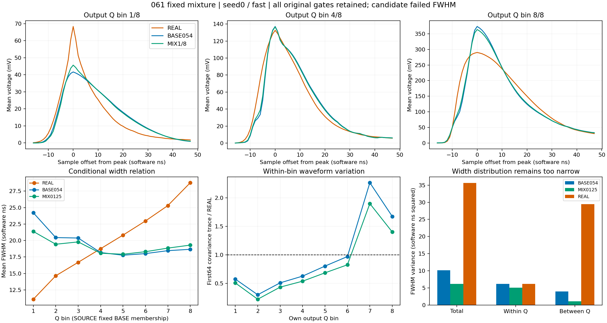

# 061 固定正面积混合：负结果

状态：CLOSED_NEGATIVE_FIXED_SHAPE_MIXTURE。两头三种噪声假设均违反原 FWHM 保护，三形态平均收益未达到 1 T；不进入确认，均值阶段和完整随机响应目标继续开放。

相对 M0 的完整波形与联合距离虽达到各 2% 点收益，但完整波形距离相对 BASE054 反而略有增加。不能把两个通过项或总分下降作为科学接受。

| 头 | H | wave 对 M0 收益 | joint 对 M0 收益 | 三形态平均 T 收益 | FWHM W1：BASE → MIX (ns) |
|---|---|---|---|---|---|
| 0 | fast | 5.526% | 9.814% | 0.113494 | 2.467555 → 3.103307 |
| 0 | slow | 4.325% | 9.872% | 0.106329 | 2.465656 → 3.104243 |
| 0 | common_level | 3.879% | 9.804% | 0.103852 | 2.464482 → 3.103712 |
| 1 | fast | 4.444% | 9.624% | 0.117353 | 2.466488 → 3.099155 |
| 1 | slow | 3.355% | 9.741% | 0.110082 | 2.463256 → 3.099430 |
| 1 | common_level | 2.950% | 9.653% | 0.110304 | 2.463065 → 3.100069 |

seed0/fast 固定 BASE 输出 Q 分组：最低箱宽度 24.2113 → 21.3745 ns，REAL 11.0829；最高箱 18.6656 → 19.3031 ns，REAL 28.7789。两端条件方向有所纠正，但总体宽度方差从 10.146016 降至 6.142677 ns²，组内从 6.174745 降至 5.049489，组间从 3.971271 降至 1.093188。REAL 为总 35.634358、组内 6.214595、组间 29.419764。弱修正尚未反转原错误 Q–width 关系，先把总体宽度分布进一步压窄。此结果不证明全混合函数族无解，也不支持直接沿原尺度试更多比例。

最低/最高输出 Q 箱的首64波形协方差迹相对 REAL 分别从 0.574624/1.675357 变为 0.507080/1.401480。高箱过大的变动有所减少，低箱原本偏小的变动继续缩小；固定输入 Q、固定 BASE 输出 Q 与各自输出 Q 成员、两种波形视图、两头及奇偶分半均保存在 MIXTURE_ANALYSIS.json。SOURCE 与 REAL 不逐事件配对，Q 不代表已知能量真值。

4份全行几何记录的均值峰均未改变，但原生峰并不固定：seed0/fast 有 894/6593 行重新选峰，范围 −11 至 +7 样点，输出 Q 箱迁移5行。无峰迁移行的尾部平均变化为 −0.000582981 V ns；峰迁移相关变化另按移位逐项保存，不能归因于单一机制。支撑边缘110和175的最大改变量为1.213516和5.311165 mV；负面积、canonical Q和区间外约束通过，不能据此接受完整响应。

下一步062采用新的条件形状表示：使用060中 SOURCE 确定性均值与 REAL 实测的 Q 条件归一profile之比，对每事件正部分作乘性校准，再恢复其原正面积。它在同条件下保留事件间逐点相对形状的比值差异，避免显式乘7/8的混合收缩。只登记一个由profile确定的设置，提前明确支撑、插值、非正样点和峰迁移；不把ADC profile当潜在物理真值。原039保护、完整波形/联合2%与形态1T均保持。实际是否有效由新有界评价决定。

执行核验：exit0，原生 86.279949 秒，峰RSS 2807508992 B；90文件 28283159 B全长度/SHA通过，308冻结引用/319部署文件一致。18H完成，原12H完整报告精确重放；11原NPZ和5原profile全部数组精确059/060。4几何26372行、12原生79116行、4自身均值26372行以及原6593/21047人口、NaN、flags、交点、Q分组与摘要核验通过。原REAL rise94/FWHM5未定义保留。

128预登记均值例子独立公式误差最大1.39e-17 V；128 fast载波例子ADC整数码精确，384原生窗例子的特征和交点一致。108标量W1以SciPy与整数CDF累计独立复算，最大原生差7.69e-13，在原浮点累计界内。9profile73791人口行/272组视图单元的全矩、首64与块协方差、线性标量及奇偶重建通过。离线核验限于已存全行标量、聚合矩及例子，未重新读取未保存的全人口完整波形。精确计数和A0/M0/005深冻结断言实际通过，0 AD/优化/DEV/确认。

