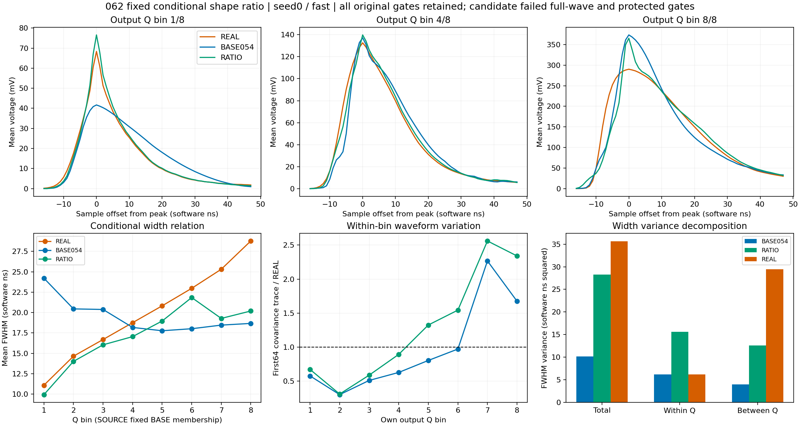

# 062 条件形状比值：负结果

状态：CLOSED_NEGATIVE_FIXED_SHAPE_RATIO。原合同失败，不开新MC确认；均值阶段及完整随机响应仍未接受。

形态平均收益达到1T，联合距离改善约39%，但完整wave相对M0恶化8.20%–12.93%。两头三H均违反wave、QPSD、front、tail、PSD_guarded、FWHM保护，并增加FWHM前沿截断/未定义及ADC越界。不能用下降的总分或单个收益替代接受。

| 头 | H | wave相对M0收益 | joint相对M0收益 | 三形态平均T收益 | 候选FWHM W1 ns |
|---|---|---|---|---|---|
| 0 | fast | -8.199% | 38.962% | 1.248992 | 2.755319 |
| 0 | slow | -9.465% | 38.982% | 1.240780 | 2.756896 |
| 0 | common_level | -11.148% | 38.958% | 1.238049 | 2.755421 |
| 1 | fast | -10.046% | 38.980% | 1.264891 | 2.738182 |
| 1 | slow | -10.989% | 39.147% | 1.256666 | 2.739236 |
| 1 | common_level | -12.934% | 39.044% | 1.255376 | 2.739417 |

seed0/fast固定BASE输出Q分组，最低至最高箱宽度均值为9.9282、14.0094、16.0393、17.0447、18.9593、21.8402、19.2795、20.1884ns；REAL对应11.0829、14.6438、16.6876、18.7552、20.8214、22.9690、25.3081、28.7789。低至中Q方向得到较大纠正，高Q关系仍错误。宽度总体方差28.251640已接近REAL35.634358，但箱内15.636976远大于REAL6.214595，箱间12.614663仍低于29.419764；总体方差接近不代表条件分布正确。最高两个箱的宽度方差为66.838831/25.062271，REAL2.772017/3.756331。

两头确定性均值均有3162/6593行移峰，偏移−6..+12样点；最高Q箱803/805移峰，25个均值峰超过+0.5V，最大0.514894V。seed0/fast原生ADC_rail_hit和pre_ADC_out_of_range均32/6593，FWHM未定义14行（固定BASE第6箱3、第7箱11）；对应原生和内在均值的异常集中有差别，不能把所有变化归因给一个阶段。条件模板比值保留了log形状比差异，但高Q的绝对协方差与峰位异常放大；此性质不能作为随机响应正确的证据。

最大均值改变量0.193885V，边缘110/175最大0.0111292/0.00809479V。全部canonical Q与正负面积检查通过；守恒本身不能阻止窗口重选、尾部偏移或ADC饱和。PEAK_AND_FLAG_ANALYSIS.json存全六H逐箱关联；原产物未导出每行ADC rail flag，因此这里只报告其原总体计数及均值越界位置，不伪称两者逐事件对应。

下一步063使用新加性表示：在相同正支撑内，把已冻结源/目标条件模板分别归一到每事件正面积，以其差作为固定均值残差；每个事件按不产生新负样点的最大可行比例应用。没有待调强度和网格。同Q/面积/原峰/正支撑且未被限制的事件对保留原加性波形差异，针对062乘性放大原偏差的问题；受限事件单独记账，均值与native峰仍正常重选。是否改善全合同由一次新有界评价决定，不从上述诊断预判成功。

执行核验：exit0，原生87.380088秒，峰RSS2821869568B；90文件29089213B全长度/SHA通过，325冻结引用/333部署文件一致。18H与精确计数/深冻结实际执行；原12H完整报告精确，11原NPZ和5原profile全部数组精确059/060。原6593/21047、权重、NaN/flags/4交点/分组保持；REAL rise94/FWHM5未定义仍保留。

128均值例子独立比值公式最大误差1.67e-16V、条件逆1.67e-16V、log odds1.55e-15。128fast载波ADC整数码精确，384原生例子特征/交点精确；108W1以SciPy和整数CDF复算最大差1.14e-12，在原累计浮点界内。9profile73791人口行/272组视图的矩、首64/块cov、奇偶和线性标量闭合。未保存全人口完整波形，离线独立核验仅限已存全行标量、聚合矩及例子；未修改科学门槛。

