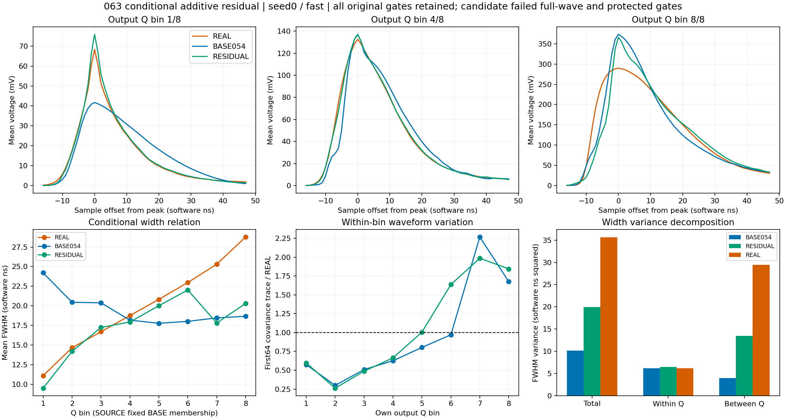

# 063 条件加性残差：负结果

状态：CLOSED_NEGATIVE_FIXED_ADDITIVE_RESIDUAL。原039评价合同未通过，不开新MC确认；均值阶段及完整随机响应仍未接受。

相对M0，六个头/H的joint改善34.56%–34.72%，但完整wave恶化5.39%–8.49%，三形态平均收益仅0.58795–0.61976T，低于1T。六H均违反wave、QPSD、front、tail、PSD_guarded、rise、FWHM保护，以及FWHM前沿截断/未定义计数。原全部科学门槛保持。

| 头 | H | wave相对M0收益 | joint相对M0收益 | 三形态平均T收益 | 候选FWHM W1 ns |
|---|---|---|---|---|---|
| 0 | fast | -5.387% | 34.702% | 0.598476 | 2.606550 |
| 0 | slow | -6.653% | 34.712% | 0.590703 | 2.605988 |
| 0 | common_level | -8.287% | 34.724% | 0.587946 | 2.607522 |
| 1 | fast | -5.681% | 34.558% | 0.619759 | 2.581413 |
| 1 | slow | -6.727% | 34.655% | 0.610970 | 2.582702 |
| 1 | common_level | -8.493% | 34.563% | 0.611711 | 2.582838 |

与062相比，本次没有ADC rail或preADC越界：两头三H的逐行观察标记均为0/6593，最大确定性均值峰为0.449247V。但无越界不能抵消完整形状及前沿/宽度失败。两头确定性均值均2432/6593移峰，偏移−5..+9样点。seed0/fast有3179/6593个原生峰迁移，范围−11..+9；原生FWHM未定义21行，均在固定BASE第6个Q箱，对应内在均值未定义29行。它们均不触及正性限制或ADC rail，不能把宽度失败归因于ADC饱和或非负截断。

每头1579/6593个事件触及正性边界。按固定BASE输出Q八箱，受限行数为[0, 74, 302, 94, 0, 12, 596, 501]；第7/8箱应用比例中位数为0.328421/0.766212，最低Q箱全部比例为1。限制高Q的幅度与未限制低Q的形态变化并存，不能把一次全局强度缩放当作已经获得的解决方案。

seed0/fast固定BASE输出Q分组的宽度均值为[9.4886, 14.1857, 17.2352, 17.9354, 20.0116, 22.0176, 17.8057, 20.3079] ns；REAL为[11.0829,14.6438,16.6876,18.7552,20.8214,22.9690,25.3081,28.7789] ns。最高两箱仍过窄，最低箱过度收窄。宽度总体/箱内/箱间方差分别19.958824/6.472493/13.486331，REAL为35.634358/6.214595/29.419764；箱内方差总量接近仍不等于各条件正确。

最大均值改变量0.113432V，固定边缘110/175最大改变量0.00750052/0.00468734V。完整积分、canonical Q、原负部分和区间外不变量均通过，但原生裁窗的Q及tail仍改变。RESIDUAL_ANALYSIS.json覆盖双头各H的条件特征/方差、完整profile矩及首64协方差、奇偶；SCALES_PEAK_AND_FLAG_ANALYSIS.json按固定输入、固定BASE输出、各自输出Q保存正性比例、峰迁移和逐行异常关联。

下一步064保持063端点和原FIT库不变，作一次有界的有序读出分解。以各事件BASE054原生峰为固定锚，分别计算均值、加M0随机项、加电子噪声、ADC固定锚、原生重选峰五阶段的原wave视图/分块及Q、PSD、宽度和截断；另存正性边界位置及预定规则选出的代表例子。它将回答剩余完整wave、QPSD和FWHM失败已经存在于形状修正，还是在噪声/ADC/重选峰阶段新增。该分解依赖指定顺序，不是唯一因果归属；固定锚视图只诊断，不替代原生评价。063已有完整条件profile直接复用，不重复提取。根据新证据再确定最小修正，不在此处追加比例、网格或新响应候选。

执行及核验：exit0，原生58.591204秒，峰RSS2804109312B；102文件31572767B逐长度/SHA通过，342冻结引用/350部署文件一致。18H、原精确计数及A0/M0/005深冻结实际执行；原12H报告精确，11原NPZ和5原profile全部数组精确059/060。6593 SOURCE和21047 REAL的身份、权重、NaN/flags/四交点/分组保留，REAL rise94/FWHM5未定义保留。

128均值例子独立公式误差1.11e-16V，模板归一3.55e-15，可行比例1.22e-15；128fast载波ADC整数码精确，384原生例子的特征和交点精确。12观察表79116行的极值阈值与flags核验通过。108W1独立SciPy/整数CDF复算最大差2.03e-12，在原累计浮点界内。9profile73791人口行/272组视图的矩、covariance、奇偶及线性标量闭合。未存全人口完整波形，离线独立核验限全行标量、聚合矩和保存例子。

