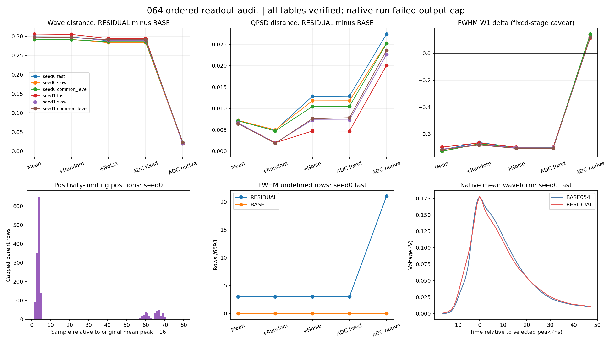

# 064 有序读出诊断

原生作业因64 MiB输出上限失败，状态CLOSED_OUTPUT_CAP_FAILURE_DIAGNOSTICS_RECOVERED。全部12份原生重放和60阶段表已核验并用于诊断；原RESULT/COMPLETE未生成，最终内存中A0/M0/005深冻结断言未执行。063的负结果及完整随机响应未接受状态保持。

重选峰对不同指标方向不同：候选相对BASE的QPSD距离增加0.013449–0.015723，FWHM W1增加0.811616–0.845306 ns，同时使固定锚下的完整wave距离差下降约0.263–0.274。不能把全部失败归因于移峰，也不能把固定锚下的宽度改善直接算作有效原生改善。固定阶段沿用窗内16点形态参考，约3102–3178行在ADC固定锚阶段该点低于实际窗内最大值；这些读数只用于诊断。

| 头 | H | 原生wave距离差 RES−BASE | 重选峰QPSD贡献 | 重选峰FWHM W1贡献 ns | 重选峰新增前沿截断行 |
|---|---|---|---|---|---|
| 0 | fast | 0.020010 | 0.014497 | 0.837783 | 21 |
| 0 | slow | 0.021025 | 0.013449 | 0.843556 | 21 |
| 0 | common_level | 0.023410 | 0.014660 | 0.845306 | 21 |
| 1 | fast | 0.020116 | 0.015356 | 0.811616 | 18 |
| 1 | slow | 0.021122 | 0.015309 | 0.821813 | 18 |
| 1 | common_level | 0.023627 | 0.015723 | 0.825659 | 18 |

六H新增18或21个FWHM前沿截断，均未触063正性界。seed0/fast从固定ADC的3个未定义变为原生21个；原3个解除，另21个出现。逐行父身份与标记转移保留，支持把这部分异常定位到指定路径的重选峰裁窗步骤。ADC量化本身的QPSD增量−3.05e−5至2.29e−4，明显小于这条路径上的重选峰增量。

固定锚下的wave差较大还包含峰位置与原TRAIN标准化的相互作用：seed0/fast峰归一shape视图第16–31样点块在固定ADC时差3.48326，重选峰后0.00401；电压视图首16样点块则由0.00601增至0.21623。原shape使用窗内实际最大值归一，固定锚的16点未必为最大值。原生条件下的完整wave保护照旧，不以固定阶段替代。

正性限制已定位到具体样点。seed0/fast固定BASE输出Q第7箱596个受限事件全部由绝对110–111点限制，第8箱501个受限事件全部由110–113点限制；对应原均值峰相对位置j=2–5。第2箱74个受限事件主要由后尾166–175点限制。单个小幅值点决定全局残差比例，使高Q整条修正中止；只扩大同一加性方向会继续触及同一几何限制。

下一步采用同一冻结源/目标条件轮廓构造一个非负面积转移矩阵。源、目标在同一正支撑分别归一，按累积区间交叠把源样点面积分配到目标样点，再把此映射作用于每个输入事件自身的正部。它从构造上保留正部总面积，避免以单点最小比率缩放全部残差；负部、prefix、区间外不变。映射随inputQ、原均值峰及正支撑变化，不建立SOURCE/REAL事件配对。固定条件下事件差异经同一矩阵变换，条件方差可能改变，必须用既有完整profile和原生读出验证。目标轮廓来自实测ADC，仍只是有效校准依据。只有一个固定映射，无强度网格；原039全部保护和2%/1T目标不变。

执行回执：原生exit1，2026-10-18T09:49:33.986411+00:00至2026-10-18T09:54:41.193884+00:00，峰RSS2892840960B；原96文件68052299B，超64 MiB 943435B。原失败、原文件和原源码均保留。复用启动时已保存且容器SHA一致的REAL_ROWS.npz，下载其余95文件66286962B，归档62516143B SHA 3a5502f422dde8268b57b6efedbed4c00f7489c73b03e1964a90f6ec840f8a0d，全长度与hash核验。最终计数已达到合同并越过原精确计数检查；资源检查在深冻结断言之前失败，此缺口明确保留。

核验覆盖361个冻结引用、379个部署文件、12原生报告精确063、37参考数组、26372几何/正性/内在均值行、79116原生行、395580阶段行、428完整载波/裁窗例子及六组有序对比和flags转移。540个W1用SciPy及整数CDF独立复算，最大差2.03e-12，在原累计浮点界内。例子ADC整数码精确，公式误差1.67e-16V，组矩误差1.05e-15，线性标量误差5.33e-15。全人口波形未保存，完整counterfactual wave/QPSD未作离线重跑；已核验全行标量/flags、聚合矩和保存例子。有序分解依赖这里指定的阶段顺序。

