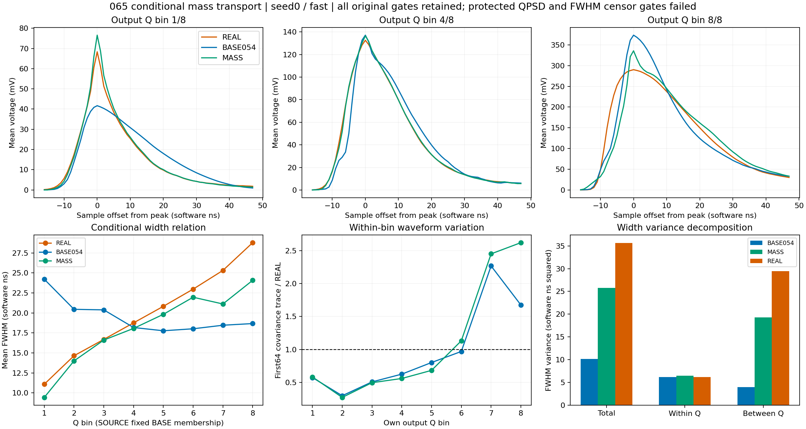

# 065 条件正部面积转移：物理保护未通过

状态：CLOSED_NEGATIVE_FIXED_MASS_TRANSPORT。执行成功，科学接受失败；不开新MC确认，均值阶段与完整随机响应仍未接受。

完整wave相对M0改善1.844%–6.216%，joint改善42.760%–43.027%，三形态平均收益2.0061–2.0272T。六H中五个满足三个点目标；seed1/common_level的wave收益1.844%，未达原2%门槛。全部H均违反QPSD、front、tail、PSD_guarded保护，并新增7/6593个FWHM前沿截断/未定义。没有ADC rail或preADC越界。原039完整接受门槛保持，不能用面积守恒、改善总分或部分点目标通过抵消保护失败。

| 头 | H | wave相对M0收益 | joint相对M0收益 | 三形态平均T收益 | 候选QPSD |
|---|---|---|---|---|---|
| 0 | fast | 6.216% | 43.015% | 2.027180 | 0.084321 |
| 0 | slow | 5.094% | 43.019% | 2.014728 | 0.086270 |
| 0 | common_level | 3.948% | 43.027% | 2.016554 | 0.082711 |
| 1 | fast | 4.267% | 42.789% | 2.018710 | 0.081330 |
| 1 | slow | 3.210% | 42.936% | 2.007684 | 0.084179 |
| 1 | common_level | 1.844% | 42.760% | 2.006102 | 0.081707 |

seed0/fast的QPSD为0.0843214，M0/BASE054为0.0503929/0.0486859；front W1为0.121058 V ns，M0为0.0910132；tail W1为0.0408485 V ns，M0为0.0169535。峰高W1降至0.0131214 V，M0为0.0368373 V；FWHM W1为1.88175 ns，M0为2.46860 ns。各项原单位与分母保留。

两头确定性均值均2560/6593移峰，范围−7..+4样点。seed0/fast原生3356/6593移峰，范围−11..+12；其余H为3312–3364。7个FWHM失败在所有头/H均出现，seed0/fast输入Q为[6.876308, 6.855499, 6.847962, 6.87858, 6.852357, 6.871748, 6.872972]，均位于固定BASE第7Q箱，均值峰移1点，而原生峰移11–12点至133/134；这些行的内在均值FWHM均有定义。该关联提示均值与随机项的峰竞争需要定量分解，尚不能把全部失败归因于M0随机项。

seed0/fast不移原生峰的3237行，tail改变量均值−0.0000402、SD0.0269612 V ns；移峰3356行均值0.0601288、SD0.188689 V ns。即使未移峰也有直接front/tail面积变化；上述分组不是独立因果归因。所有H对应逐行关联及条件分组见MASS_PEAK_AND_FLAG_ANALYSIS.json。

固定BASE输出Q八箱的宽度均值为[9.4334, 13.9996, 16.6041, 18.0598, 19.8212, 21.9571, 21.1134, 24.0712] ns；REAL为[11.0829, 14.6438, 16.6876, 18.7552, 20.8214, 22.969, 25.3081, 28.7789]。候选宽度总体/箱内/箱间方差为25.785033/6.504299/19.280734，REAL为35.634358/6.214595/29.419764。第7/8箱候选宽度方差23.1443/13.0083，REAL为2.77202/3.75633；低Q第1箱候选1.56781，REAL14.2263。总体箱内方差相近掩盖了条件失配。固定inputQ、固定BASEoutputQ与各自outputQ结论分别记录，SOURCE和REAL不配对。

第7/8箱fast电压profile首64协方差trace/REAL为2.45036/2.62026；按Q归一后为2.48747/3.85845。面积转移改善了条件均值和宽度趋势，但未恢复正确条件波动。完整profile矩、区域残差、首64协方差及奇偶检查见MASS_ANALYSIS.json。不是全256点协方差。

非负转移的列和、模板映射及全积分/canonicalQ守恒通过；最大均值改变量0.236021V，边缘110/175最大0.00679117/0.00816006V。每事件面积加权绝对位移均值1.62251样点。原负部、prefix和176之后不变。K对事件差异也作线性变换，其数学守恒不代表统计接受。

下一步066冻结065端点与两FIT库，进行有界五阶段有序诊断，并逐行记录最终ADC峰与该事件内在均值峰之间的竞争差值：均值差、M0随机差、电子噪声差和量化差。分解完整wave、QPSD、front/tail、FWHM及截断出现阶段，检查7个异常行及全人口条件关系。只诊断，不加入候选或比例网格。指定顺序的分解不是唯一因果；固定锚index16可能不是真峰，保留对应flag。065完整profiles复用。

066沿用64MiB输出上限。为避免064已经出现的输出超限，完整PSD逐行值由原Q/tail确定，不再重复存储两份可重建数组；REAL复用065已核验原件，新作业仍在内存验证所有REAL数组。保留全部人口、NaN、flags、交点与9特征报告，并在RESULT写出后再次检查预算。此处不扩大计算预算。

执行与验收：exit0，原生151.445011秒，峰RSS2795216896B；102文件31335338B逐长度/SHA通过，378冻结引用/386部署文件一致。18H、原精确计数与A0/M0/005深冻结实际通过。原12H报告、11NPZ、5profile数组精确059/060；6593 SOURCE/21047 REAL身份权重完整，REAL rise94/FWHM5未定义保留。

128均值例子独立区间交叠矩阵公式误差2.94e-15V，列和/模板映射误差2.22e-16/6.94e-18；128fast例子ADC整数码精确，384原生例子特征/交点精确。12观察表79116行极值和flags核验；108W1独立SciPy和整数CDF最大差1.27e-12，在原累计浮点界内。9profile73791人口行/272组视图闭合。未导出全人口完整波形，离线核验范围为保存的全行标量、聚合矩和例子。

