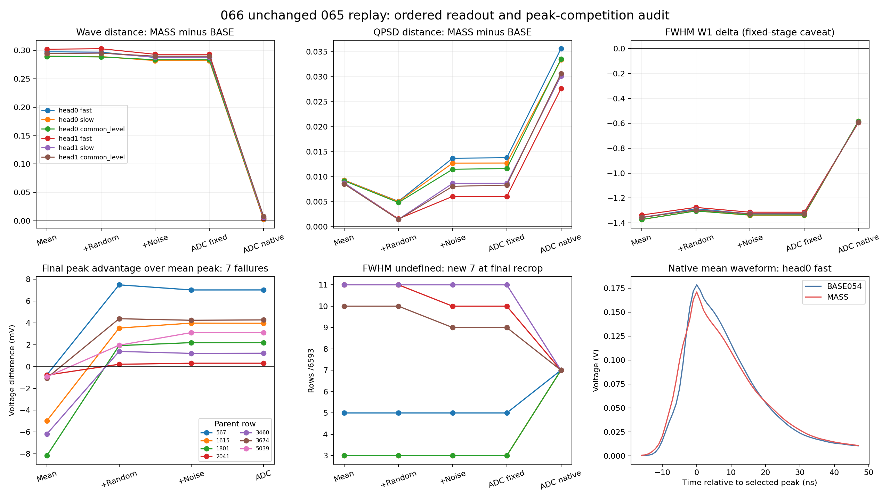

# 066：均值、随机项与读出分解完成

状态 CLOSED_DIAGNOSTIC_COMPLETE。原生执行成功，065两头/三H/两端点的12份完整报告精确重放，原负结果保持。当前科学目标未完成，均值阶段未接受。

两个头各自7个原生FWHM失败，在三个噪声假设下分别是同一组父事件。全部在加入M0随机项后，峰从均值123点移到133/134点；后续电子噪声与ADC未再次改变这些事件的峰。它们的内在均值FWHM均有定义，原生未定义在最终重选峰裁窗时新出现。固定锚前一阶段已有的3–11个FWHM未定义行全部在最终裁窗解决；不能把两阶段总数之差当作新增数量。

| 头 | H | 最终峰不同于均值峰 /6593 | 随机/电子/ADC相邻移峰数 | 五阶段FWHM未定义数 |
|---|---|---|---|---|
| 0 | fast | 550 | [450, 266, 23] | [5, 5, 5, 5, 7] |
| 0 | slow | 528 | [450, 229, 25] | [3, 3, 3, 3, 7] |
| 0 | common_level | 529 | [450, 231, 26] | [3, 3, 3, 3, 7] |
| 1 | fast | 545 | [445, 266, 28] | [11, 11, 10, 10, 7] |
| 1 | slow | 517 | [445, 234, 24] | [11, 11, 11, 11, 7] |
| 1 | common_level | 518 | [445, 228, 23] | [10, 10, 9, 9, 7] |

7个失败的seed0均值峰竞争差为−0.7600..−8.1568mV，M0随机项贡献+0.9957..+10.0776mV；seed1均值差−0.7600..−6.5054mV，M0随机贡献+4.1337..+13.1048mV。逐事件逐H的原始差值及分量闭合见PEAK_COMPETITION_ANALYSIS.json。比较位置由最终ADC峰与内在均值峰选定，是指定顺序的路径诊断。

QPSD的MASS−BASE差在均值阶段为0.008571–0.009346，加入M0随机项后降到0.001464–0.005108；电子噪声随后增加0.004491–0.008618。最终重选峰裁窗增加0.020641–0.022300，成为原生差0.027639–0.035636的重要部分。均值本身的偏差仍存在，不能声称只改变随机项就能解决全部QPSD。

front/tail W1的最终裁窗增量分别为0.023882–0.025094和0.017402–0.022808 V ns。FWHM W1裁窗增量为0.720071–0.755610ns，但最终相对BASE仍改善0.582469–0.594307ns。完整wave在固定BASE锚的差为0.282065–0.293217，重新对齐后缩小至0.002329–0.008173：重选峰改善wave对齐，同时恶化电荷分区/时间交点关系，不能统一称为读出导致所有失败。固定锚index16不一定是真峰，shape视图按裁窗实际最大值归一；完整报告保留该flag。

下一步067只改变一处：把固定065均值所用K同样作用于M0随机残差的相同正均值支撑，支撑外残差保持。均值、K、原两FIT随机库、005、读出、人口和039门槛不变。K由输入Q、确定性均值峰和正部支撑确定，不由随机样本或失败行选择。它能改变条件协方差；只在原条件随机残差期望为零时保留零期望，不宣称有限样本均值为零或协方差正确。这是均值算子的随机耦合诊断，不开放随机核训练。全积分/canonicalQ守恒、prefix、完整wave/QPSD/噪声/异常与条件方差同时检查；通过所有原FIT门后才另登记新随机库确认。

验收：exit0，235.930182秒，峰RSS2867462144B；68文件49043215B长度和SHA通过。397冻结引用/418部署文件一致，A0/M0/005实际深冻结与全部操作预算通过。37原数组与12原生报告精确065；79116原生行、395580五阶段行、316464载体行、288完整例子均核验。540 W1独立SciPy/整数CDF在原累计浮点界内；公式误差3.36e-15V，峰竞争闭合精确，ADC整数码精确，NaN与全部人口保留。未保存全人口完整波形，离线验证范围为全行标量、聚合矩、峰竞争及所存例子。

