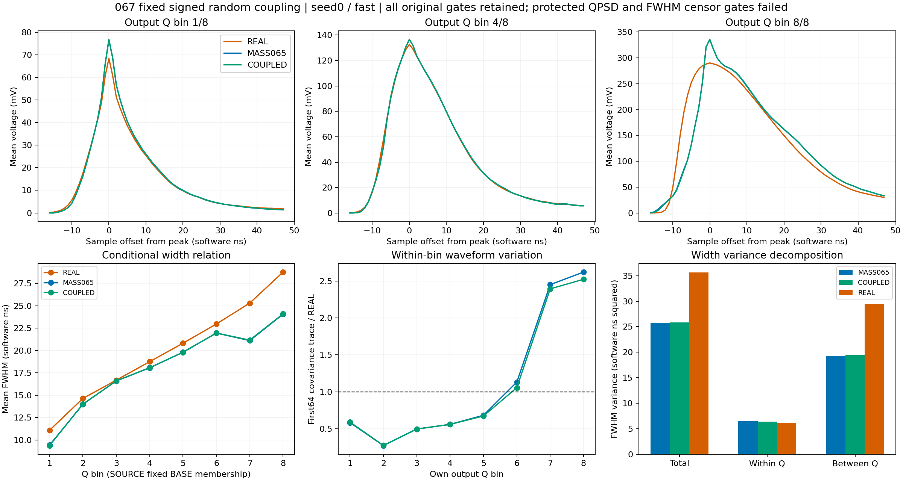
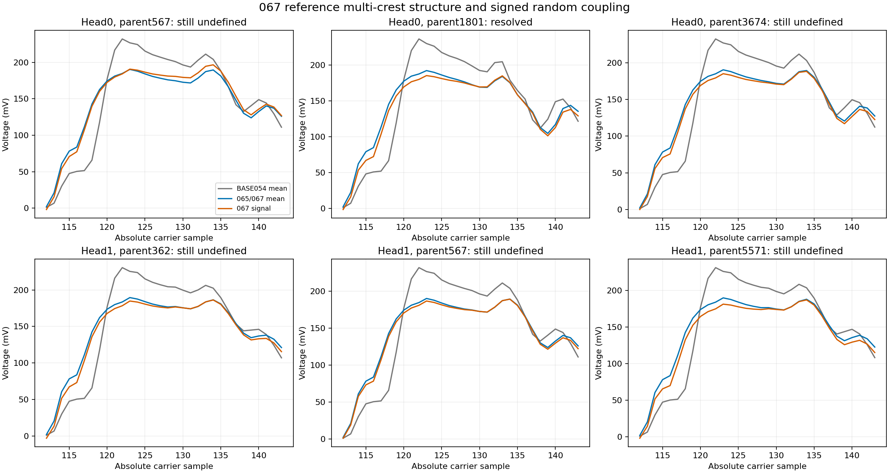

# 067：随机项同步映射有局部收益，联合保护仍失败

状态 CLOSED_NEGATIVE_FIXED_COUPLED_TRANSPORT。原生执行及复核成功，科学接受失败；未开确认库，均值阶段和完整随机响应目标继续开放。

两头、三H的wave相对M0改善4.340%–9.518%，joint改善42.728%–43.094%，三形态平均收益2.0186–2.0404T，六项条件均通过三个点目标。但全部H均失败QPSD/front/tail/PSD_guarded及FWHM未定义/前沿截断保护。不能用点目标通过代替完整接受。

| 头 | H | wave收益/M0 | joint收益/M0 | 三形态平均T收益 | 原065 QPSD | 067 QPSD |
|---|---|---|---|---|---|---|
| 0 | fast | 9.518% | 43.094% | 2.040400 | 0.084321 | 0.082736 |
| 0 | slow | 8.538% | 43.080% | 2.029787 | 0.086270 | 0.084675 |
| 0 | common_level | 7.284% | 42.959% | 2.025738 | 0.082711 | 0.081212 |
| 1 | fast | 6.821% | 42.790% | 2.033842 | 0.081330 | 0.080094 |
| 1 | slow | 5.894% | 42.892% | 2.021574 | 0.084179 | 0.083125 |
| 1 | common_level | 4.340% | 42.728% | 2.018638 | 0.081707 | 0.080761 |

第一头原7个FWHM失败中1801、2041、3460恢复，剩余567、1615、3674、5039；第二头原7个全部仍失败。各头三个H的失败行一致，均未新增原065之外的失败行。每条件分母6593，未删除失败事件。相对065的原生移峰数为209–223/6593；完整inputQ、固定MASS065输出Q和各自输出Q分组及观察异常保存在COUPLING_PEAK_AND_FLAG_ANALYSIS.json。均无ADC rail/preADC越界。

首头fast三个恢复事件的峰从133/134回到均值123点；剩余4个及第二头7个仍在加入耦合后的随机项时移到133/134。后续电子噪声/ADC未改变这些剩余行的峰。均值峰差与耦合随机差仍足以解释选峰翻转：例如父行567参考BASE054主/次峰为122点232.011mV与133点211.207mV，相差20.804mV；065/067均值变成123点190.235mV与134点189.475mV，仅差0.760mV。该头耦合随机项在最终峰与均值峰间贡献+6.693mV。此处比较的是已保存BASE054参考均值，不是原始沉积波形，也不是两个物理作用的证据。

随机耦合没有改变确定性均值，因此高Q平均形态与离散度失配仍明显。seed0/fast在固定MASS065输出Q八箱的宽度均值为[9.3643, 14.0199, 16.6076, 18.0805, 19.8028, 21.9566, 21.1707, 24.1049]ns，REAL为[11.0829, 14.6438, 16.6876, 18.7552, 20.8214, 22.969, 25.3081, 28.7789]。第7/8箱宽度方差23.1422/12.7697，对REAL2.77202/3.75633；最低箱1.38959，对REAL14.2263。总体/箱内/箱间宽度方差为25.871200/6.424616/19.446584，REAL为35.634358/6.214595/29.419764。总体箱内方差相近仍掩盖条件错配。

最高两个自身输出Q箱，首64电压协方差trace/REAL由065的2.45036/2.62026降到2.39301/2.52279，仍偏大。最高箱平均波形峰前16点相对REAL积分残差由−0.640605变为−0.654920 V ns，峰附近16:24、下降段24:46、早尾46:64及晚尾64:256残差分别+0.128275/+0.239691/+0.135529/+0.052408 V ns。条件profile与首64协方差包括输入人口与随机性共同变化，不是同一输入多次抽样的纯随机核协方差。

下一步068检验一种新的确定性表示：保留同一062条件SOURCE/REAL模板，由峰左右两侧累计profile分别推导单调时间查询，以原均值峰和支撑端点为锚，插值每事件电压，再用一个正部总面积标量归一。这样可检验局部面积转移对多峰相对高度的影响；不把多峰强行投影为单峰，也不把参考波形中的结构直接当作物理标签。它与052的四个半高结点位移不同，时间查询由整段条件profile确定，只有一个预定端点。

068的随机项使用同一确定性插值，并以均值正部的单位面积profile作线性面积补偿，使每个随机实现保留原signed积分；不增加随机参数训练。这个线性投影可改变协方差，插值及统一归一也可能造成新的均值偏差，必须保留所有native峰位、QPSD/front/tail/噪声/异常及条件统计。源和REAL不逐事件配对，实测ADC模板不当潜在物理真值。原039完整门槛、6593/21047人口、三H、两头、MC确认顺序保持。

执行验收：exit0，原生58.642205秒，峰RSS2825277440B；110文件34485005B逐长度/SHA通过，run34401000B低于64MiB。415冻结引用/424部署源码一致，精确操作数与真实最终A0/M0/005深冻结通过。原12H全报告精确065，MASS065与COUPLED均值/内在行及内在profile精确相同；新固定输出Q参照为MASS065，未误当原BASE054参照。

70NPZ、9profiles73791人口行/272组视图、4geometry和4intrinsic各26372行、12native/12obs各79116行，4signed行表26372行及156完整随机例子通过。128均值例子独立公式误差2.94e-15V，156signed例子误差5.78e-16V，native特征误差5.51e-14；ADC整数码精确，384原生例子特征/交点精确。108W1以SciPy和整数CDF独立复核，最大native差1.69e-12，在原累计浮点界内；NaN与分母保留。未导出全人口完整波形，离线只核保存标量、矩和例子。013T仍为人工扰动研究尺度。

