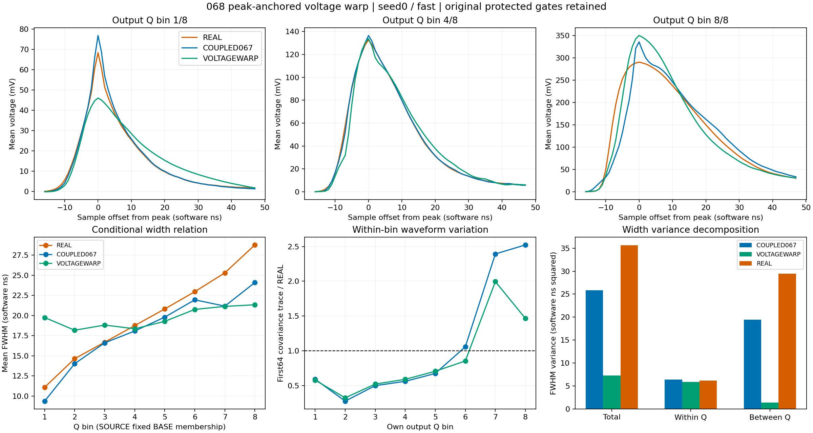
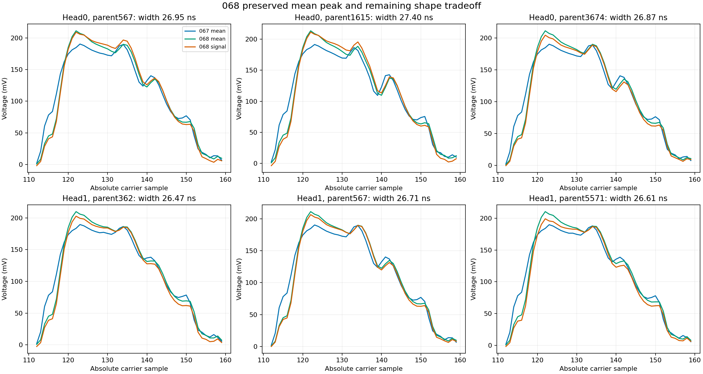

# 068：峰锚恢复异常，宽度的电荷条件关系仍失败

状态 CLOSED_NEGATIVE_PEAK_ANCHORED_VOLTAGE_WARP。原生执行和独立复核完成，科学接受失败；未开确认库，均值阶段和完整随机响应目标继续开放。

两头三H的完整wave相对M0改善15.421%–17.201%，joint改善27.625%–27.897%，三形态平均收益1.0122–1.0286T。六个条件的三个点目标均过，但所有H仍失败QPSD、tail、PSD_guarded距离和FWHM距离保护。front及异常保护已不再失败；不能用点目标或较接近的总体宽度均值代替完整接受。

| 头 | H | wave收益/M0 | joint收益/M0 | 三形态T收益 | M0 QPSD | 067 QPSD | 068 QPSD | 068 FWHM W1/ns |
|---|---|---|---|---|---|---|---|---|
| 0 | fast | 17.201% | 27.720% | 1.021176 | 0.050393 | 0.082736 | 0.073806 | 3.043903 |
| 0 | slow | 16.362% | 27.897% | 1.016297 | 0.054324 | 0.084675 | 0.073880 | 3.045448 |
| 0 | common_level | 16.705% | 27.761% | 1.012230 | 0.050659 | 0.081212 | 0.074253 | 3.046064 |
| 1 | fast | 16.155% | 27.625% | 1.028597 | 0.055221 | 0.080094 | 0.076895 | 3.025792 |
| 1 | slow | 15.421% | 27.887% | 1.023620 | 0.055715 | 0.083125 | 0.074416 | 3.026970 |
| 1 | common_level | 15.831% | 27.681% | 1.021454 | 0.052964 | 0.080761 | 0.073727 | 3.028156 |

每头6593个确定性均值峰全部保持；原峰分布为120:506、121:394、122:1875、123:1900、124:1240、125:204、126:474。统一幅值系数0.871438–1.128743，最大时间查询位移5.69379个样本。067中seed0剩余4行、seed1剩余7行的FWHM未定义均恢复，所有H无新增FWHM未定义，且原066的全部7行每头也均恢复。所有H无ADC rail、preADC越界、选峰边界、全局峰越界、Q非正或PSD未定义。rise未定义仍32–36/6593，原样保留；这些并未超出本轮原保护门槛。PSD_guarded的失败是分布距离，不是guarded事件计数增加。

峰锚仅针对确定性均值。加入随机项后，两个头仍分别有512/516行峰不同于均值；最终原生峰不同于均值为722–805/6593。相对067原生峰变化2987–3065/6593，其中包含原质量搬运带来的确定性移峰被撤回，不能全部归因于随机波动。逐行及inputQ/固定COUPLED067输出Q/ownQ分组见VOLTAGE_WARP_TOPOLOGY.json，包含全部原7失败例子及所有异常计数。

核心代价是宽度与Q的关系被压缩。seed0/fast固定COUPLED067输出Q八箱的FWHM均值为[19.7574, 18.1748, 18.8193, 18.3565, 19.2797, 20.7642, 21.138, 21.3364]ns，REAL为[11.0829, 14.6438, 16.6876, 18.7552, 20.8214, 22.969, 25.3081, 28.7789]。低Q过宽、高Q过窄；068总体宽度均值19.687535ns接近REAL19.881951ns，但其总/箱内/箱间方差仅7.283431/5.899581/1.383850，REAL为35.634358/6.214595/29.419764。主要缺少箱间变化。FWHM W1由M0约2.46ns、067约1.88ns恶化至068约3.03–3.05ns。

冻结模板的只读几何审计支持这一表示层解释。在参考峰122的位置，将已有068公式作用于其自身条件源profile：最低Q结点的FWHM从23.8867变为18.8011ns，而对应目标profile为8.0808ns；最高Q从18.3508变为21.2027ns，目标为28.4252ns。累计面积分位点确定时间查询后，插值电压加单一归一并不保证目标电压交点，单靠此映射就会压缩目标宽度关系。这是既有算子和已冻结模板的分析，没有解码新人口或评价新候选。

图中的条件均值、协方差和宽度关系同时反映输入人口与随机性。SOURCE/REAL不逐事件配对，固定SOURCE输出Q分组与REAL自身Q分组也不是物理能量真值。目标平均profile的FWHM不等于逐事件FWHM的平均值；最低REAL箱两者约8ns与11ns的差异需保留，不能声称后续平均profile对齐必然使完整分布通过。

下一步069仅改变查询的构造：沿用062冻结条件profile，在其峰左右找到最靠近峰的50%和90%电压交点，以这些交点、固定峰和支撑端点建立单调分段线性时间映射。保留068的事件电压插值、单一正面积标量及线性随机残差积分投影，保持外支撑和非正样本。相比052的事件半高点加四个log-Q系数，069使用条件profile在多个电压水平的对应位置；不新增强度网格，也不把每个事件替换成模板。实际峰、条件方差、QPSD和尾部仍须完整评价。

执行验收：exit0，原生58.788648秒，峰RSS2814816256B；112文件40951696B逐长度/SHA通过，run40862312B低于64MiB。439冻结引用/445部署源码一致，18H精确计数与真实最终A0/M0/005深冻结通过。原M0/COUPLED067的12H全报告精确067；baseline旧科学数组精确，固定Q参照变化单列。首次CUDA工程测试的批量检查混用电压和采样点单位，已仅拆分为原有各单位容差，科学runner及所有科学门槛未改；失败部署未启动科学计算，记录和原源码包保留。

72NPZ、9profiles73791人口行/272组视图、geometry/intrinsic/coupling各26372行、12native/12obs各79116行核验。13186全人口查询独立重建最大误差4.83e-13sample；156均值/随机完整例子的公式误差分别3.36e-15/5.78e-16V，原128均值EX一致，128 fast载波/384原生例子ADC整数码及特征/交点通过。108W1由SciPy及整数CDF独立复核，最大native差1.69e-12在原累计浮点界内。NaN/权重/分母全部保留。未导出全人口完整波形，离线核验边界仍是保存的标量、矩、查询和例子。013T仍为人工扰动研究尺度。

