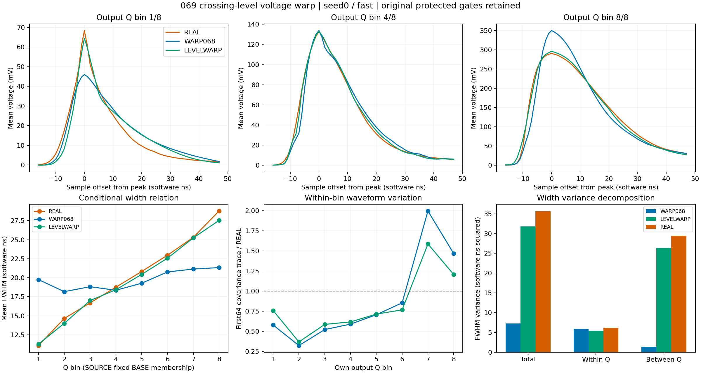
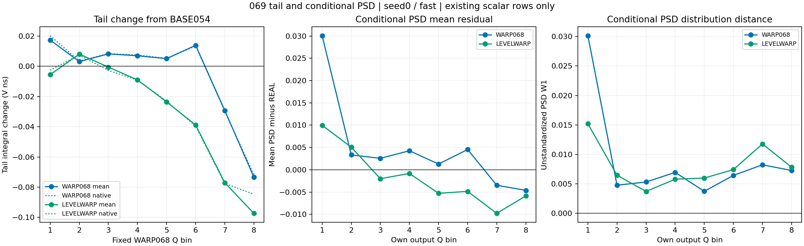
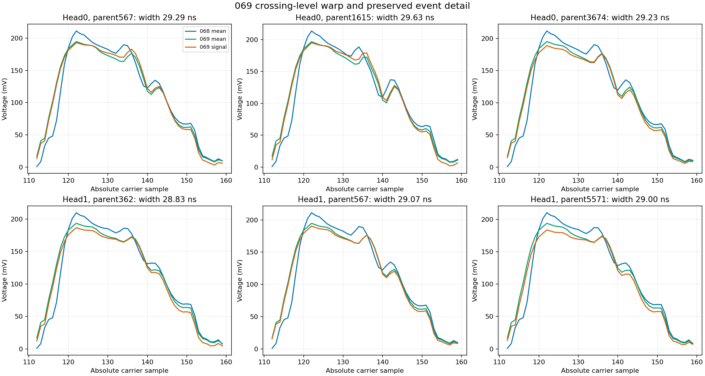

# 069：宽度关系恢复，前尾面积重分配仍失败

状态 CLOSED_NEGATIVE_CROSSING_LEVEL_VOLTAGE_WARP。两头原生执行和独立复核完成，科学接受失败；均值阶段与完整随机响应目标继续开放，未开确认库。

两头三H相对M0的完整wave改善28.275%–30.731%，joint改善57.942%–58.211%，三形态平均收益3.6598–3.6840T。全部六个条件的点目标通过，FWHM和PSD_guarded距离保护也已通过；剩余失败在全部H均为QPSD与tail积分距离。首头fast的FWHM距离从M0/068的2.468600/3.043903降为0.765689ns，峰高距离降为0.006920V；tail距离从0.016953/0.026042增至0.039018V ns，QPSD为0.050393/0.073806/0.065228。各指标必须共同判断。

| 头 | H | wave收益/M0 | joint收益/M0 | 三形态T收益 | 069 QPSD | 069 tail W1/V ns | 069 FWHM W1/ns |
|---|---|---|---|---|---|---|---|
| 0 | fast | 30.731% | 58.057% | 3.684002 | 0.065228 | 0.039018 | 0.765689 |
| 0 | slow | 29.436% | 58.211% | 3.675641 | 0.069200 | 0.038202 | 0.766664 |
| 0 | common_level | 29.726% | 58.146% | 3.670831 | 0.063076 | 0.038691 | 0.767377 |
| 1 | fast | 29.340% | 57.942% | 3.673449 | 0.067276 | 0.039410 | 0.762050 |
| 1 | slow | 28.275% | 58.137% | 3.662958 | 0.070111 | 0.038281 | 0.763519 |
| 1 | common_level | 28.558% | 57.957% | 3.659802 | 0.065051 | 0.039897 | 0.763695 |

首头fast固定WARP068输出Q八箱的FWHM均值为[11.2705, 14.0035, 17.0002, 18.4209, 20.4394, 22.5722, 25.2387, 27.5424]ns，REAL为[11.0829, 14.6438, 16.6876, 18.7552, 20.8214, 22.969, 25.3081, 28.7789]。宽度总/箱内/箱间方差为31.806304/5.419627/26.386677ns²，REAL为35.634358/6.214595/29.419764。原068箱间方差约1.384，现为26.387，表明先前被压缩的电荷条件变化已明显恢复。高Q箱内方差仍偏大，低Q偏小；不能把人口条件方差当作同一输入的重复随机方差。

每头6593个确定性均值峰全部保持，统一幅值系数0.760663–1.697515，最大查询位移13.925950个样本。全部H的FWHM未定义仍为0，原066七个失败例子每头均保持可定义；rise未定义为37–42/6593，保留原记录并通过相对M0的原异常保护。全部七项observation异常计数为0。两个头的mean到signal移峰为392/424行，mean到native为580–666行，相对068原生峰改变634–689行。全部inputQ/固定WARP068输出Q/ownQ分组及旧失败例子已保存。

尾部失败主要对应已有均值算子的面积重分配。按全6593父行核对，069与原BASE054的确定性峰和总Q一致，但5350行的确定性尾部积分减少，平均变化−0.030118638V ns，范围−0.387436311至+0.090594342。BASE054/069/REAL尾部均值分别为1.016213634/0.986094996/1.022874155V ns，确定性均值的tail W1从0.026210605增为0.046463293V ns。首头fast原生尾部相对BASE054变化−0.028689552V ns，其中确定性均值变化−0.030118638，剩余读出差分为+0.001429086；六H剩余项仅+0.001251至+0.001905。这个恒等分解中的剩余项合并了随机响应、电子学、基线扣除、量化和选峰窗口，不能单独解释成噪声因果贡献。

BASE054两头三H的QPSD和tail距离均在原039上限内，见TAIL_AND_CONDITIONAL_PSD_AUDIT.json的BASE054_native_reference。069首头fast低Q箱PSD均值为0.158351对REAL0.148379，高Q第七箱为0.215430对0.225209；全局PSD W1虽通过，条件差异仍存在。QPSD原定义同时含全局边缘/投影与逐Q箱PSD分布距离，不能用单一全局PSD距离替代。SOURCE与REAL未配对，输出Q分组也不是物理能量真值。

下一步070仅改面积约束：保持069全部交点与查询，将活动支撑在原确定性峰p+30处分为前部和尾部，分别归一到原BASE054的正面积；随机项分别投影到原残差在相同两段的有符号积分。它不再任意将电荷跨越前尾边界搬运。现有069全人口确定性右半高点位于p+4.37至p+25.69，落在分割前；这说明保留主峰交点结构有依据，但并不保证新读出的峰和宽度不变。两段幅值可在边界产生接缝，且随机选峰会改变实际读出分割位置，因此完整039验收和接缝诊断仍必要。只登记一个无新强度参数的候选，不重开055的失败确认端点，不新增随机训练。

执行验收：exit0，原生153.687042秒，峰RSS2808012800B；112文件42560771B逐长度/SHA核验，run42467707B低于64MiB。459冻结引用/468部署源码、18H精确计数与真实最终A0/M0/005深冻结通过。原M0/WARP068的12H完整指标报告精确068；baseline旧科学数组精确，固定Q参照变化单列。首个55秒启动快照仅4H，被原9H条件拒绝；第二次有界核验通过，科学代码、预算和门槛未改，未重启作业。

72NPZ、9profiles73791人口行/272组视图、geometry/intrinsic/coupling各26372行、12native/12obs各79116行核验。13186查询及源/目标各七结点独立重建，查询误差2.84e-14sample、结点误差0；156mean/random例子公式误差7.77e-16/4.51e-17V，128原mean EX、128 fast载波与384原生例子一致，ADC整数码精确。108W1由SciPy及整数CDF独立复核，最大native差1.27e-12在原累计浮点界内。NaN、人口、权重和分母保留。未导出全人口完整波形，离线核验限于保存的标量、矩、查询和例子；未重算完整wave/QPSD。013T仍为人工扰动研究尺度。

