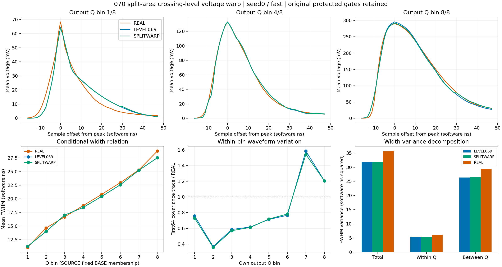
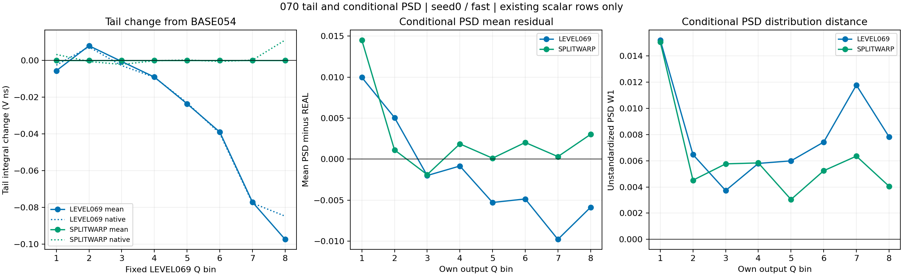
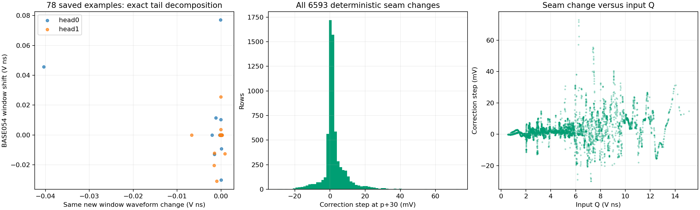
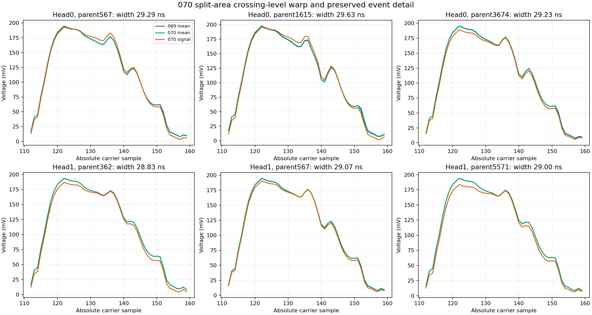

# 070：分段面积恢复，原生选峰相关的尾部差异仍未通过

状态 CLOSED_NEGATIVE_SPLIT_AREA_CROSSING_LEVEL_WARP。两头、三种噪声假设的执行与复核完成；五个条件的tail距离失败，第二头fast/common_level还失败QPSD。全部点目标通过，但均值阶段未接受，完整随机响应目标仍开放，未开新确认库。

| 头 | H | wave收益/M0 | joint收益/M0 | 三形态T收益 | QPSD | tail W1/V ns | 原保护失败 |
|---|---|---|---|---|---|---|---|
| 0 | fast | 32.603% | 58.300% | 3.708429 | 0.052111 | 0.018950 | tail_Vns |
| 0 | slow | 31.462% | 58.497% | 3.698348 | 0.054719 | 0.016971 | none |
| 0 | common_level | 31.665% | 58.253% | 3.693691 | 0.052449 | 0.018746 | tail_Vns |
| 1 | fast | 31.032% | 57.894% | 3.694256 | 0.058424 | 0.022126 | QPSD, tail_Vns |
| 1 | slow | 29.947% | 58.209% | 3.683393 | 0.057457 | 0.020118 | tail_Vns |
| 1 | common_level | 30.431% | 57.997% | 3.681326 | 0.055944 | 0.022493 | QPSD, tail_Vns |

原069全部六个QPSD/tail失败现已大幅缩小。当前首头slow的全部保护通过，其他五个条件仍失败，按原039界限保留，不因差距小而放宽。六H波形收益29.947%–32.603%，联合形态57.894%–58.497%，三形态平均3.6813–3.7084T。峰高/前沿/宽度保护均通过。

确定性前尾积分恢复到BASE054。6593个确定性峰逐行保持；新旧参考尾部最大差8.88e-16V ns，所有行在1e-12容差内。原生tail相对BASE054的均值变化仍为+0.001250至+0.001816V ns。因此，剩余差异来自参考积分以外的随机响应与共同读出组合。它不能从一个残差项直接归因于某一种噪声。

全人口配对标量表显示，相对BASE054的原生峰不同事件为981–1046/6593，约15%；这些行占绝对尾部差值总和的94.68%–96.06%。两者都选在确定性均值峰时，5337–5420行的平均绝对tail差约9.1e-5V ns，最大4.88e-4V ns，与分段面积守恒后保留的ADC离散误差相符。这个分组定位关联，尚不是全人口因果分解。

作为标量归因诊断，将“峰不同”组的tail值替换为相同父行BASE054值，六H W1变为0.018241/0.016643/0.018066/0.020150/0.018612/0.020497V ns，均在原各自tail界内；替换“峰相同”组几乎不改失败。这只定位保存的标量差异，未构成可执行响应模型，也不代表任何候选通过。78个已保存fast完整例子进一步精确分解为“相同新窗口中的波形变化”与“BASE054波形的窗口移动”两项，并分离参考窗口的均值、随机和ADC差。完整人口同样的分解仍需071一次有界冻结重放。

接缝需要保留审查。前段幅值系数范围0.748598–1.674281，尾段0.660521–2.210132；p+30的确定性修正接缝为−29.909至+73.032mV。由于不同原生峰引起的差异已占主要份额，当前证据不足以断言单独平滑接缝能解决尾部保护。未以接缝小或总面积正确代替共同读出评价。

首头fast固定LEVEL069输出Q八箱FWHM均值为[11.2543, 13.9997, 17.0005, 18.4208, 20.439, 22.5716, 25.2334, 27.5403]ns，REAL为[11.0829, 14.6438, 16.6876, 18.7552, 20.8214, 22.969, 25.3081, 28.7789]。宽度总/箱内/箱间方差为31.796356/5.395863/26.400494ns²，对REAL 35.634358/6.214595/29.419764。070保留069恢复的宽度关系；低Q峰前与尾部形状仍有残差，高Q箱内波形变化仍偏大。人口条件方差包含源事件差异，不能当成同一输入的随机核方差。

全部六H FWHM未定义为0，原066七个失败父行每头保持有定义；rise未定义36–40/6593，均通过原保护。全部七类observation flags为0。均值到随机signal移峰392/424行；均值到native为578–675行；相对069仅25–36行移峰。保留inputQ、固定LEVEL069输出Q、各自输出Q的所有分组，SOURCE与REAL仍不逐事件配对，Q不是能量真值。

下一步071只做冻结诊断：完整重放070的18H并逐报告一致，补算相同输入/随机库/电子噪声下的BASE054观察；全6593行逐H保存选峰阶段、Q/tail的均值/随机/量化/裁窗分解与峰竞争贡献。它将判别误差主要在随机项耦合还是最终噪声选峰，以及是否存在有证据支持的最小修正。没有新端点、拟合、强度网格或确认库，不预设“改变随机项一定成功”。

执行验收：exit0，原生58.715068秒，峰RSS2807902208B。112文件44396782B逐长度/SHA核验，run44299351B低于64MiB。481冻结引用/490部署源码一致；18H精确计数与真实最终A0/M0/005深冻结通过。原M0/LEVEL069的12H完整指标报告精确069，原科学数组不变，固定Q参照例外单列。

72NPZ、9profiles/73791行/272组视图、geometry/intrinsic/coupling各26372行、12native/12obs各79116行核验。13186查询和七结点对精确069且独立重建；查询误差2.84e-14sample、结点误差0。均值/随机分段残差最大3.51e-15/5.2e-17V ns。156mean/random例子、128原EX、384native和128carrier检查通过；ADC整数码精确。108W1用SciPy及整数CDF独立复核，最大native差8.01e-13，沿用原浮点累计界。未保存全人口完整波形，未离线重算完整wave/QPSD；013T仍为人工扰动研究尺度。

