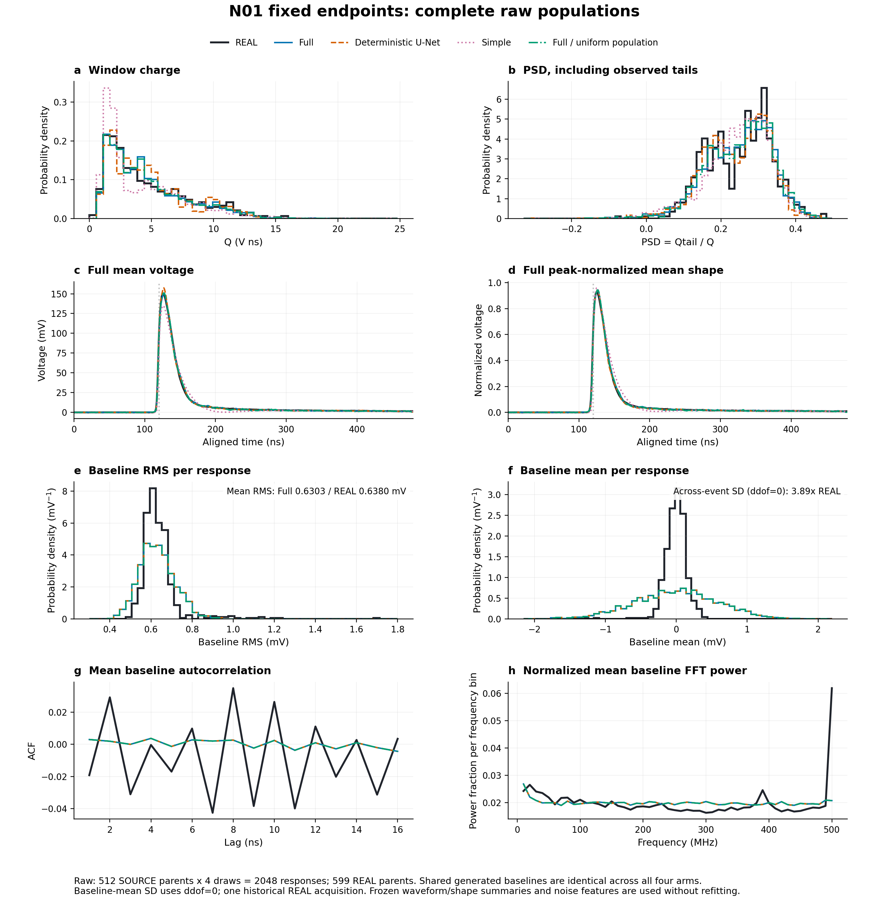
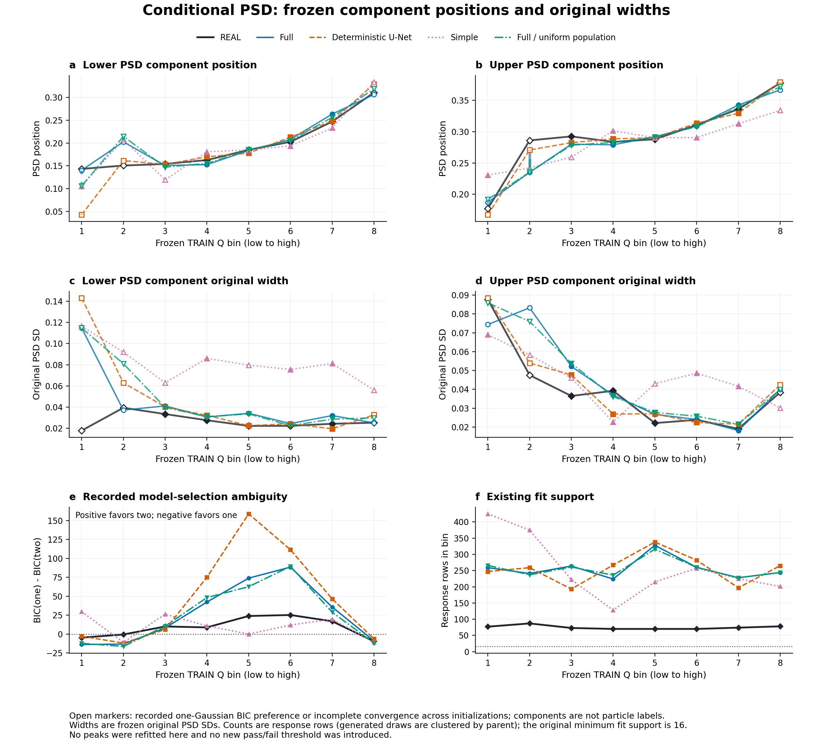
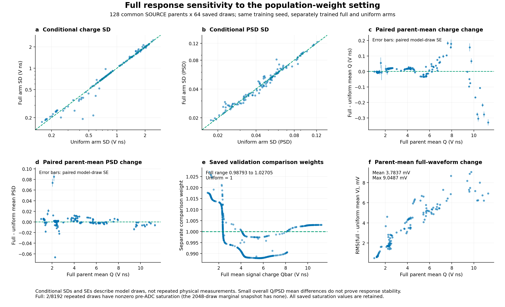
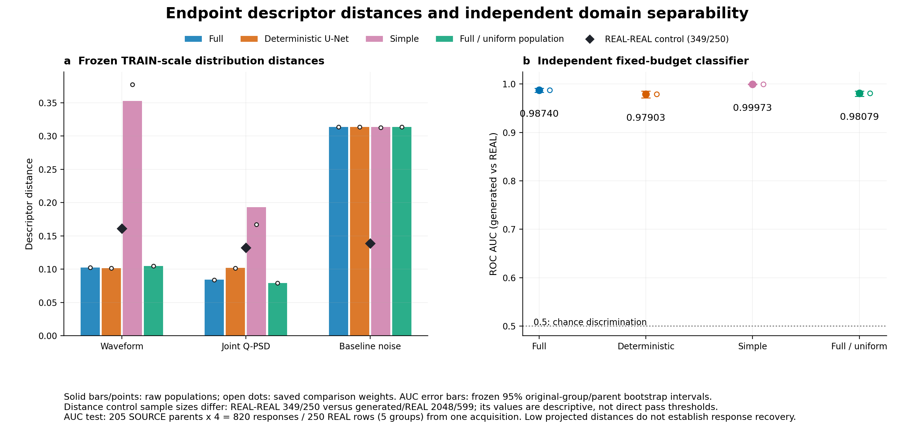

# N01 完整模型：固定终点评估

四组训练于 **2026-10-12 07:00:28（UTC+8）** 正常结束，退出码 0。共享基线 1000 更新＋四臂各 19000 更新，共 **77000 次生成器训练更新**；每臂名义终点 20000。

**部分 QPSD 统计得到改善，完整 sim2real 响应匹配尚未得到支持。** 当前只有一个训练种子、一份历史 REAL 采集。随机方差存在不等于物理随机性已识别。

| 固定终点 | 原始 wave 距离 ↓ | 原始 QPSD 距离 ↓ | 原始域分类 AUC |
|---|---:|---:|---:|
| full | 0.102580 | 0.084326 | 0.987395 |
| deterministic | 0.101556 | 0.101716 | 0.979029 |
| simple | 0.352711 | 0.193116 | 0.999732 |
| full_uniform | 0.104809 | 0.079330 | 0.980785 |

距离使用冻结的 TRAIN 尺度；AUC 越接近 0.5，生成与实测越难区分。full 的 AUC 95% 分组 bootstrap 区间为 **[0.982761, 0.991082]**，测试 REAL 只有 5 个原始块；这不代表跨采集误差。

full 的 QPSD 距离较 deterministic 低约 **17.1%**，wave 和可区分性没有整体改善。最明确的噪声残差是基线均值的跨事件 SD：生成 **0.596916 mV**，REAL **0.153325 mV**，约 **3.89 倍**。独立抽取漂移截距与斜率、短窗估计噪声及后续冻结可以解释这一结构缺口。部分条件 PSD 峰宽也仍有偏差。

## 完整报告与证据

- [中文 HTML 报告](N01_COMPLETE_MODEL_REVIEW.html)：下载本目录后在浏览器打开；GitHub 文件页显示源码。
- [独立科学审核](INDEPENDENT_REVIEW.md)
- [机器可读总结](REVIEW_SUMMARY.json)
- [四臂最终比较](train/ARM_COMPARISON.json)
- [末点与划分审计](CHECKPOINT_AND_SPLIT_AUDIT.json)
- [电子学与输入外推诊断](FULL_MODEL_ELECTRONICS_AND_INPUT_DIAGNOSTIC.json)
- [原始回收哈希核验](RECOVERY_VERIFICATION.json)

### 总体波形与噪声

### 条件 PSD 分量位置与原始宽度

空心标记保留拟合歧义。图中箱号 1–8 对应数值报告的 0–7；两个 Gaussian 分量不是真实 neutron / gamma 标签。

### 比较总体假设的敏感性

full / full_uniform 使用相同种子重新训练。该对照不等同于冻结同一响应后的跨源迁移验证。

### 距离与独立分类器

## 模型与逐事件结果

完整模型、三个对照、阶段检查点、训练日志与逐事件评估数组均在 [固定终点 Release](https://github.com/Aggressivecyber/ej276d-n01/releases/tag/n01-run-001-20261012) 的 `N01_run_001_complete.tar.gz` 中。解压后生成 `train/` 目录，68 个文件按 `REMOTE_MANIFEST.json` 逐文件核验。

[Release](https://github.com/Aggressivecyber/ej276d-n01/releases/tag/n01-run-001-20261012) 同时提供本目录的离线报告包 `N01_review_bundle.zip` 以及 SHA256 清单。`N01_review_bundle.zip` 解压后即可打开 HTML；将模型结果包解压到同一目录，可运行 `analysis/build_figures.py` 重建四张图。该脚本保留了本次 Windows E 盘的绘图库/临时目录设置，其他环境应先调整路径并提供 NumPy、Matplotlib。

原始 TRAIN 容器不随仓库或 Release 上传。重新训练需要按 [DATA_REFERENCES.json](../../DATA_REFERENCES.json) 取得原始合法输入；检查点和验证输出不能替代原始训练数据。原始全 1 权重仅是均匀计数参考，真实物理权重和绝对校准未知。

当前下一步建议是优先验证电子学噪声的联合结构。本次发布没有启动新训练，也没有根据验证结果挑选终点。
