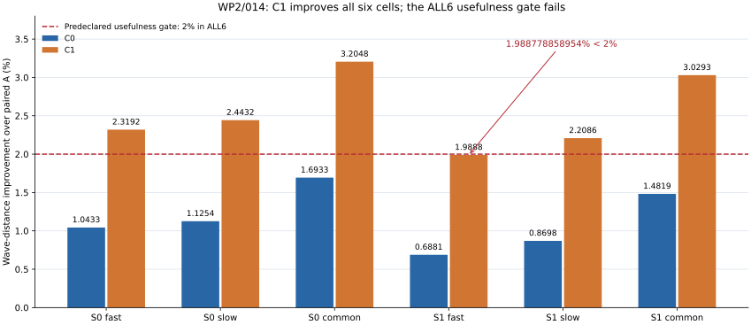
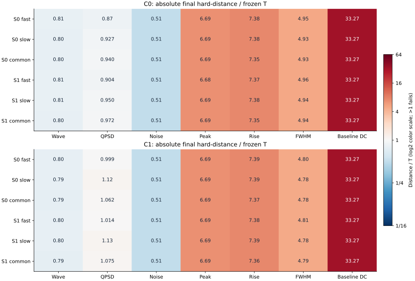
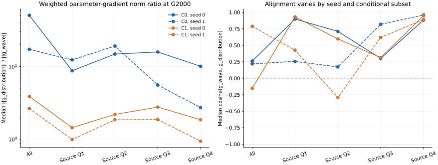

# N01 WP2 / 014：损失表示对照与独立读回报告

日期：2026-10-15（Asia/Singapore）。按六工作包主实施计划完成 C0/C1 两种子、四次各2000G的固定预算对照；本报告数据来自保存JSON与已完成的独立保存数组读回。

**结果：选择C1作为后续开发代码路径；两候选的当前权重均未晋级。** C1的12项最终wave距离均值为0.15042006897712382，低于C0的0.15255321144257886。C1通过已冻结的ALL6关键组件非劣性规则，用途改善达到5/6格；seed1-fast为1.9887788589535327%，未达到2%门槛。形态与基线均值的绝对T门仍未通过，科学状态保持 `response_match_not_established`。

## 1. 固定实验与数据角色

| 项目 | 实际范围 | 比较含义 |
|---|---|---|
| 训练 | seed0 C0→C1，seed1 C0→C1；每次2000G，共8000G | 四次按固定顺序串行完成，C2关闭 |
| 模型 | A(det19k)及005冻结；同结构8维随机形状头，1288可训练参数 | C0/C1单因素为分布损失表示 |
| 每步训练 | 512 SOURCE父×2draw；1024 REAL行；三电子学假设 | 全部合法TRAIN循环，SOURCE6593/REAL21047均覆盖 |
| 完整硬评价 | 6593 SOURCE父×4draw×2库；REAL全部21047行；三假设 | 每格先平均两库各自距离，父事件是重复响应的源单位 |
| 梯度探针 | G0/G2000；64父×2draw×2库×3假设；13类子集 | 每个子集对固定128条全局REAL参考计算条件经验损失 |
| 独立保存数组审核 | 36 pair、176 NPZ、1898784硬波形行、8梯度快照 | 176个原NPZ留在服务器，本地回收审核结果19文件 |

本轮C0沿用010的原损失代码，并重新初始化、校准随机头；C1在同seed复用同一校准初始化。它们均不以010的G2000头作为本轮初始权重。128 TRAIN父×4draw×2库的校准RMS分别为0.9994843046300347和0.9999251348242464 LSB，采用预登记16次lower-bracket二分；0.05相对幅度增益和头容量保持相同。

硬观察保持14 bit、384点载体、原100点基线、first-argmax搜索[112,144)、p−16:p+240裁窗、256点输出及tail起点46，时间单位为1 ns软件采样间隔。REAL来自已确认的单次采集、422个旧逻辑组；旧DEV已经暴露。本轮响应训练、损失拟合与候选比较均使用TRAIN。独立跨采集物理复用仍待确认。

## 2. C1改变的目标与配对控制

C0训练目标保留 wave + 2×原QPSD + 0.01×regular；C1将其中的分布项替换为无分母积分距离，wave与regular及其权重保持相同。六维特征为Q、T及[0,16)、[16,46)、[46,96)、[96,256)四段积分。每维按 `max(REAL TRAIN median(abs(integral)), ADC_LSB×sqrt(segment_length))` 固定尺度做signed-asinh变换，距离为0.5×逐坐标经验W1加0.5×16方向联合投影W1，外层权重为2。全部有限行保留，非正Q不触发删除。

积分统计在候选输出之前仅拟合一次，覆盖21047条REAL TRAIN；六个尺度为3.7103998、0.700152597、0.880075688、2.13181957、0.342031374、0.359189404 V·软件ns。统计JSON的SHA256为 `5b8a20ddfc2475ab275966e715fedd549f94140be0d5c4703fe0717dad077f07`。硬评价继续使用原native QPSD、raw/guarded PSD、形态和基线指标。训练日志中C1的distribution/QPSD别名表示积分目标，本文表格的QPSD均取硬评价native指标。

每seed的C0/C1初始头哈希一致、初始完整人口指标一致；全部21个记录批次的SOURCE父序列与wave投影上下文相同。SOURCE/REAL、shape/005/extension和投影使用配对的显式流地址；配置指纹是流地址证据。原生冻结参数/缓冲守卫通过，校准初始状态和配对日志的独立核验以保存哈希与JSON为依据。

## 3. 全六格wave：C1更低，用途门仍为5/6

| 候选 | seed | 假设 | A | 共同初始 | final | 相对A改善/% | ≥2%用途门 |
|---|---|---|---|---|---|---|---|
| C0 | 0 | fast | 0.153707296 | 0.153724751 | 0.152103660 | 1.043305172679 | FAIL |
| C0 | 0 | slow | 0.154674684 | 0.154654796 | 0.152934029 | 1.125365147174 | FAIL |
| C0 | 0 | common_level | 0.154605859 | 0.154555574 | 0.151987946 | 1.693281923767 | FAIL |
| C0 | 1 | fast | 0.153707296 | 0.153725054 | 0.152649597 | 0.688125888601 | FAIL |
| C0 | 1 | slow | 0.154674684 | 0.154690247 | 0.153329330 | 0.869796119859 | FAIL |
| C0 | 1 | common_level | 0.154605859 | 0.154590713 | 0.152314707 | 1.481930930574 | FAIL |
| C1 | 0 | fast | 0.153707296 | 0.153724751 | 0.150142574 | 2.319162882221 | PASS |
| C1 | 0 | slow | 0.154674684 | 0.154654796 | 0.150895665 | 2.443204998363 | PASS |
| C1 | 0 | common_level | 0.154605859 | 0.154555574 | 0.149651004 | 3.204829589404 | PASS |
| C1 | 1 | fast | 0.153707296 | 0.153725054 | 0.150650398 | 1.988778858954 | FAIL |
| C1 | 1 | slow | 0.154674684 | 0.154690247 | 0.151258463 | 2.208649063961 | PASS |
| C1 | 1 | common_level | 0.154605859 | 0.154590713 | 0.149922309 | 3.029347994797 | PASS |

判定使用保存的未舍入浮点数。C1的seed1-fast改善为1.9887788589535327%，与2%门槛差−0.011221141046467362个百分点；该格保留FAIL。C0的6格用途门全部失败，C1为5格通过。表内两库均值是两个独立经验距离的均值，合并8draw的经验距离未用于这些判定。

图1：英文图按两个种子×三假设展示wave改善，虚线为预登记2%用途门。精确数值另存 [ALL6 wave表](WP2_ALL6_WAVE.csv)。

| 候选 | ALL6正T组件非劣 | mean12 final wave | 用途门 | 绝对T全过 | 开发选择 | 权重/科学验收 |
|---|---|---|---|---|---|---|
| C0 | PASS（每格15项，共90项） | 0.15255321144257886 | 0/6 | FAIL | — | false / false |
| C1 | PASS（每格15项，共90项） | 0.15042006897712382 | 5/6 | FAIL | C1 | false / false |

开发选择按已冻结规则执行：同一候选全部6格、每个正且有定义T组件的 `mean2banks(final−A)≤T`，再比较全部12项final wave均值；绝对差≤1e−12时选C0。C0/C1均eligible，C1取得较低分数，因此开发代码路径选择C1。用途、绝对容忍度及科学确认分别保留自己的判定。

## 4. 原QPSD、噪声和绝对T缺口

| 候选 | seed | 假设 | A QPSD | initial QPSD | final QPSD | final相对A变化/% | noise |
|---|---|---|---|---|---|---|---|
| C0 | 0 | fast | 0.050785702 | 0.050701960 | 0.042065553 | -17.17048 | 0.124825000 |
| C0 | 0 | slow | 0.045074661 | 0.045050774 | 0.042266266 | -6.23054 | 0.124825000 |
| C0 | 0 | common_level | 0.052339287 | 0.052322127 | 0.043443861 | -16.99570 | 0.124825000 |
| C0 | 1 | fast | 0.050785702 | 0.050646106 | 0.043634221 | -14.08168 | 0.124825000 |
| C0 | 1 | slow | 0.045074661 | 0.045108077 | 0.043316723 | -3.90006 | 0.124825000 |
| C0 | 1 | common_level | 0.052339287 | 0.052300002 | 0.044920474 | -14.17446 | 0.124825000 |
| C1 | 0 | fast | 0.050785702 | 0.050701960 | 0.048201630 | -5.08819 | 0.124825000 |
| C1 | 0 | slow | 0.045074661 | 0.045050774 | 0.051263138 | +13.72939 | 0.124825000 |
| C1 | 0 | common_level | 0.052339287 | 0.052322127 | 0.049065810 | -6.25434 | 0.124825000 |
| C1 | 1 | fast | 0.050785702 | 0.050646106 | 0.048935480 | -3.64319 | 0.124825000 |
| C1 | 1 | slow | 0.045074661 | 0.045108077 | 0.051380657 | +13.99011 | 0.124825000 |
| C1 | 1 | common_level | 0.052339287 | 0.052300002 | 0.049685155 | -5.07101 | 0.124825000 |

QPSD距离越小越好。C1的slow QPSD较A增加，wave收益与原比值/条件PSD目标存在具体取舍；逐格数值完整保留。noise_prefix100在所有候选、种子和假设下均为0.124825000，形状头的原100点前缀保持冻结基线噪声。

| 候选 | seed | 假设 | 峰幅D/T | 上升D/T | FWHM D/T | 基线DC D/T | 上升未定义率差D/T |
|---|---|---|---|---|---|---|---|
| C0 | 0 | fast | 6.6861 | 7.3755 | 4.9539 | 33.2674 | 1.8783 |
| C0 | 0 | slow | 6.6876 | 7.3805 | 4.9275 | 33.2674 | 2.4143 |
| C0 | 0 | common_level | 6.6874 | 7.3537 | 4.9282 | 33.2674 | 3.1203 |
| C0 | 1 | fast | 6.6848 | 7.3694 | 4.9645 | 33.2674 | 1.8365 |
| C0 | 1 | slow | 6.6863 | 7.3769 | 4.9380 | 33.2674 | 2.3108 |
| C0 | 1 | common_level | 6.6861 | 7.3479 | 4.9396 | 33.2674 | 3.0717 |
| C1 | 0 | fast | 6.6907 | 7.3876 | 4.8045 | 33.2674 | 2.2368 |
| C1 | 0 | slow | 6.6921 | 7.3944 | 4.7790 | 33.2674 | 2.7471 |
| C1 | 0 | common_level | 6.6920 | 7.3658 | 4.7792 | 33.2674 | 3.6444 |
| C1 | 1 | fast | 6.6854 | 7.3827 | 4.8109 | 33.2674 | 2.2965 |
| C1 | 1 | slow | 6.6868 | 7.3881 | 4.7843 | 33.2674 | 2.9025 |
| C1 | 1 | common_level | 6.6866 | 7.3626 | 4.7865 | 33.2674 | 3.7803 |

图2：最终硬评价距离除以WP1冻结T；红色区域大于1。两候选的峰幅、上升时间、FWHM与基线DC绝对距离持续超过T，基线DC约33.27T。T来自预登记gain/tail/电子学幅度/展宽的人工自距离，作为本计划的规范性灵敏度标尺，`hardware_calibrated=false`。

| 未标定组件 | 本轮状态 |
|---|---|
| Q_nonpositive_rate | pending_not_calibrated；零/未定义T不自动PASS |
| PSD_undefined_rate | pending_not_calibrated；零/未定义T不自动PASS |
| PSD_guarded_rate | pending_not_calibrated；零/未定义T不自动PASS |
| FWHM_undefined_rate | pending_not_calibrated；零/未定义T不自动PASS |
| temporal_nonpositive_peak_rate | pending_not_calibrated；零/未定义T不自动PASS |
| FWHM_prepeak_censored_rate | pending_not_calibrated；零/未定义T不自动PASS |
| FWHM_postpeak_censored_rate | pending_not_calibrated；零/未定义T不自动PASS |

Q_nonpositive、PSD undefined/guarded等已记录的零率差仍保留上述pending角色。所有低Q、非正Q与失效路径按原合同保留；已完成库中的零发生数不替代该路径的物理验收。全部组件的A/initial/final、final−A、T及绝对判定见 [完整组件表](WP2_ALL6_COMPONENTS.csv)。

## 5. 输出Q条件：保留每格最差库与箱

输出Q条件沿用原TRAIN统计的8个logQ箱；每行按观测Q落入且仅落入一箱，支持门为fake与REAL各至少16行。72套REPORT中的576个库×臂×假设×箱均有支持。箱边界按保存REPORT中的冻结数组指针引用，本报告未读取边界NPZ；输出Q不是能量或粒子真值。

| trial | 假设 | 支持箱 | 最小fake/REAL箱行数 | 最大PSD W1（库/箱） | 最大绝对rise均值差/ns | 最大绝对FWHM均值差/ns |
|---|---|---|---|---|---|---|
| seed0_C0 | fast | 16/16 | 3181/2630 | 0.012063（b0/q0） | 2.7969（b1/q2） | 13.0473（b0/q0） |
| seed0_C0 | slow | 16/16 | 3178/2630 | 0.011059（b0/q0） | 2.7827（b1/q2） | 13.0457（b1/q0） |
| seed0_C0 | common_level | 16/16 | 3172/2630 | 0.013132（b0/q0） | 2.7990（b1/q2） | 13.0772（b1/q0） |
| seed1_C0 | fast | 16/16 | 3181/2630 | 0.012502（b0/q0） | 2.7967（b1/q2） | 13.0454（b1/q0） |
| seed1_C0 | slow | 16/16 | 3175/2630 | 0.010931（b0/q0） | 2.7844（b1/q2） | 13.0644（b1/q0） |
| seed1_C0 | common_level | 16/16 | 3169/2630 | 0.013704（b0/q0） | 2.7985（b1/q2） | 13.0970（b1/q0） |
| seed0_C1 | fast | 16/16 | 3180/2630 | 0.013446（b0/q0） | 2.7939（b1/q2） | 13.1821（b0/q0） |
| seed0_C1 | slow | 16/16 | 3179/2630 | 0.013763（b0/q0） | 2.7815（b1/q2） | 13.1861（b1/q0） |
| seed0_C1 | common_level | 16/16 | 3176/2630 | 0.014009（b0/q0） | 2.7963（b1/q2） | 13.2092（b1/q0） |
| seed1_C1 | fast | 16/16 | 3184/2630 | 0.013157（b0/q0） | 2.7946（b1/q2） | 13.1670（b0/q0） |
| seed1_C1 | slow | 16/16 | 3179/2630 | 0.014093（b0/q0） | 2.7818（b1/q2） | 13.1735（b1/q0） |
| seed1_C1 | common_level | 16/16 | 3171/2630 | 0.014308（b1/q0） | 2.7961（b1/q2） | 13.2060（b1/q0） |

表内逐一保留两候选×两seed×三假设的final结果；每列选择该格两库×8箱中的实际最差值，列间可能来自不同箱。PSD W1为保存producer距离，rise/FWHM为保存条件均值的差；它们属于不同统计量。条件T未标定，这些数值只作描述，不套用全人口T作条件PASS判定。

[输出Q条件完整表](WP2_OUTPUT_Q_CONDITIONS.csv)保留A/initial/final共576条箱记录，包含fake/REAL行数与支持、PSD W1及Q/front/tail/PSD/峰幅/rise/FWHM的均值、总体标准差和定义/未定义计数；各seed、hypothesis和bank均单列。

## 6. SOURCE输入趋势与输入信息边界

| trial | 假设 | r(inputQ,父meanQ) | r(inputQ,父varQ) | r(PC0,父meanQ) | r(PC0,父meanTail) |
|---|---|---|---|---|---|
| seed0_C0 | fast | +0.899604 | +0.006378 | +0.560005 | +0.419498 |
| seed0_C0 | slow | +0.899587 | +0.003332 | +0.559954 | +0.419170 |
| seed0_C0 | common_level | +0.899600 | +0.001887 | +0.559941 | +0.419225 |
| seed1_C0 | fast | +0.899604 | +0.007102 | +0.560006 | +0.418428 |
| seed1_C0 | slow | +0.899587 | +0.004861 | +0.559954 | +0.418101 |
| seed1_C0 | common_level | +0.899599 | +0.005182 | +0.559943 | +0.418141 |
| seed0_C1 | fast | +0.899600 | +0.006771 | +0.560008 | +0.418541 |
| seed0_C1 | slow | +0.899583 | +0.004633 | +0.559958 | +0.418217 |
| seed0_C1 | common_level | +0.899595 | +0.005305 | +0.559946 | +0.418258 |
| seed1_C1 | fast | +0.899597 | +0.006269 | +0.560011 | +0.418428 |
| seed1_C1 | slow | +0.899579 | +0.002962 | +0.559958 | +0.418155 |
| seed1_C1 | common_level | +0.899592 | +0.002837 | +0.559946 | +0.418205 |

表中为每库4draw父统计上的描述性Pearson，再算两个库r值的算术均值；全部12个候选×seed×假设格均列出。canonical-Q、384点幅度和16个形状PC共18个审计描述量，对Q/tail/峰幅/基线RMS的父mean与variance的每库结果，共10368条，保存于 [SOURCE趋势完整表](WP2_SOURCE_INPUT_TRENDS.csv)。这些描述量未新增为网络输入。

原WP1信息审计显示，TRAIN canonical-Q归一化384点SOURCE形状的95%、99%、99.9%解释方差维数均为1，总方差约9.14890675e-05。它来自已登记的EE/hadron双模板混合；高阶数值PC继续作为审计项保存，不把float32舍入图样解释为新的物理自由度。

保存的全8192父同原角色输入普查，在相对Q差≤1%、480点峰归一化形状RMS差>0.001的规则下找到6890个有可测形状对比的父，最大强度0.01583175。这是旧SOURCE输入可区分性的证据；本轮未新增同Q配对响应干预。SOURCE到生成响应的相关性描述当前生成器的输入依赖；未配对REAL没有相应父真值，真实条件均值和物理源权重继续保持未识别/unknown。

## 7. 两种子的描述性差异

| 候选 | 假设 | seed1−seed0 final wave | seed1−seed0 final QPSD | seed1−seed0 final峰幅 | seed1−seed0 final FWHM |
|---|---|---|---|---|---|
| C0 | fast | +0.000545936475 | +0.00156866837 | -7.27531897e-06 | +0.00547637273 |
| C0 | slow | +0.000395300586 | +0.00105045664 | -7.35992682e-06 | +0.00538795462 |
| C0 | common_level | +0.000326761018 | +0.00147661341 | -7.33665555e-06 | +0.00585978337 |
| C1 | fast | +0.00050782435 | +0.000733850707 | -2.92684758e-05 | +0.00328471431 |
| C1 | slow | +0.000362798651 | +0.000117519236 | -2.92244037e-05 | +0.0027027898 |
| C1 | common_level | +0.000271304826 | +0.000619344743 | -2.94103921e-05 | +0.00379277538 |

两候选的seed1 final wave均高于seed0；C1在fast的种子差使该格落到2%线下。这些是两个拟合种子的实际差值，本轮没有追加bootstrap、置信区间或近阈值补训。两库重复控制Monte Carlo变化，统计源单位仍是6593个SOURCE父。

## 8. 分层梯度：强度与方向，按子集解释

| trial | G | 分布/wave范数比中位数 | 六格范围 | wave/分布cos中位数 | 峰位较自身初始变化/768次 |
|---|---|---|---|---|---|
| seed0_C0 | 0 | 45.93336 | 33.1863..72.3716 | +0.17635 | 0 |
| seed0_C0 | 2000 | 50.28768 | 40.1999..55.9005 | +0.26020 | 19 |
| seed0_C1 | 0 | 5.47951 | 4.2667..7.3202 | -0.10762 | 0 |
| seed0_C1 | 2000 | 3.92395 | 2.8796..4.6686 | -0.15425 | 58 |
| seed1_C0 | 0 | 15.93051 | 13.0685..18.8287 | +0.49536 | 0 |
| seed1_C0 | 2000 | 17.26756 | 11.4778..21.2704 | +0.21843 | 51 |
| seed1_C1 | 0 | 2.28312 | 2.0359..2.5282 | +0.81912 | 0 |
| seed1_C1 | 2000 | 2.68567 | 2.2961..3.2119 | +0.78755 | 79 |

图3：G2000固定探针中，按all及SOURCE Q四分位展示六个库×假设格的中位数。C1的加权分布/wave参数梯度范数比低于C0；wave与分布梯度的夹角随种子和子集变化，C1 seed0的all中位cos为负而seed1为正。

13类子集包括all、SOURCE Q四分位、生成输出Q四分位和4个预指定单父位置。每个子集均针对同一全局128行REAL参考计算非加性经验损失；范数比是梯度强度比，子集梯度不能相加解释为事件贡献、损失比例或因果占比。weighted total向量由wave、2×distribution和0.01×regular三向量相加，保存向量的逐项加和误差为0，范数最大核验差约2.13e−14。

峰位变化以各trial自身G0探针为参考，表内768次为2库×3假设×128行，包含同父重复。保存probe没有完整窗或peak_index；独立读回核对其已保存布尔值及行/父计数。完整13子集的中位数、范围与计数见 [分层梯度表](WP2_GRADIENT_STRATA.csv)。

## 9. 保存数组读回与4/8draw统计

受监督CPU任务原生退出0，耗时60.486秒，CPU2线程；worker记录峰值RSS约476.70 MiB，限制为RSS1536 MiB、虚拟内存3072 MiB、wall1800秒、输出64 MiB。176个原NPZ共3077281496字节逐项核SHA并解码一次；308项durable操作entered=completed，无失败、缺口或在途。首个完整pair是正式预算内任务。

| 层级 | 独立核验内容 | 范围 |
|---|---|---|
| 硬波形编码 | uint16裁窗ADC码＋原double基线均值＋可选IEEE XOR，解码与编码回写 | 72 HARD_ROWS，父/seed路径/bank/draw身份与可重建flags |
| 逐行量 | Q、T、raw/guarded PSD、峰幅、rise、FWHM、基线均值/RMS；另核front/crossing辅助值 | 1898784行；16 BASELINE100文件 |
| r4原报告 | 均值、无偏方差、9×9标量协方差、有限交集计数及MCSE | 72个原生REPORT NPZ；协方差分母3 |
| r8派生 | 实际4+4行的中心化波形因子、方差、9×9标量协方差及MCSE；与merge式交叉核验 | 36 pair；协方差分母7；波形因子经验秩≤7 |
| 梯度保存向量 | 1288维三向量加和、范数、余弦和分层成员/掩码计数 | 8快照、624条件记录，原有1872次AD查询的输出 |

r8硬波形方差使用 `[3(s²_bank0+s²_bank1)+2(μ_bank0−μ_bank1)²]/7`；硬波形r4、r8条件均值MCSE分别为sqrt(s²/4)、sqrt(s²/8)。标量MCSE使用各维有限样本数n，按sqrt(s²/n)计算；标量协方差使用逐对共同有限样本及其计数。带不同缺失支持的完整标量矩阵不强加统一半正定或秩7声明。完整256×256波形协方差由中心化因子表示，本轮未输出6593个稠密矩阵。

| 候选 | seed | 假设 | final硬波形8draw散布/mV | 条件均值MCSE/mV |
|---|---|---|---|---|
| C0 | 0 | fast | 2.856344 | 1.009870 |
| C0 | 0 | slow | 2.807245 | 0.992511 |
| C0 | 0 | common_level | 2.788500 | 0.985884 |
| C1 | 0 | fast | 3.808014 | 1.346336 |
| C1 | 0 | slow | 3.786978 | 1.338899 |
| C1 | 0 | common_level | 3.775588 | 1.334872 |
| C0 | 1 | fast | 2.794705 | 0.988077 |
| C0 | 1 | slow | 2.751074 | 0.972652 |
| C0 | 1 | common_level | 2.729255 | 0.964937 |
| C1 | 1 | fast | 3.757567 | 1.328500 |
| C1 | 1 | slow | 3.735391 | 1.320660 |
| C1 | 1 | common_level | 3.720333 | 1.315336 |

上表散布为sqrt(mean_parent,time(s²_8draw))，MCSE为sqrt(mean_parent,time(s²_8draw/8))，涵盖电子学、ADC和裁窗后的总硬输出。014未保存纯信号完整384点库；上表不能用作纯形状头RMS。36 pair的摘要和因子/协方差SHA见 [r8派生矩表](WP2_R8_MOMENTS.csv)。

独立核验边界集中记录如下：完整wave/QPSD/noise经验距离沿用冻结producer输出并独立复核JSON聚合与选择逻辑；原REAL TRAIN median未重拟合，核验其保存SHA、fit21047、floor与使用链；原始Y没有第二份独立副本，producer曾在内存逐字节比较编码回放，独立任务核编码回写与统计；完整preADC384、纯载体及probe完整窗/peak_index未保存，相应原生诊断维持producer或保存布尔证据。

## 10. 原生费用、保护与交付位置

| 计数 | 实际完成 | 含义 |
|---|---|---|
| G/optimizer steps | 8000 | 4trial×2000；累计训练159667→167667 |
| training backward AD | 8000 | 每G一次 |
| probe AD | 1872 | 4trial×2快照×2库×3假设×13子集×3项 |
| 全部新AD | 9872 | 8000+1872 |
| old_A_rows | 8616256 | 冻结A前向 |
| head实际参数前向 | 8616512 | 含校准实际评估 |
| head校准map | 36864 | 解析校准映射另列 |
| head总kernel行 | 8653376 | 实际参数行+校准map行 |
| 005前向行 | 8616000 | 冻结电子学噪声模型 |
| hard ADC / gather | 26480928 | 两项各26480928 |
| 原科学checkpoint loads | 2 | A与005；保存头CP未在审核中解码 |
| optimizer创建 / 积分统计fit | 4 / 1 | 每trial一个优化器；一次完整REAL TRAIN统计 |
| D/noise/pop/C2ST更新 / DEV模型行 | 全部0 | 本轮noGAN且DEV模型未使用 |
| 独立读回新CP/NN/AD/更新/随机/CDF | 全部0 | 176 NPZ CPU读回与本报告不新增科学训练成本 |

科学原生child=107083、supervisor=107073，两者退出0；总wall 2148.641秒，采样峰值RSS 4.077 GiB、GPU 8.268 GiB，整批输出3005.51 MiB。95个源码与271条旧保护记录通过冻结/原生保护链；独立closeout另核侧车6个实际Git blob及全部19个回收文件。

首次选择性回收142/318个科学文件，176个原NPZ留在原服务器只读目录 `/home/rylan/projects/ej276d-n01/wp2_014_20261015`；14个新头CP已随选择性包保存，审核未加载。随后在同级隔离目录执行一次保存数组CPU审核，回收19文件到 `runs/wp2_014_20261015/independent_readback_collected_01`。原142文件的collection和provisional selection保留原始时点字段；现行 `FINAL_DEVELOPMENT_SELECTION.json` 已引用独立CLOSEOUT_REVIEW，将C1代码路径选择登记为independently_reviewed，原科学分数及阈值保持相同。

科学选收归档SHA256：`247dccdf9a572b46df54c1e38d18fdb5e557fbfbb5f00c931d34e38ced107842`。保存数组审核归档SHA256：`2d14a16ca34eb7d629f23b2b57016ab8c141b4c0d5f810a242c7e53e43403202`。审核ARRAY_READBACK SHA256：`bfb2169ead85c60a7f5a39e9379f5d910a2d1712cc3a01ff1d9b48f1bce8ea71`。本报告及图表仅由保存JSON生成，图中没有重播模型、AD、完整CDF或损失计算。

## 11. 决策与下一工作包

WP2完成四次固定短试验及保存数组独立读回。后续开发沿用C1无分母积分表示；当前C0/C1权重仍为未晋级候选，科学响应匹配未建立。下一WP3由根流程按主计划登记固定人口的平均残差定位和配对均值路径对照，先完成实现与人工QA；014不补训、不追加候选，也不修改2%或T判据。

可交付的软件、冻结源码、负结果与审核证据均已保存。独立采集信息、完整系统外部泛化与最终确认按主计划另行保持自己的状态。

## 12. 证据与可复用表

[用户主实施计划](../../USER_MASTER_PLAN_20261015.txt)

[当前六工作包登记](../../MASTER_EXECUTION_PLAN.json)

[014冻结配置](../../wp2_014_config.json)

[014源码manifest](../../WP2_SOURCE_MANIFEST.json)

[014验收合同](../../docs/WP2_ACCEPTANCE_CONTRACT.md)

[014数据角色](../../WP2_DATA_ROLES.json)

[观察合同](../../OBSERVATION_CONTRACT.json)

[WP1冻结数字T](../../CALIBRATED_TOLERANCES_WP1_013.json)

[已保存SOURCE信息审计](../../INPUT_INFORMATION_AUDIT.json)

[科学选择性回收](../../receipts/wp2_014_20261015/collection_01/COLLECTION_RECEIPT.json)

[原科学完整库存](../../receipts/wp2_014_20261015/collection_01/REMOTE_FULL_INVENTORY.json)

[原始开发选择JSON（保留provisional时点）](../../receipts/wp2_014_20261015/postrun_engineering_01/DEVELOPMENT_SELECTION.json)

[现行独审后开发选择](../../receipts/wp2_014_20261015/postrun_root_02/FINAL_DEVELOPMENT_SELECTION.json)

[独立小JSON/日志审核](../../receipts/wp2_014_20261015/postrun_independent_01/LOCAL_METADATA_READBACK.json)

[保存数组审核范围](../../receipts/wp2_014_20261015/postrun_independent_01/READBACK_SCOPE_NOTE.json)

[已执行保存数组读回](../../runs/wp2_014_20261015/independent_readback_collected_01/artifacts/ARRAY_READBACK.json)

[CPU读回回收](../../receipts/wp2_014_20261015/readback_collection_01/COLLECTION_RECEIPT.json)

[独立收尾审核](../../receipts/wp2_014_20261015/postrun_independent_02/CLOSEOUT_REVIEW.json)

[完整wave表](WP2_ALL6_WAVE.csv) · [全部组件表](WP2_ALL6_COMPONENTS.csv) · [输出Q条件表](WP2_OUTPUT_Q_CONDITIONS.csv) · [SOURCE输入趋势表](WP2_SOURCE_INPUT_TRENDS.csv) · [全部分层梯度表](WP2_GRADIENT_STRATA.csv) · [r8矩摘要](WP2_R8_MOMENTS.csv) · [机器可读报告数据](REPORT_DATA.json) · [报告文件SHA清单](report_manifest.json)
