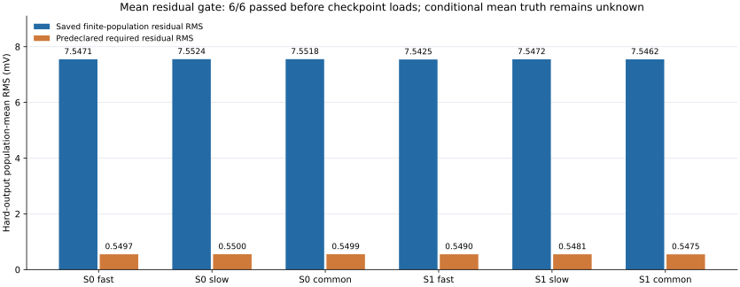
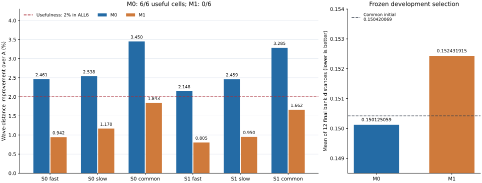
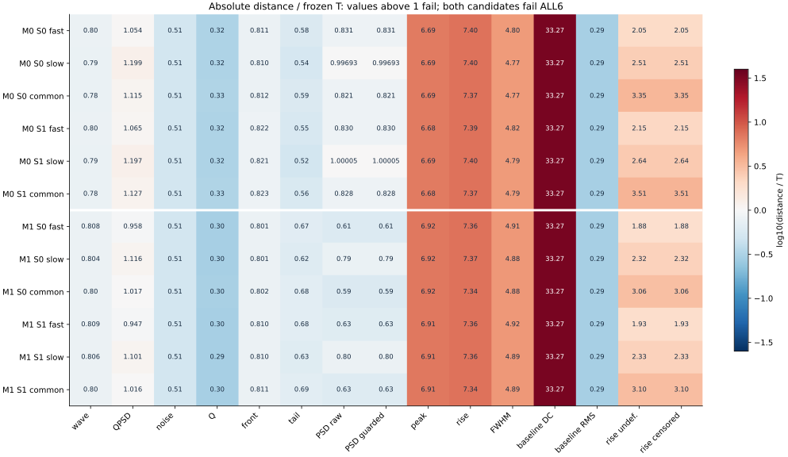
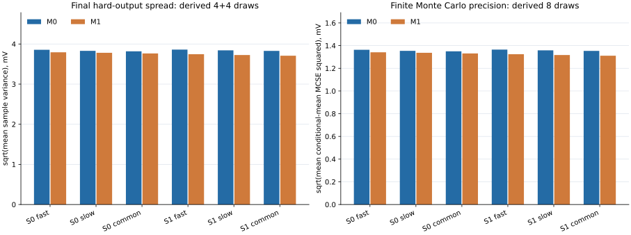

# N01 · WP3 / 015 有限均值路径对照报告

**开发结论：采用 M0 继续形状头作为下一阶段研究参考，均值适配器关闭。** 四次2000G短试和一次保存数组CPU独立读回已完成。M0相对A的完整wave用途门为6/6，M1为0/6；两个候选均通过冻结双参考非劣条件，均未通过全部绝对T。权重未晋级，科学状态仍为 `response_match_not_established`。

## 1. 固定对照与数据口径

每个seed从原014 C1 final头的相同字节起步，使用新的AdamW。M0只继续1288参数形状头；M1冻结该头，只训练6个零初始化均值参数。每trial为2000G/AD，共8000G/AD；原A和005保持冻结。M1均值由增益、软件σ2 ns平滑差、软件τ16 ns慢尾差三个基和连续输入控制构成，prefix100严格为0，增量RMS上限为0.10×RMS(A)。随机形状幅度仍由原A控制。

完整6593条SOURCE TRAIN和21047条REAL TRAIN参与各trial；每seed/候选/假设包含2个独立随机库，每库每父4 draw，单库26372条硬输出。fast、slow、common_level分别报告；mean2bank是两个库各自经验距离的均值，开发排序使用12个final bank距离的均值。MC draw的统计单位仍是父事件，422个REAL逻辑组属于既有采集内分组。旧DEV已暴露，本轮DEV模型行和人口调整均为0。

观察链沿用14 bit ADC、384点内部carrier、原100点基线、搜索[112:144)的first-argmax、裁窗[p−16:p+240)和256点输出；采样间隔为1软件ns，tail从输出第46点起。T是WP1预登记的人工灵敏度标尺，SHA256为 `f33217e07b1872dfd51f56e86ed30cda665a705568f2f9ada937865d8a33607b`。

## 2. 均值残差入口

checkpoint、NN、优化器和新随机数之前的入口检查为6/6阳性：保存总体均值残差RMS为7.54248–7.55237 mV，要求值为0.54750–0.55004 mV；两库残差cosine均大于0.99998。它支持执行预登记的有限均值对照；REAL与SOURCE未配对，真实条件均值保持unknown。hard256均值DC与电子学baseline100 DC分别解释。

## 3. 开发选择与完整wave

冻结规则要求同一候选ALL6的每个正且已定义T分量，同时相对A与共同C1初始非劣：两项mean2bank距离差均≤T。必需已标定分量缺失或undefined使候选pending；零或undefined T继续pending。合格候选按mean12排序，1e−12内tie选M0；胜者还须比共同初始低超过1e−12。

| 候选 | final wave mean12 | 共同初始 mean12 | 双参考非劣 | ≥2%用途 | 绝对T ALL6 |
| --- | --- | --- | --- | --- | --- |
| M0 | 0.15012505860962605 | 0.15042006897712382 | 6/6 | 6/6 | FAIL |
| M1 | 0.15243191496746586 | 0.15042006897712382 | 6/6 | 0/6 | FAIL |

M0相对共同初始的mean12改善为0.196124%；M1相对共同初始变化为+1.337485%（距离增大）。015的M0用途6/6属于本次继续训练结果；原014 C1的历史用途5/6保持原记录。

| 候选 | seed | 噪声假设 | A wave | 共同初始 | final wave | 相对A改善/% | 用途 |
| --- | --- | --- | --- | --- | --- | --- | --- |
| M0 | 0 | fast | 0.153707296 | 0.150142574 | 0.149924623 | 2.460958543 | PASS |
| M0 | 0 | slow | 0.154674684 | 0.150895665 | 0.150748742 | 2.538193466 | PASS |
| M0 | 0 | common_level | 0.154605859 | 0.149651004 | 0.149271840 | 3.450075157 | PASS |
| M0 | 1 | fast | 0.153707296 | 0.150650398 | 0.150406310 | 2.147579516 | PASS |
| M0 | 1 | slow | 0.154674684 | 0.151258463 | 0.150871380 | 2.458905729 | PASS |
| M0 | 1 | common_level | 0.154605859 | 0.149922309 | 0.149527456 | 3.284741225 | PASS |
| M1 | 0 | fast | 0.153707296 | 0.150142574 | 0.152258816 | 0.942362721 | FAIL |
| M1 | 0 | slow | 0.154674684 | 0.150895665 | 0.152864506 | 1.170313273 | FAIL |
| M1 | 0 | common_level | 0.154605859 | 0.149651004 | 0.151756876 | 1.842739337 | FAIL |
| M1 | 1 | fast | 0.153707296 | 0.150650398 | 0.152469989 | 0.804976013 | FAIL |
| M1 | 1 | slow | 0.154674684 | 0.151258463 | 0.153204706 | 0.950368075 | FAIL |
| M1 | 1 | common_level | 0.154605859 | 0.149922309 | 0.152036597 | 1.661814081 | FAIL |

## 4. 绝对容忍度与保留失败

每个候选90个已标定分量判定均满足双参考非劣，42个未标定分量继续pending；合计180个非劣、84个pending。绝对distance≤T另行判断。峰高、rise、FWHM及baseline DC仍有明显绝对差距；其中baseline DC为005电子学限制，prefix100为0的signal均值适配器不覆盖该段。完整QPSD、raw/guarded PSD、Q/front/tail、噪声和失效率见全部组件表。

| 分量 | final distance/T范围 | 绝对失败格 | 总格 |
| --- | --- | --- | --- |
| QPSD | 0.94732–1.19892 | 10 | 12 |
| peak_voltage_V | 6.68366–6.91819 | 12 | 12 |
| rise10_90_ns | 7.33756–7.40277 | 12 | 12 |
| FWHM_ns | 4.77138–4.91648 | 12 | 12 |
| baseline_mean_V | 33.26737–33.26737 | 12 | 12 |

## 5. 输出Q条件与低Q

四套评价中的输出Q条件部分覆盖8个冻结箱；全部72个REPORT、576个条件箱均有至少16行支持，Q≤0、分母保护和undefined行均保留在flags及分母中。下表每项分别取2库×8箱的最差值，括号为库/箱；条件T未标定。完整表保留两域各特征的defined/undefined数、均值、宽度和p01/p10/p50/p90/p99分位数。

| trial | 假设 | 最大PSD W1 | rise均值差/ns（绝对最差） | FWHM均值差/ns（绝对最差） |
| --- | --- | --- | --- | --- |
| seed0_M0 | fast | 0.013792 (b0/q0) | +2.792180 (b1/q2) | +13.175372 (b0/q0) |
| seed0_M0 | slow | 0.014395 (b0/q0) | +2.780687 (b1/q2) | +13.174286 (b1/q0) |
| seed0_M0 | common_level | 0.014194 (b0/q0) | +2.795645 (b1/q2) | +13.199736 (b1/q0) |
| seed1_M0 | fast | 0.013605 (b0/q0) | +2.792652 (b1/q2) | +13.163940 (b0/q0) |
| seed1_M0 | slow | 0.014826 (b0/q0) | +2.780435 (b1/q2) | +13.170196 (b1/q0) |
| seed1_M0 | common_level | 0.014220 (b1/q0) | +2.794902 (b1/q2) | +13.199586 (b1/q0) |
| seed0_M1 | fast | 0.013790 (b0/q0) | +2.801995 (b1/q2) | +13.104631 (b0/q0) |
| seed0_M1 | slow | 0.014397 (b0/q0) | +2.791162 (b1/q2) | +13.113413 (b0/q0) |
| seed0_M1 | common_level | 0.014467 (b0/q0) | +2.800962 (b1/q2) | +13.143947 (b0/q0) |
| seed1_M1 | fast | 0.013321 (b0/q0) | +2.803520 (b1/q2) | +13.081343 (b0/q0) |
| seed1_M1 | slow | 0.014652 (b0/q0) | +2.789445 (b1/q2) | +13.084154 (b0/q0) |
| seed1_M1 | common_level | 0.014771 (b1/q0) | +2.800475 (b1/q2) | +13.122839 (b1/q0) |

## 6. SOURCE输入趋势与可辨识范围

SOURCE输入趋势使用6593个父事件的18个审计描述量，对Q、tail、peak和baseline RMS的父内均值/方差记录相关性；描述量和事件标识均不加入网络。下表为两个库相关系数的均值，仅描述生成器内部输入关联。真实条件响应、真实源人口权重以及跨采集物理复用继续保持未识别/unknown。

| trial | 假设 | inputQ→meanQ | inputQ→varQ | PC0→meanQ | PC0→meanTail |
| --- | --- | --- | --- | --- | --- |
| seed0_M0 | fast | +0.899594 | +0.007159 | +0.560006 | +0.418353 |
| seed0_M0 | slow | +0.899578 | +0.004912 | +0.559956 | +0.418044 |
| seed0_M0 | common_level | +0.899591 | +0.006050 | +0.559944 | +0.418070 |
| seed1_M0 | fast | +0.899595 | +0.007284 | +0.560012 | +0.418141 |
| seed1_M0 | slow | +0.899577 | +0.003417 | +0.559960 | +0.417840 |
| seed1_M0 | common_level | +0.899590 | +0.003395 | +0.559948 | +0.417871 |
| seed0_M1 | fast | +0.897739 | +0.006798 | +0.558833 | +0.414532 |
| seed0_M1 | slow | +0.897723 | +0.004798 | +0.558782 | +0.414208 |
| seed0_M1 | common_level | +0.897735 | +0.005717 | +0.558770 | +0.414253 |
| seed1_M1 | fast | +0.897751 | +0.006523 | +0.558844 | +0.414330 |
| seed1_M1 | slow | +0.897734 | +0.003075 | +0.558793 | +0.414014 |
| seed1_M1 | common_level | +0.897746 | +0.002794 | +0.558780 | +0.414052 |

既有输入审计覆盖全部8192条合法SOURCE（TRAIN6593、INTERNAL_VAL1599；固定DEV512已暴露），分别报告full480、carrier384、clean256的归一形状PCA及数值舍入。验证过的沉积元数据h=.15×edep_hadron/(edep_ee+.15×edep_hadron)属于SOURCE代理。相对Q差≤1%的既有同角色配对中，6890条输入具有达到0.001峰归一RMS的形状对照，最大强度0.015831751；响应形状干预尚未执行。全人口Q宽差及输入关联不构成条件charge涨落识别。

## 7. 同父重复响应：native4与derived8

保存数组CPU审核验证36组bank pair；每组6593父、每库4 draw。native4的行特征、flags、有限支持、均值/方差、MCSE及9×9标量协方差已核验。derived8由实际4+4保存行重新合并，协方差分母7，MCSE按有效n计算；它是新派生摘要，原producer没有native r8报告。

硬波形derived8方差使用 [3(s²₀+s²₁)+2(μ₀−μ₁)²]/7；r4/r8条件均值MCSE分别为sqrt(s²/4)、sqrt(s²/8)。中心化8draw波形因子的经验秩≤7；这与preADC形状分支8维潜变量的理论协方差秩≤8属于不同层次。标量协方差使用逐对共同有限支持与计数；缺失支持不同的矩阵不自动保证半正定。完整256×256波形协方差通过中心化因子表示，未物化每父稠密矩阵。

图中散布为sqrt(mean_parent,time(s²_8draw))，MCSE为sqrt(mean_parent,time(s²_8draw/8))，包括电子学、ADC和裁窗后的总硬输出；纯信号完整preADC384未保存为独立审核库，图中数值不作纯形状分支RMS。

## 8. flags与数值边界

全部fake/REAL flags及其原分母在 [ALL_FLAGS.csv](tables/ALL_FLAGS.csv) 保留，包括低Q、PSD undefined/guarded、rise/FWHM失效与截断、峰位边界/并列、裁窗全局峰关系、ADC rail/preADC越界、half-grid、形状峰floor和Q floor。REAL缺少的硬件域标记保持unknown。未标定flag的pending状态与观测到的0发生率分开保存。

## 9. 独立审核分层

| 证据层 | 完成内容 | 边界 |
| --- | --- | --- |
| 原producer | 完整wave/QPSD/noise经验距离和四套REPORT | 数值距离沿用冻结producer |
| 独立JSON聚合/决策 | 原日志、库存、双参考ALL6、mean12、用途和绝对T | 未重播完整经验CDF或loss |
| 保存数组CPU | ADC roundtrip、身份/行映射、行features/flags、native4矩、derived8和有限支持 | 原Y无第二份独立副本；CP tensor未解码 |
| 原统计与均值入口 | 冻结C1统计与median使用链、mean gate标量公式 | 原REAL TRAIN median未重拟合；REAL mean摘要NPZ仅SHA未decode |
| 物理响应 | 科学状态response_match_not_established | 绝对T和跨条件确认仍按主计划独立判定 |

CPU完成161个原NPZ SHA检查，共3064431039字节；解码160个评价NPZ（72 HARD_ROWS、72 REPORT、16 BASELINE100），核验1898784条硬输出。285个operation entered=completed、570条journal事件，无inflight/failed。两个原生退出均为0；用时60.446秒。worker getrusage峰值489336832字节、supervisor采样owned-tree峰值402255872字节是不同测量，均在1536 MiB上限内。19个小文件共513764字节已回收并核SHA。

本报告仅使用已回收JSON聚合和标准绘图；新增NPZ/CP/NN/AD/G、随机、原TRAIN/DEV波形读取、GPU、CDF/loss重播和SSH均为0。独立审核完成不授予物理响应匹配成功。

## 10. 实际成本与可追溯性

| 计数 | 实际值 | 解释 |
| --- | --- | --- |
| G / AD / optimizer step | 8000 / 8000 / 8000 | 4 trial×2000；累计训练已含015，为175667 |
| CP load / optimizer创建 | 4 / 4 | A、005、每seed一个共享C1头；每trial新优化器 |
| A / 实际head / 总head kernel / 005 | 各8613952 | 训练行及initial/final评价 |
| mean adapter行 | 4306976 | 仅两个M1 trial |
| hard ADC / gather | 各26474784 | 所有路径分别记账 |
| 科学operation entered / completed | 154518 / 154518 | 无failed或unknown inflight |
| mean入口 REAL / REPORT父行 | 21047 / 79116 | 12 REPORT、6 gate测试；checkpoint前 |
| map / 新统计fit / probeAD / D-noise-pop-C2ST / DEV | 全部0 | 冻结目标、冻结005、原角色 |

训练原生child与supervisor退出0，总wall 2180.914秒，采样峰值RSS 3.977 GiB、GPU 8.293 GiB。首次选择性回收139/300文件，共76908267字节，包含12个未解码薄checkpoint且不含NPZ；161个原NPZ留在服务器原目录。CPU审核随后在独立目录完成；本报告阶段无远程操作。

原 provisional DEVELOPMENT_SELECTION 和 LOCAL_METADATA_READBACK 保留其生成时的pending字段；现行FINAL_DEVELOPMENT_SELECTION引用最终独立审核，将保存数组读回登记为complete。原分数、T、用途及科学状态保持原值。

## 11. 下一步

以015 M0为下一阶段研究参考，均值适配器关闭。WP3既定6次短试已用4次，剩余最多2次只检验单因素q_sig电荷随机性；采用正值、均值校正且可完全关闭的低自由度形式。该试验检验信号电荷涨落，不承诺同时修复peak、rise或电子学DC。教师恢复、稳健验证和最终确认按用户主计划继续。

## 12. 交付与来源

[机器可读报告数据](REPORT_DATA.json) · [来源SHA256](SOURCES_SHA256.json) · [输出清单](report_manifest.json) · [内容验证](VALIDATION.json)

[12格wave](tables/ALL6_WAVE.csv)

[264组件](tables/ALL6_COMPONENTS.csv)

[576条件Q箱](tables/OUTPUT_Q_CONDITIONS.csv)

[10368输入趋势](tables/SOURCE_INPUT_TRENDS.csv)

[全部flags](tables/ALL_FLAGS.csv)

[全人口特征](tables/POPULATION_FEATURES.csv)

[36 pair矩](tables/DERIVED8_MOMENTS.csv)

[6格均值入口](tables/MEAN_RESIDUAL_GATE.csv)

[015冻结配置](../../wp3_015_config.json)

[015验收合同](../../docs/WP3_ACCEPTANCE_CONTRACT.md)

[用户主实施计划](../../USER_MASTER_PLAN_20261015.txt)

[既有SOURCE审计](../../INPUT_INFORMATION_AUDIT.json)

[最终独立审核](../../receipts/wp3_015_20261015/postrun_independent_02/FINAL_INDEPENDENT_REVIEW.json)

[最终研究参考选择](../../receipts/wp3_015_20261015/postrun_independent_02/FINAL_DEVELOPMENT_SELECTION.json)

[原始JSON独立决策](../../receipts/wp3_015_20261015/postrun_independent_01/DEVELOPMENT_SELECTION.json)

[CPU完成回执](../../receipts/wp3_015_20261015/readback_execution_01/WAKE_COMPLETION_SUMMARY.json)

[保存数组审核结果](../../runs/wp3_015_20261015/independent_readback_collected_01/artifacts/ARRAY_READBACK.json)
