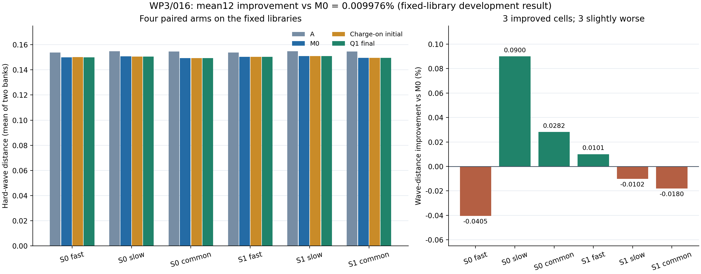
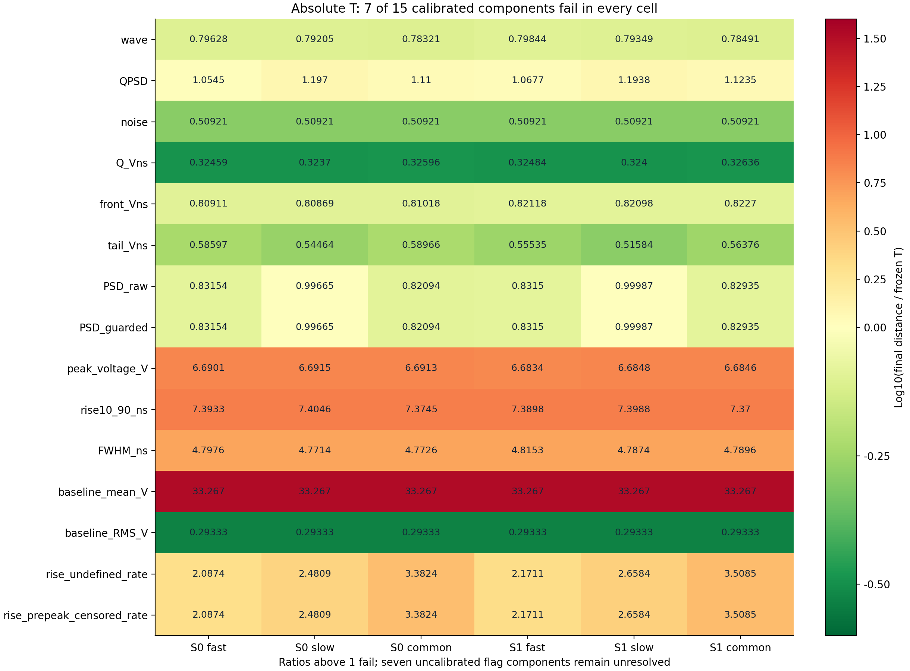
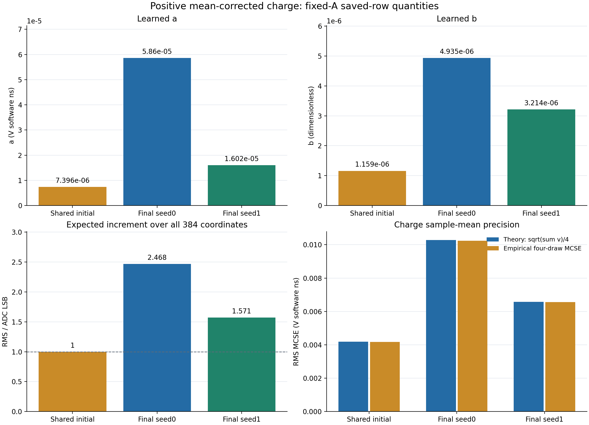
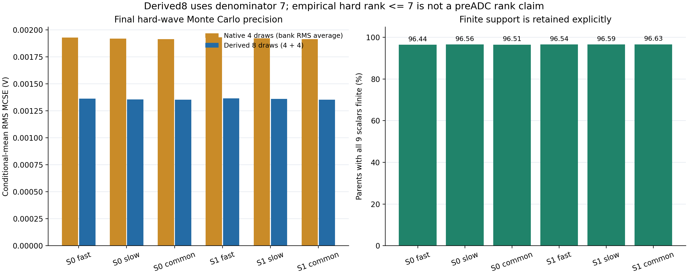

# N01 WP3 / 016：冻结 M0 后的正值电荷涨落短试

**结论：最终研究参考选 Q1，均值适配关闭、电荷分支开启；权重未作科学晋级，响应匹配仍为 response_match_not_established。** 两个 seed 各完成 2000G，保存数组独立 CPU QA 已通过。016 消耗 WP3 最后两次短试，WP3 短试预算为 6/6、总短试为 10/12；六个工作包尚未完成，下一步进入 WP4 已知响应恢复。

## 1. 固定规则与小幅开发增益

共 2 seed×3 假设×2 库=12 个原 wave 距离；每个 seed×假设先对两库取均值得到 6 个单元，再对 6 单元等权平均（与 12 个原距离等权平均相同）；不 pool8 重算距离。A / M0 / charge-on initial / Q1 final 的 mean12 依次为 0.15432927983704245 / 0.15012505860962605 / 0.15012367005166385 / 0.15011008209012994。Q1 比配对 M0 低 1.4976519496112672e-05，相对改善 0.009976029%。

Q1 在 ALL6 中对每个必需且正值有定义 T 的组件，均满足 final−A≤T 且 final−M0≤T；90 个组件单元、180 个参考比较全部非劣。mean12 改善超过预先冻结的 1e-12，故按原规则替换研究参考。六个单元中对 M0 为 3 个改善、3 个略差；该小幅固定库效应没有新增重采样或置信区间，不能解释为跨采集稳定收益。

| seed / 假设 | A | M0 | 初始电荷开启 | Q1 final | 相对 M0 改善 % | 相对 A 改善 % |
| --- | --- | --- | --- | --- | --- | --- |
| 0 / fast | 0.153707296 | 0.149924623 | 0.150029721 | 0.149985285 | -0.040462 | 2.421493 |
| 0 / slow | 0.154674684 | 0.150748742 | 0.150610035 | 0.150613038 | 0.090020 | 2.625929 |
| 0 / common_level | 0.154605859 | 0.149271840 | 0.149238522 | 0.149229811 | 0.028156 | 3.477260 |
| 1 / fast | 0.153707296 | 0.150406310 | 0.150377254 | 0.150391160 | 0.010073 | 2.157436 |
| 1 / slow | 0.154674684 | 0.150871380 | 0.150923376 | 0.150886776 | -0.010205 | 2.448952 |
| 1 / common_level | 0.154605859 | 0.149527456 | 0.149563112 | 0.149554422 | -0.018034 | 3.267300 |

ALL6 相对 A 至少 2% 的用途门为 6/6。用途、研究参考替换、绝对 T 和科学响应确认分别判定；当前选择不增加科学接受结论。两个库原始分数与全部组件见 ALL6_WAVE.csv 和 ALL6_COMPONENTS.csv。

图 1：四个配对 arm 与相对 M0 的微小变化。柱图使用保存 JSON 的 mean2bank；右图逐单元变化和总体 mean12 不是新的统计检验。

## 2. 冻结实验与数据角色

只训练两个全局参数 theta_a / theta_b。原 A、005、每 seed 的 015 M0 final 形状头、C1 积分尺度、观察流程及 013 T 冻结；均值适配器关闭，不继承 015 优化器。新 AdamW lr=.01、weight_decay=0、clip5，每步一次 backward，共 4000G/AD，无新增 AD 探针。形状、005、扩展和投影前缀沿用015，电荷流单独登记；模型内部不创建随机数。

SOURCE TRAIN 6593 个父事件、REAL TRAIN 21047 行、422 个逻辑组；重复 MC draw 不增加物理事件数。每库 4 draw、两库、fast / slow / common_level 三假设。初始 A、M0 关闭电荷、初始开启电荷共享一次 forward 和电子学；结束后只评价 final。48 份 HARD/REPORT 保留全部行及低 Q、缺失和 flags，未读原 DEV 波形。SOURCE Q 是软件积分描述量，不是已标定入射能量；SOURCE 趋势与输出 Q 分箱不提供独立物理标签。

电荷规律：s²=log1p(a/mu+b)，q_sig=mu·exp(s·Z−s²/2)，a=q_reference·softplus(theta_a)、b=softplus(theta_b)，固定 q_reference=3.7103998046755806 V软件ns。mu 来自每一实际 A 输出的 canonical [110:366) 积分，全部严格正，不设 floor。E[q_d]=mu_d、v_d=a·mu_d+b·mu_d²。信号组装为原 M0 加 A·expm1(log_multiplier)，B(x)z_shape 的幅度仍取原 A，不乘 q_sig；电荷关闭分支直接返回原 M0 tensor 字节。

## 3. 绝对 T 与未标定组件

每个假设有 15 个正值 T 和 7 个未标定 flag 组件。未标定状态、观测到零发生率和 PASS 分开记录；缺失必需正 T 组件会使候选 pending。绝对 T 全部通过的单元数为 0/6：每个单元均有同样 7 个失败组件。T 来自已冻结的人工自距离规则，hardware_calibrated=false。

| 组件 | final/T 最小 | final/T 最大 | 绝对失败单元 / 6 |
| --- | --- | --- | --- |
| wave | 0.783209 | 0.798437 | 0 |
| QPSD | 1.05447 | 1.19701 | 6 |
| noise | 0.509209 | 0.509209 | 0 |
| Q_Vns | 0.323701 | 0.326362 | 0 |
| front_Vns | 0.808685 | 0.822698 | 0 |
| tail_Vns | 0.515842 | 0.589655 | 0 |
| PSD_raw | 0.820935 | 0.999875 | 0 |
| PSD_guarded | 0.820935 | 0.999875 | 0 |
| peak_voltage_V | 6.68336 | 6.6915 | 6 |
| rise10_90_ns | 7.37003 | 7.40459 | 6 |
| FWHM_ns | 4.77144 | 4.81526 | 6 |
| baseline_mean_V | 33.2674 | 33.2674 | 6 |
| baseline_RMS_V | 0.293333 | 0.293333 | 0 |
| rise_undefined_rate | 2.08742 | 3.50855 | 6 |
| rise_prepeak_censored_rate | 2.08742 | 3.50855 | 6 |

持续失败集中于 QPSD、peak_voltage、rise10_90、FWHM、baseline_mean 以及 rise_undefined / rise_prepeak_censored 两个 rate。baseline_mean 约 33.27T，峰高约 6.69T、rise 约 7.40T、FWHM 约 4.82T。不能把这些残差共同归因为电荷方差。PSD_raw / guarded 的最大 ratio 为 0.9998749634，保留该结果及原停止规则，不据近阈值另加短试。

图 2：六单元×十五正 T 组件。显示值作数值格式化，精确值在表格与 REPORT_DATA.json；七个未标定 flag 不进入 ratio 热图。

## 4. 学到的电荷参数与校准

一次初始化覆盖全部 6593 SOURCE 父事件及 384 坐标，含严格零 prefix100。producer 保存 S0=0.0016069720304571775 V²，Sminus=0.00025187027004966006 V²/(V软件ns)；a0=7.3961589168800368e-06 V软件ns，b0=1.1592439124125852e-06，目标为 1 ADC LSB=1/16383 V。解析 a0=δ²/(2Sminus)、b0=δ²/(2S0)，未按有限 MC 重新调参。CPU 在已保存的实际重复 A 上独立复算预期增量 RMS，不另作 A 前向或校准重拟合。

| 状态 | a / V软件ns | b | 预期 A 增量 RMS / LSB | 平均条件 CV % | 理论四 draw 均值 MCSE RMS / V软件ns |
| --- | --- | --- | --- | --- | --- |
| Shared initial | 7.396158917e-06 | 1.159243912e-06 | 1.000000 | 0.188755 | 0.0041795836 |
| Final seed0 | 5.860415918e-05 | 4.934797363e-06 | 2.467844 | 0.486943 | 0.010276835 |
| Final seed1 | 1.601902908e-05 | 3.214281573e-06 | 1.571400 | 0.290765 | 0.00657757917 |

实际每 draw 的 mu_d / v_d 全部保留。异均值条件下 E[samplevar(q,ddof1)]=mean(v_d)+samplevar(mu_d,ddof1)；理论均值 MCSE=sqrt(sum(v_d))/4。经验 sqrt(samplevar(q)/4)、逐 draw q−mu 的二阶矩 mean((q−mu)²)（分母4）及样本方差（分母3）分别核对，不用均值或第一 draw 替代模型分母。数值 mu spread 单列，不解释为物理方差。有限四 draw 矩不是精确总体实现。

图 3：保存 JSON 与 CPU 已验收摘要。经验 MCSE 为两个库 RMS 摘要的平均；理论与经验栏分别命名，不作为响应匹配门。

## 5. 独立 CPU 保存数组核验

112 个原 NPZ 逐文件 SHA 一次、解码一次：48 HARD、48 REPORT、8 baseline100、8 charge moments，共 2169655337 字节。核验 1265856 条硬输出和 210976 条实际 A384 行（81014784 个 float64 坐标）、210976 个 mu/q draw、52744 条父矩记录。24 个两库 hard pair、8 个 charge bank 全部完成；200 entered=completed、400 条 journal，无 inflight/failed/truncated tail。

独立 QA 包括：savedADC+double baseline+可选 IEEE XOR 逆变换与精确 code roundtrip；父/draw/bank/ID；Q/front/tail/PSD、峰高、rise/FWHM、baseline 与可重建 flags；native4 均值/样本方差/MCSE、9×9 pairwise-finite covariance 与 joint counts；从 4+4 保存行派生8draw并核对分母7合并恒等式。经验硬波形 rank≤7 不代表理论 preADC 秩；不同缺失支持下的 pairwise covariance 不自动保证 PSD。

实际 A 最大同父重复差 5.4148215581500958e-09 V，在既有013 1e-7 V 工程门内；mu 最大重复差 2.2204460492503131e-16 V软件ns。GPU mu 与独立 CPU canonical sum 的最大差 3.5527136788005009e-15，逐行在预先 γ255 双归约界内；保存 residual 位级等于保存 mu−保存 CPU sum。所有 mu/q 严格正。旧失败运行未保存的差值幅度仍 unknown，不能用本次结果回填旧幅度。

| 证据 | 独立完成 | 保留边界 |
| --- | --- | --- |
| 完整经验距离 | 冻结 producer JSON 的独立选择代数 | 完整 CDF/loss 未重播 |
| hard 保存行 | 逆变换、行 features/flags、native4/derived8 矩与有限支持 | 无第二份原 Y 浮点副本 |
| charge / A384 | 实际 A、mu/q/v、数值门、方差和 MCSE 恒等式 | 原 SOURCE 字节未重 hash；仅保存 digest 重复与跨库一致性 |
| 随机和模型 | 来源/随机状态字节 schema 与冻结源码绑定 | 未重放 Z / RNG、CP tensors、NN、完整随机 preADC signal/carrier |
| 统计与物理 | 冻结 C1 使用链；条件和 flags 完整保留 | C1 median 未重拟合；不授予物理响应匹配 |

图 4：final 六单元 native4 与 derived8 的 MCSE 和9标量完整支持比例。所有缺失行仍在原分母中，pairwise-finite 矩按各自 joint counts 核验。

## 6. 全人口、条件分箱与 flags

OUTPUT_Q_CONDITIONS.csv 保留 48 REPORT×8箱=384 条条件记录，全部箱支持完整；SOURCE_INPUT_TRENDS.csv 保留 6912 条输入描述量相关摘要；POPULATION_FEATURES.csv 保留全部积分/形态总体摘要。它们来自已回收 REPORT JSON，未重算原 REAL 或 SOURCE 波形。输出 Q 条件和 Pearson 趋势只作诊断，不将总体 Q 宽度认作真实条件方差，也不从单采集识别全部物理参数。

| seed / 假设 | 16库箱最少fake行 | 最少REAL行 | 最大条件PSD W1 | 最差有符号rise差 / ns | 最差有符号FWHM差 / ns |
| --- | --- | --- | --- | --- | --- |
| 0 / fast | 3185 | 2630 | 0.0136261 | 2.78907 | 13.167 |
| 0 / slow | 3176 | 2630 | 0.0143906 | 2.77718 | 13.1776 |
| 0 / common_level | 3178 | 2630 | 0.0143614 | 2.7912 | 13.2065 |
| 1 / fast | 3185 | 2630 | 0.0135984 | 2.79196 | 13.1634 |
| 1 / slow | 3172 | 2630 | 0.0148135 | 2.77796 | 13.1785 |
| 1 / common_level | 3180 | 2630 | 0.0141894 | 2.79375 | 13.1958 |

ALL_FLAGS.csv 保留所有 fake / REAL flags 的 count、原 denominator、rate 和 unknown 状态，包括 Q≤0、PSD undefined/guarded、rise/FWHM 失效或截断、峰位边界/并列、crop 与全局峰、ADC rail / preADC 越界、half-grid 和 floor。不能从 crop256 重建的 full-carrier flags 只核验保存行与计数的一致性。REAL 未知硬件域标记保持 unknown，不写成零。

## 7. 实际执行成本与资源

最初 bootstrap 准备失败未安装/启动科学计算；随后一次原生运行在首 G 前严格 Q 相等断言失败，G/AD=0 但 NN/随机/CP 成本非零且保留。fix02 使用已有 A 点门并先保存实际逐 draw 证据，在新目录作一次替代执行，两个科学 seed 槽位不增加。没有自动重启或第三个训练候选。

| 计数 | 旧失败实际 | 成功替代实际 | 合计 |
| --- | --- | --- | --- |
| calibration_A_rows | 6593 | 6593 | 13186 |
| old_A_rows | 32965 | 4313569 | 4346534 |
| head_actual_parameter_forward_rows | 26372 | 4306976 | 4333348 |
| head_total_kernel_rows | 26372 | 4306976 | 4333348 |
| noise005_rows | 26372 | 4306976 | 4333348 |
| charge_module_rows | 26372 | 4306976 | 4333348 |
| charge_latent_scalar_draws | 26372 | 4306976 | 4333348 |
| charge_initialization_fits | 1 | 1 | 2 |
| hard_ADC_rows | 237348 | 13553856 | 13791204 |
| all_path_gather_rows | 237348 | 13553856 | 13791204 |
| checkpoint_loads | 3 | 4 | 7 |
| optimizer_created | 1 | 2 | 3 |
| optimizer_steps | 0 | 4000 | 4000 |
| G_updates | 0 | 4000 | 4000 |
| training_backward_queries | 0 | 4000 | 4000 |
| new_AD_queries | 0 | 4000 | 4000 |
| probe_AD_queries | 0 | 0 | 0 |
| integral_statistics_fits | 0 | 0 | 0 |
| mean_adapter_rows | 0 | 0 | 0 |
| D_updates | 0 | 0 | 0 |
| noise_updates | 0 | 0 | 0 |
| population_updates | 0 | 0 | 0 |
| C2ST_updates | 0 | 0 | 0 |
| DEV_model_rows | 0 | 0 | 0 |

成功替代 94249 个 operation 完整，child/supervisor 均退出0；wall 1258.370s，采样峰值RSS 4705976320B、GPU 8881438720B、输出 2216636183B。累计G保持179667；先前已记137，本次root只补3863，未重复加4000。

独立CPU child/supervisor退出0，supervisor wall 44.300s；supervisor采样owned-tree峰值RSS 417308672B，与worker getrusage峰值 493142016B是不同口径，分别保留且均低于1536MiB。CPU输出峰值 249037B；19个小文件共470489B回收并核SHA，CPU没有新增G/AD。

训练选择性回收99/211文件、47224353B内容，包括6个仅作不透明hash核验的薄checkpoint，0个NPZ；112个raw仍在原远端目录。CPU另在独立sidecar只读原文件并回收小JSON/journal。报告生成只读本地已接受JSON和标准绘图，新增原NPZ/CP/NN/AD/G/RNG、原TRAIN/DEV波形、GPU、CDF/loss和SSH均为0。

## 8. 来源、交付与下一步

| 关键文件 | SHA256 |
| --- | --- |
| 冻结 config | 5279597aed74feae87448bfc71aa1387bd711609591eabde775142fa6d1303ab |
| 冻结 source manifest | 824780d297c440d0f1bc51b3ea3344e488ec42ccb46af959d9d0412d8240fc14 |
| 独立CPU ARRAY_READBACK | 7337c5ab50929eb4381fc29ded4af138420b8257ba0c7b9945a7c82ca6be604a |
| 最终独立审核 | e62630fe7a3d902ba36d239dcd0799556bd0dae6a2f3645c30e27091ca9248b7 |
| 最终开发选择 | 4e859622f4c3c1335e6912228f139e70c0e9083679fb36ce022e2daa4b648e20 |

保留 Q1 作为当前开发研究参考，并按主计划进入 WP4 已知响应恢复与可识别性验证。WP3 有限搜索闭合不等于六工作包完成；绝对响应残差、跨条件稳定性和物理响应匹配仍按主计划推进，不因本次小幅分数变化改门或追加短试。

[机器可读报告](REPORT_DATA.json) · [来源SHA](SOURCES_SHA256.json) · [输出manifest](report_manifest.json) · [结构QA](REPORT_QA.json)

[ALL6_WAVE.csv](tables/ALL6_WAVE.csv)

[ALL6_COMPONENTS.csv](tables/ALL6_COMPONENTS.csv)

[ABSOLUTE_T.csv](tables/ABSOLUTE_T.csv)

[CHARGE_BANKS.csv](tables/CHARGE_BANKS.csv)

[CHARGE_PARAMETERS.csv](tables/CHARGE_PARAMETERS.csv)

[OUTPUT_Q_CONDITIONS.csv](tables/OUTPUT_Q_CONDITIONS.csv)

[OUTPUT_Q_FINAL_SUMMARY.csv](tables/OUTPUT_Q_FINAL_SUMMARY.csv)

[SOURCE_INPUT_TRENDS.csv](tables/SOURCE_INPUT_TRENDS.csv)

[ALL_FLAGS.csv](tables/ALL_FLAGS.csv)

[POPULATION_FEATURES.csv](tables/POPULATION_FEATURES.csv)

[DERIVED8_MOMENTS.csv](tables/DERIVED8_MOMENTS.csv)

[最终独立审核](../../receipts/wp3_016_20261015/postrun_independent_01/FINAL_ARRAY_AND_SELECTION_REVIEW.json)

[最终开发选择](../../receipts/wp3_016_20261015/postrun_independent_01/FINAL_DEVELOPMENT_SELECTION.json)

[用户主计划](../../USER_MASTER_PLAN_20261015.txt)

[016配置合同](../../docs/WP3_016_CONFIGURATION.md)
